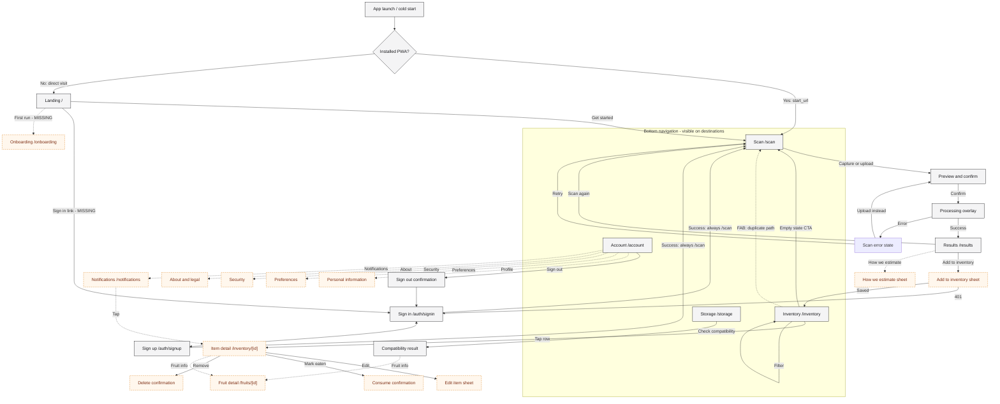
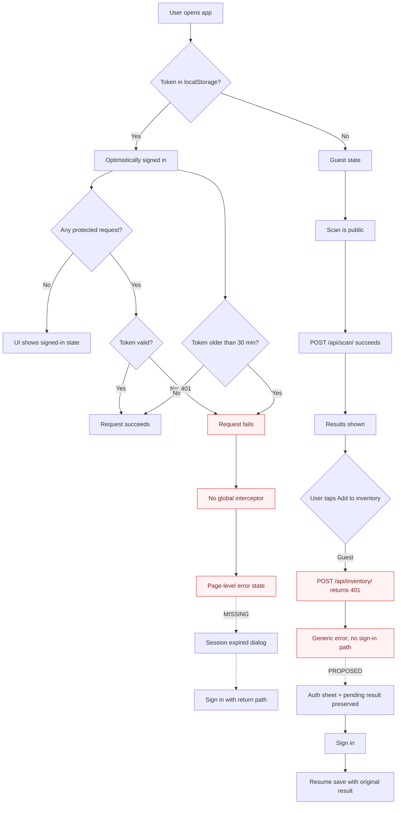
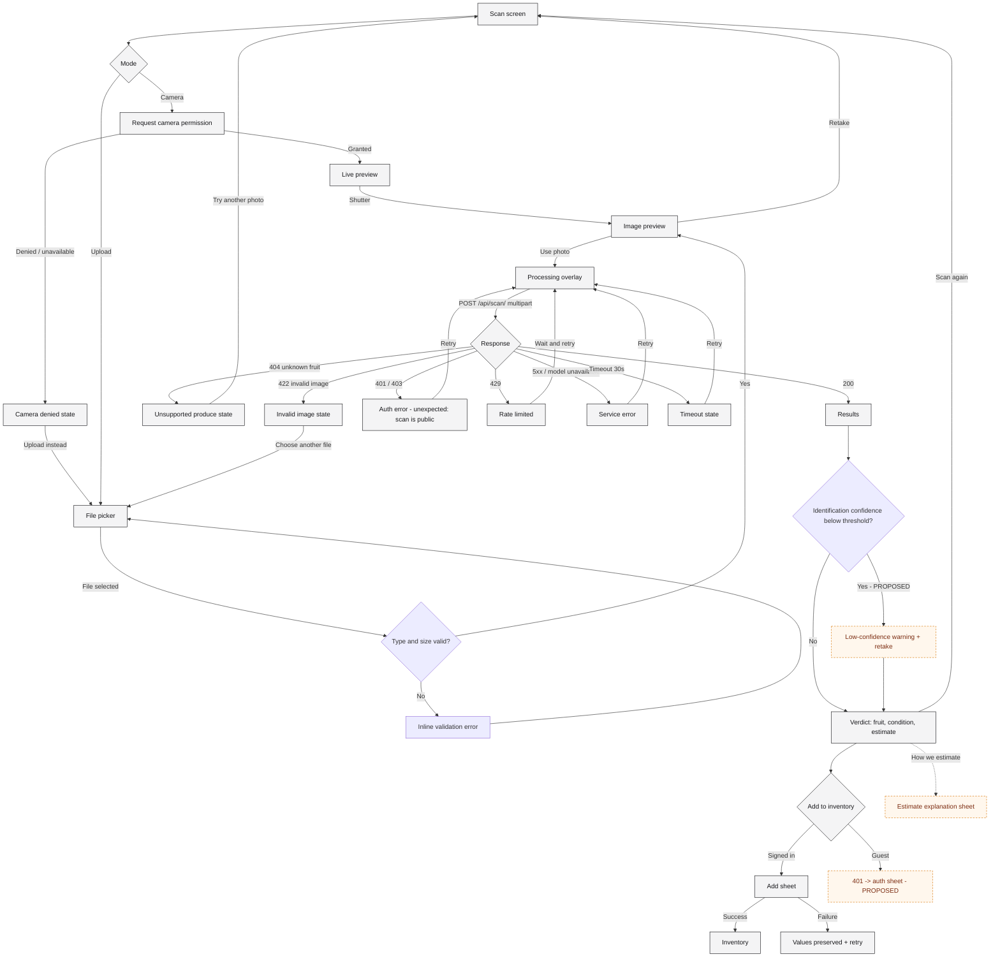
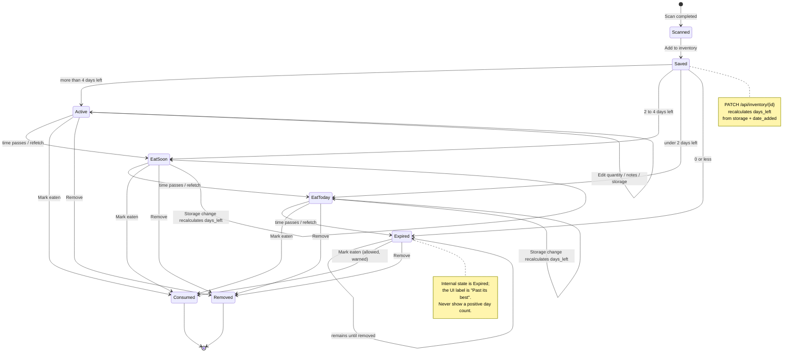
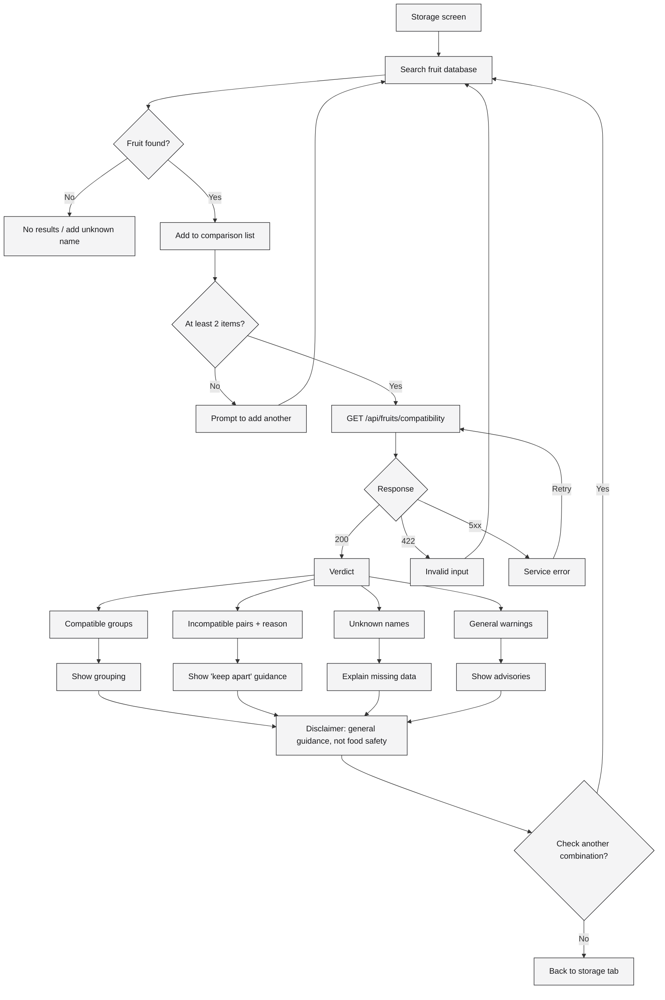
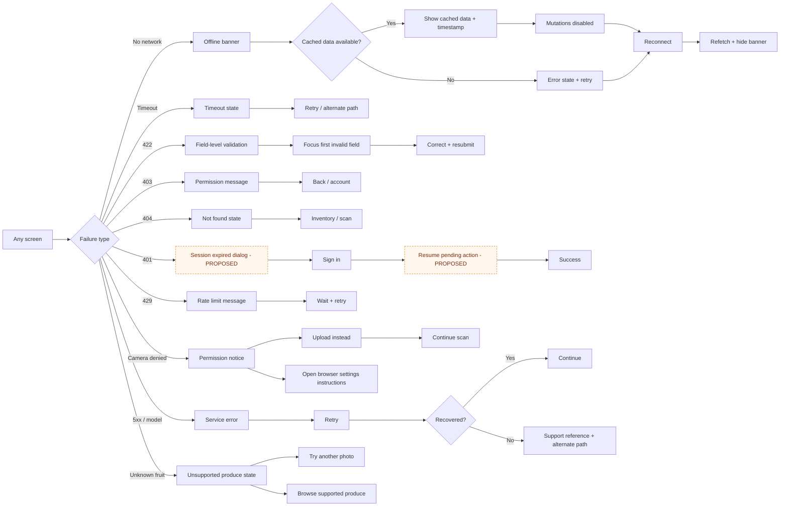

# FRESCO — Complete Application Screen Inventory & User Experience Specification

**Version:** 1.0
**Date:** 4 November 2026
**Product:** FRESCO (branded `fresco` in the PWA)
**Target:** Mobile-first Next.js PWA
**Document owner:** Product / UX / Engineering

---

## 0. Evidence base, scope and status legend

### 0.1 What was inspected

This specification is derived from the repository, not from assumptions about what a fruit app usually contains.

| Evidence | Location | Weight |
|---|---|---|
| Implemented PWA source | `frontend/app/**`, `frontend/components/**`, `frontend/lib/**` | Primary (authoritative) |
| Implemented FastAPI backend | `backend/app/**` | Primary |
| PWA manifest & service worker | `frontend/public/manifest.json`, `frontend/public/sw.js` | Primary |
| Project README | `README.md` | Secondary |
| Backend README / config | `backend/README.md`, `backend/app/config.py` | Secondary |
| Separate Expo native prototype | `fresco-app/src/**` | Secondary design-intent evidence only |
| Supabase schema | `supabase/migrations/20260419222155_new-migration.sql` | Secondary |

No Figma file, screenshot set, or written PRD was present. Where a behaviour is not in the code, it is marked as missing or proposed and the assumption is stated.

### 0.2 Important scope note: two clients exist

- `frontend/` is the **Next.js PWA**. It is the product this document specifies.
- `fresco-app/` is a **separate Expo/React Native prototype** with four tabs (Scan, Fridge, Ideas, Profile). It is *not* the PWA and must not replace it. It is referenced only where it demonstrates intended behaviour that the PWA lacks (camera-permission recovery, per-result storage selection, consume/remove actions, sign-out confirmation, live `days_left` usage).

The instruction “remain a PWA” is respected throughout. No screen below requires a native shell.

### 0.3 Status legend

Every screen, component and capability carries one of these tags:

| Tag | Meaning |
|---|---|
| **[EXISTING]** | Confirmed implemented and reachable in the current PWA. |
| **[INCOMPLETE]** | Present in code but partial, inconsistent, or behaving incorrectly. |
| **[MISSING]** | Required by the product description but absent from the PWA. |
| **[PROPOSED]** | A recommendation. Not implemented; not to be described to stakeholders as shipped. |

### 0.4 The ten most important findings (read this first)

1. **Tapping an inventory card deletes it immediately, with no confirmation and no undo.** `frontend/app/inventory/page.tsx` passes `onItemClick={handleDelete}`. This is a destructive primary interaction and the single highest-severity UX defect in the product. **[INCOMPLETE]**
2. **There is no route protection.** `AuthGuard` exists but is never mounted; there is no `middleware.ts`. Protected API calls simply return 401 and render an error state. **[INCOMPLETE]**
3. **The scan result’s “confidence” is not identification confidence.** The UI prints `result.confidence`, which is the decision engine’s composite score (60% freshness + 40% remaining-life ratio), labelled “% confidence”. `classification_confidence` exists but is never displayed. **[INCOMPLETE]**
4. **`best_storage` is computed as the maximum of room/fridge/freezer days, so it is effectively always `freezer`.** The recommendation sentence then says “Store in the freezer for up to *N* days” where *N* is the **room-temperature** estimate. **[INCOMPLETE — correctness bug]**
5. **The inventory list displays the stale at-scan snapshot (`estimated_days_remaining`), not the server’s live `days_left`.** Items do not visibly age, and an item can show a positive day count while also showing “Expired”. **[INCOMPLETE — correctness bug]**
6. **There is no inventory detail screen.** Quantity, notes, date added, storage changes, “mark consumed”, and fruit information cannot be viewed or edited in the PWA, although the backend supports all of it. **[MISSING]**
7. **There is no notifications UI at all.** The backend creates and lists notification rows; the PWA has no list, badge, permission request, push handler, or scheduler. **[MISSING]**
8. **There is no onboarding, no guest mode, and no post-auth return path.** Sign-in always lands on `/scan`, even when the user was interrupted while saving a scan result. **[MISSING]**
9. **Scanning is public but saving is not.** `POST /api/scan/` has no auth dependency; `POST /api/inventory/` does. An unauthenticated user can complete a scan and only discovers the requirement when they tap “Add to Inventory”. **[INCOMPLETE]**
10. **The installed PWA opens at `/scan`, bypassing the landing page entirely.** `manifest.json` sets `start_url: "/scan"`. The landing page is therefore only seen by direct browser visitors. **[INCOMPLETE]**

Additional correctness and accessibility findings are listed in Part H.

### 0.5 Assumptions

- The PWA is the release target; `fresco-app/` is not shipped in this scope.
- The backend base URL is `NEXT_PUBLIC_API_URL` (default `http://localhost:8000`).
- The classifier currently recognises **Apple, Banana, Carrot and Tomato only** (14 class stages, Expired masked out). The fruit database contains **43** entries. A scan of any other produce returns HTTP 404 from `lookup_fruit`.
- “Freshness” in the current pipeline is derived from the predicted ripeness-stage class, not from a separately trained freshness model. `backend/app/ai/freshness.py` is a stub and is not called by the pipeline.
- Shelf-life numbers are estimates from a deterministic formula, not measured spoilage dates.

### 0.6 Document map

| Section | Contents | Use it for |
|---|---|---|
| Part A | Information architecture, navigation, auth model, route and overlay inventory | Scoping and navigation decisions |
| Part B | 27 screens, each with the nine-part template | Screen-level design and build tickets |
| Part C | 10 journeys plus 12 error/recovery sub-journeys | End-to-end QA and flow reviews |
| Part D | Scan-results specification, confidence and safety policy | Trust-critical result work |
| Part E | Inventory model, lifecycle, cards, dates, editing, notifications | Inventory build and data rules |
| Part F | Global component catalogue, states, tokens, accessibility contract | Design-system and frontend implementation |
| Part G | Six Mermaid diagrams | Architecture and journey communication |
| Part H | Priorities, phases, gap analysis, API/AI dependencies, risks | Planning and release gating |
| Master checklist | Screens, overlays, states, journeys and cross-cutting QA | Release tracking and sign-off |

---

# PART A — Product information architecture

## A.1 Product shape

FRESCO is a four-destination, task-first PWA. The core loop is:

**Scan → Understand → Save → Monitor → Act**

The information architecture is intentionally shallow: one level of primary navigation plus contextual result/detail screens. There is no deep settings tree in the current build, and no content-heavy section.

```
FRESCO
├── Entry
│   ├── Landing (/)
│   ├── Sign in (/auth/signin)
│   └── Sign up (/auth/signup)
├── Primary tabs
│   ├── Scan (/scan)              ← default PWA entry
│   ├── Inventory (/inventory)
│   ├── Storage (/storage)        ← ethylene compatibility
│   └── Account (/account)
├── Contextual
│   ├── Scan results (/results)
│   ├── Inventory item detail (/inventory/[id])        [MISSING]
│   ├── Fruit detail (/fruits/[id])                    [MISSING]
│   ├── Notifications (/notifications)                 [MISSING]
│   └── Settings sub-pages (/account/*)                [MISSING]
└── System states
    ├── Offline banner (global overlay)
    ├── Scan processing overlay
    ├── Camera permission state
    ├── Empty / loading / error states
    └── 404 / error boundary                           [MISSING]
```

## A.2 Main application sections

| Section | Job to be done | Current state |
|---|---|---|
| Scan | “Tell me what this is and how long I have.” | Implemented, camera + upload |
| Results | “Explain the verdict and let me act on it.” | Implemented, read-only verdict |
| Inventory | “What do I have, and what should I eat first?” | Implemented list; detail/editing missing |
| Storage | “Can I put these together?” | Implemented ethylene compatibility checker |
| Account | “Who am I and how do I leave?” | Read-only profile + sign out |
| Notifications | “Remind me before it spoils.” | Backend only; no UI |
| Fruit knowledge | “How should this specific fruit be stored?” | Only a one-line tip on results |
| Settings | “Control my preferences and security.” | Placeholder rows only |

## A.3 Primary navigation

**Bottom navigation — [EXISTING]**, `frontend/components/ui/BottomNav.tsx`.

| Order | Label | Route | Icon | Active rule |
|---|---|---|---|---|
| 1 | Scan | `/scan` | camera outline | exact or child path |
| 2 | Inventory | `/inventory` | list | exact or child path |
| 3 | Storage | `/storage` | transfer arrows | exact or child path |
| 4 | Account | `/account` | person | exact or child path |

Rules encoded in code:

- Fixed to the viewport bottom, height `56px`, `z-50`, translucent surface with blur.
- Hidden only when `pathname.startsWith("/auth")`.
- **Shown on `/` and `/results`** — the nav is not context-aware beyond auth.
- Content is constrained to `max-width: 480px`; the nav is centred to the same width.
- `safe-bottom` padding uses `env(safe-area-inset-bottom)`.
- Touch targets: each tab is `py-1 px-3` with a global 48px minimum, but the global rule is frequently overridden by `min-h-0` on inner buttons.

**Gaps:** no central “scan” affordance, no notification badge, no active-state announcement to screen readers (`aria-current` absent), no label for the nav landmark.

## A.4 Secondary navigation

| Pattern | Where | State |
|---|---|---|
| Back chevron | Results → `/scan` (hardcoded) | [EXISTING] |
| Modal/drawer | None | [MISSING] |
| In-page tabs | Inventory filters (All / Eat First / Fresh / Expired; recommended label “Past best”) | [EXISTING] |
| Segmented control | Scan mode (Camera / Upload), storage method | [EXISTING] |
| Dropdown | Storage fruit search suggestions | [EXISTING] |
| Settings rows | Account cards | [INCOMPLETE — non-interactive] |
| Breadcrumbs | None | Not appropriate for mobile |

There is no hamburger menu, no side drawer, and no nested settings navigation. Adding either would be inconsistent with the one-hand, four-tab model.

## A.5 Authentication routes and protection

### Auth routes

| Route | Access | Behaviour |
|---|---|---|
| `/auth/signin` | Public | Email + password; on success `router.push("/scan")`; bottom nav hidden |
| `/auth/signup` | Public | Username + email + password + confirm; on success `router.push("/scan")`; bottom nav hidden |

### Protection model as implemented

- Tokens are stored in `localStorage` (`fresco_token`) **and** a non-HttpOnly cookie (`fresco_auth`).
- The cookie is written for a hypothetical Next.js middleware that does not exist.
- `AuthProvider` initialises synchronously from `localStorage`; it never calls `GET /api/auth/me`.
- There is no token refresh. Tokens expire after **30 minutes** (`access_token_expire_minutes = 30`).
- There is no global 401 interceptor. An expired token leaves the UI in a “signed in” state until a protected request fails.
- `AuthGuard` (`frontend/components/ui/AuthGuard.tsx`) would redirect to `/auth/signin?redirect=…`, but **no page imports it**.
- The sign-in page **ignores** the `redirect` query parameter.

### Protection model that should exist

| Route | Required access | Current enforcement |
|---|---|---|
| `/` | Public | None needed |
| `/auth/*` | Public; redirect authenticated users to `/scan` | Missing |
| `/scan` | Public (guest scanning allowed) | None; correct for scan, but save fails |
| `/results` | Public to view; auth required to save | UI allows view; save returns 401 |
| `/inventory` | Authenticated | API-only; page renders 401 error |
| `/inventory/[id]` | Authenticated | Route missing |
| `/storage` | Public | None; correct (public endpoint) |
| `/notifications` | Authenticated | Route missing |
| `/account` | Public shell; content requires auth | Page-level check exists |
| `/account/*` | Authenticated | Routes missing |

**Recommended model:** guest scanning is a deliberate acquisition path. Keep `/scan` and `/results` public, but (a) show a persistent “Sign in to save” state on results, (b) open an auth sheet rather than navigating away, and (c) return the user to the pending result after auth.

## A.6 Shared components

| Component | File | Used by |
|---|---|---|
| `Button` | `components/ui/Button.tsx` | Auth, storage, results actions, account |
| `Input` | `components/ui/Input.tsx` | Sign in / sign up; password reveal |
| `Card` | `components/ui/Card.tsx` | Results, inventory rows, account, compatibility |
| `Badge` | `components/ui/Badge.tsx` | Result status |
| `BottomNav` | `components/ui/BottomNav.tsx` | All non-auth pages |
| `EmptyState` | `components/ui/EmptyState.tsx` | Inventory, filtered inventory |
| `ErrorState` | `components/ui/ErrorState.tsx` | Scan, inventory, storage |
| `OfflineBanner` | `components/ui/OfflineBanner.tsx` | Global |
| `AuthGuard` | `components/ui/AuthGuard.tsx` | **Unused** |
| `CameraView` | `components/scan/CameraView.tsx` | Scan |
| `StorageSelector` | `components/scan/StorageSelector.tsx` | Scan |
| `ScanButton` | `components/scan/ScanButton.tsx` | **Unused** (dead component) |
| `StatusBadge` | `components/result/StatusBadge.tsx` | Results |
| `DaysLeftDisplay` | `components/result/DaysLeftDisplay.tsx` | Results |
| `RecommendationText` | `components/result/RecommendationText.tsx` | Results |
| `StorageBreakdown` | `components/result/StorageBreakdown.tsx` | Results |
| `ActionButtons` | `components/result/ActionButtons.tsx` | Results |
| `InventoryList` | `components/inventory/InventoryList.tsx` | Inventory |
| `InventoryItem` | `components/inventory/InventoryItem.tsx` | Inventory |
| `FloatingAddButton` | `components/inventory/FloatingAddButton.tsx` | Inventory |

## A.7 Global overlays and modals

| ID | Overlay | Type | State |
|---|---|---|---|
| OV-01 | Scan processing | Full-screen blocking overlay | [EXISTING] |
| OV-02 | Offline banner | Top fixed banner | [EXISTING] |
| OV-03 | Image preview + confirm | In-page state | [EXISTING] |
| OV-04 | Camera error notice | Inline message | [INCOMPLETE] |
| OV-05 | Add-to-inventory sheet | Bottom sheet | [MISSING] |
| OV-06 | Quantity / storage edit sheet | Bottom sheet | [MISSING] |
| OV-07 | Delete confirmation | Alert dialog | [MISSING] |
| OV-08 | Mark-consumed confirmation | Alert / undo toast | [MISSING] |
| OV-09 | Sign-out confirmation | Alert dialog | [MISSING in PWA; exists in Expo] |
| OV-10 | Toast host | Transient toast | [MISSING] |
| OV-11 | Profile menu | Dropdown/sheet | [MISSING] |
| OV-12 | Notification panel | Sheet or page | [MISSING] |
| OV-13 | Install prompt | Bottom sheet | [MISSING] |
| OV-14 | Session-expired dialog | Modal | [MISSING] |
| OV-15 | Search suggestions | Dropdown | [EXISTING] |
| OV-16 | Inline error banner | Inline region | [EXISTING] |
| OV-17 | How we estimate | Bottom sheet | [MISSING] |

## A.8 Important user journeys (index)

| # | Journey | Entry | Exit | Status |
|---|---|---|---|---|
| 1 | First-time visitor | `/` | `/scan` or auth | Partial |
| 2 | Returning user | PWA launch | `/scan` | Partial (no session validation) |
| 3 | Camera scan | `/scan` | `/results` | Implemented |
| 4 | Upload scan | `/scan` → Upload | `/results` | Implemented |
| 5 | Save & manage inventory | `/results` | `/inventory` | Partial (no detail/edit) |
| 6 | Storage recommendations | `/results` | Results | Partial (tip only) |
| 7 | Ethylene compatibility | `/storage` | Results inline | Implemented |
| 8 | Notifications | — | — | Missing |
| 9 | Account management | `/account` | `/auth/signin` | Partial |
| 10 | Error & recovery | Any | Retry / fallback | Partial |

## A.9 Route inventory

Full pages:

| Route | Screen name | Access | Purpose | Entry point | Status |
|---|---|---|---|---|---|
| `/` | Landing | Public | Introduce the product; start a scan | Direct URL only | [EXISTING] |
| `/auth/signin` | Sign in | Public | Authenticate returning user | Account, auth links, redirects | [EXISTING] |
| `/auth/signup` | Sign up | Public | Create account | Sign-in link | [EXISTING] |
| `/scan` | Scan | Public (guest scanning) | Capture/upload produce | PWA start, tab, landing CTA, FAB, results | [EXISTING] |
| `/results` | Scan results | Public view; auth to save | Explain verdict; add to inventory | After successful scan | [EXISTING] |
| `/inventory` | Inventory | Protected (API) | List and triage tracked produce | Tab, post-save | [EXISTING] |
| `/storage` | Storage Check | Public | Ethylene compatibility check | Tab | [EXISTING] |
| `/account` | Account | Public shell | Identity, preferences, sign out | Tab | [EXISTING] |
| `/inventory/[id]` | Inventory item detail | Protected | Inspect/edit/consume/remove one item | Inventory row | [MISSING] |
| `/fruits/[id]` | Fruit detail | Public | Full shelf-life, storage, ethylene profile | Result, storage, inventory | [MISSING] |
| `/notifications` | Notifications | Protected | Expiry alert inbox | Header bell, account | [MISSING] |
| `/account/profile` | Personal information | Protected | Edit username/email | Account | [MISSING] |
| `/account/preferences` | Preferences | Protected | Units, default storage, reminders | Account | [MISSING] |
| `/account/security` | Security | Protected | Password change, sessions, delete account | Account | [MISSING] |
| `/account/about` | About & legal | Public | Version, disclaimers, privacy | Account | [MISSING] |
| `/onboarding` | Onboarding | First run | Explain value + permissions | First launch | [MISSING] |
| `/offline` | Offline fallback | Public | Explain offline limits | SW fallback | [PROPOSED] |
| `not-found` | 404 | Public | Recover from bad URLs | Any invalid URL | [MISSING] |

Temporary UI (not routes):

| ID | Name | Trigger | Status |
|---|---|---|---|
| OV-01 | Scan processing overlay | Confirm scan | [EXISTING] |
| OV-02 | Offline banner | `offline` event | [EXISTING] |
| OV-03 | Preview / confirm | Capture or file pick | [EXISTING] |
| OV-04 | Camera denied notice | `NotAllowedError` | [INCOMPLETE] |
| OV-05 | Add-to-inventory sheet | “Add to Inventory” | [MISSING] |
| OV-06 | Edit item sheet | Item detail → Edit | [MISSING] |
| OV-07 | Delete dialog | Item detail → Delete | [MISSING] |
| OV-08 | Consumed confirmation | “Mark eaten” | [MISSING] |
| OV-09 | Sign-out dialog | Account → Sign out | [MISSING] |
| OV-10 | Toast host | Any mutation success/failure | [MISSING] |
| OV-11 | Profile menu | Avatar / account header | [MISSING] |
| OV-12 | Notification panel | Bell icon | [MISSING] |
| OV-13 | Install prompt | `beforeinstallprompt` | [MISSING] |
| OV-14 | Session expired | 401 from API | [MISSING] |
| OV-15 | Search suggestions | Typing in Storage | [EXISTING] |
| OV-16 | Inline error banner | Failed request or validation | [EXISTING] |
| OV-17 | How we estimate | Results → estimate explanation | [MISSING] |

The native image picker (upload mode) and the inventory filter tabs are UI states rather than overlays; they are specified as `INP-14` and `NAV-05` in Part F.

## A.10 Navigation principles that follow from the code

1. **One primary action per screen.** Results currently has two equal-width buttons, which weakens hierarchy; “Add to Inventory” should dominate and “Scan Again” should be secondary/ghost.
2. **Never strand the user.** Every error state must offer a forward action, not only a retry.
3. **Do not hide the only path to auth.** The landing page has no sign-in link; the account tab is the only discoverable route.
4. **Preserve context across auth.** A pending scan result must survive sign-in.
5. **The bottom nav is for destinations, not actions.** The inventory FAB duplicates the Scan tab; either remove the FAB or replace the Scan tab with a central action.

---

# PART B — Complete screen-by-screen documentation

Screens are ordered as a user encounters them. Screens 1–9 are implemented (with the caveats noted); screens 10–27 are required but missing or proposed. Each screen uses the same nine-part template.

---

## Screen 1: App launch / cold start

**1. Purpose**
- Establish the shell, restore the session, and decide where the user lands.
- Solve the “what do I see first?” problem without adding a marketing delay.
- Expected outcome: the user reaches the scan surface (installed PWA) or the landing page (browser) within one paint, with no flash of the wrong auth state.

**2. When it appears**
- Every cold start, PWA launch, hard refresh, or new tab.
- Everyone: first-time and returning, authenticated and anonymous.

**3. What the user sees**
- Browser chrome or PWA standalone window; `theme_color` `#18181B`; background `#FAFAF8`.
- No custom splash screen is configured. The manifest provides only name, icons, colours, orientation and `start_url`.
- Installed PWA: `/scan` renders immediately. Browser: `/` renders.
- A brief empty shell while React hydrates; the `AuthProvider` reads `localStorage` synchronously, so there is no auth spinner.
- If the device is offline at launch, the service worker may serve a cached page; the amber OfflineBanner appears at the top.
- No onboarding, no permission prompt, no install prompt.

**4. User interactions**
- None specific to launch. The first meaningful interaction is the camera permission prompt on `/scan` (see Screen 6).
- If a stale token exists, the UI treats the user as signed in without validation. Tapping Inventory then triggers a 401 and an error state.

**5. Navigation**
- Installed PWA → `/scan`.
- Browser → `/`.
- Invalid deep link → Next.js default 404 (unstyled).
- Back button from `/scan` in standalone mode exits the app or does nothing, depending on platform history.

**6. Data and backend behavior**
- Reads `fresco_token` and `fresco_user` from `localStorage`.
- Writes a `fresco_auth` cookie when a token is set (unused).
- Registers `/sw.js` only when `NODE_ENV === "production"`.
- **No call to `GET /api/auth/me`.** Session validity is unknown until the first protected request.
- Service worker precaches `/scan`, `/inventory`, `/storage`, `/account`, `/auth/signin`, `/auth/signup`.

**7. UI states**
- **Initial:** blank/surface background during hydration.
- **Loading:** none (synchronous local read).
- **Success:** target route renders.
- **Offline:** cached shell + OfflineBanner; API calls fail.
- **Expired session:** indistinguishable from valid until a protected request.
- **Corrupt `fresco_user` JSON:** `getStoredUser()` calls `JSON.parse` without try/catch → render-time exception; no error boundary → white screen. **[INCOMPLETE]**

**8. Responsive behavior**
- Phone: full-bleed, max 480px content column.
- Tablet/desktop: content remains a 480px column centred on a wide background; the bottom nav is also 480px. This is acceptable for a PWA but looks like a phone app in a desktop window.
- Landscape phone: camera viewfinder remains 4:3; bottom nav consumes vertical space.

**9. Completion criteria**
- A cold start never flashes a signed-in UI for an expired session.
- Corrupt local storage is handled without a white screen.
- Launch target is deliberate and documented (`/scan` vs `/`).
- Offline launch shows a usable shell, not a browser error.
- Service worker registration failures are non-fatal and logged.

---

## Screen 2: Landing

**1. Purpose**
- Explain the product in one sentence and provide a single entry action.
- Solve the “I opened a link, what is this?” problem.
- Expected outcome: the visitor taps “Scan Your First Fruit” and grants camera access, or navigates to sign in.

**2. When it appears**
- Browser visits to `/` only.
- **Not shown to installed-PWA users**, because `start_url` is `/scan`.
- Everyone; no auth check.

**3. What the user sees** — `[EXISTING]`
- Top: nothing. No header, logo bar, or sign-in link.
- Centre column, vertically centred with a negative top margin (`-mt-20`):
  - Wordmark: **fresco** (`text-2xl font-bold`).
  - Tagline: “Know your fruit.” (`text-sm`, muted).
  - Primary CTA: “Scan Your First Fruit” — full-width up to 280px, dark (`#18181B`) background, white text, rounded-xl, `py-3.5`.
- Bottom: the standard four-tab navigation is visible (Scan, Inventory, Storage, Account), with no tab active because `/` matches none.
- Footer: none. No features, no screenshots, no social proof, no legal links, no install CTA.

**4. User interactions**
- **Tap “Scan Your First Fruit”** → client-side navigation to `/scan`. No API call. Camera permission is requested on the next screen, without prior explanation.
- **Tap any bottom tab** → navigates to that destination. Inventory and Account may show auth-related states.
- **No sign-in / sign-up link** on the page. A returning user must discover the Account tab.

**5. Navigation**
- Previous: browser back (leaves the app).
- Next: `/scan` (primary), `/inventory`, `/storage`, `/account`.
- Back-button behaviour: normal history.

**6. Data and backend behavior**
- Static page. No API calls, no data dependencies, no auth requirement.
- No analytics or attribution hooks exist.

**7. UI states**
- Only one state. No loading, empty, error, or offline variant.
- Offline: page is precached? `/` is **not** in `PRECACHE_URLS`; a cold offline visit to `/` falls back to the cached `/scan` shell only if the request is a navigation and `/scan` is cached. This is inconsistent with the visible URL.

**8. Responsive behavior**
- Small phones (≤360px): CTA remains 280px, comfortable.
- Large phones: unchanged; lots of empty space.
- Tablet/desktop: a narrow centred column with the bottom nav; no desktop-specific layout.
- Safe areas: no explicit top padding; the centred layout avoids the notch.

**9. Completion criteria**
- A first-time visitor can state what the product does after 5 seconds.
- A returning user can reach sign-in in one tap.
- The page is precached or has an explicit offline fallback.
- The primary CTA explains that camera access will be requested.
- The page is reachable from the installed app (or intentionally removed in favour of `/scan`).

---

## Screen 3: Sign in

**1. Purpose**
- Authenticate a returning user and restore access to their inventory.
- Solve the “my data is private and tied to my account” problem.
- Expected outcome: a valid JWT is stored and the user lands in the app.

**2. When it appears**
- Tapping “Sign In” from the Account signed-out state.
- Direct navigation to `/auth/signin`.
- A future `AuthGuard` redirect (currently unused).
- Returning users only; new users are routed to sign up.

**3. What the user sees** — `[EXISTING]`
- No header, no back button, no logo link. Bottom nav is hidden.
- Vertically centred column, `px-6`, `min-h-screen`.
- Brand block: **fresco** (`text-3xl`), “Know your fruit.” below.
- Optional inline error banner: pale red background, red border, red text.
- Form:
  - Label “Email”, email input, placeholder `you@example.com`, required.
  - Label “Password”, password input, placeholder `••••••••`, required, with an eye toggle on the right.
  - Primary button “Sign In”, full width, 48px minimum height.
- Footer text: “Don’t have an account? **Sign up**” (underlined accent link).
- No “Forgot password?”, no “Remember me”, no terms, no social login, no password-manager hints (`autoComplete` absent).

**4. User interactions**
- **Submit** → `POST /api/auth/login` with `{ email, password }`. Button enters loading (spinner + unchanged label); inputs remain editable.
  - **Success:** token + user persisted to `localStorage` and cookie; `router.push("/scan")`.
  - **401:** inline banner “Invalid email or password”.
  - **Network failure:** generic “Something went wrong. Please try again.” because a raw `TypeError` is not an `ApiError`.
  - **Validation:** HTML `required` and `type=email` only; no inline field errors.
- **Eye toggle** → toggles password visibility locally; `aria-label` changes between “Show password” and “Hide password”.
- **Sign up link** → `/auth/signup`.
- No API call on typing.

**5. Navigation**
- Previous: browser back; no in-app back.
- Next: `/scan` on success; `/auth/signup` via link.
- `?redirect=` is ignored. A user interrupted on `/results` is sent to `/scan`, losing their place.
- Back-button after success returns to the sign-in form while still authenticated; no redirect away.

**6. Data and backend behavior**
- `POST /api/auth/login` → `TokenResponse { access_token, token_type, user }`.
- Errors: 401 “Invalid email or password” (same message for unknown email and wrong password), 422 for malformed input.
- Token lifetime: 30 minutes. No refresh token.
- Client writes `fresco_token`, `fresco_user`, and `fresco_auth` cookie.

**7. UI states**
- **Initial:** empty fields, enabled button.
- **Loading:** spinner inside button; button disabled via `loading`.
- **Success:** navigation; no confirmation toast.
- **Error:** top banner; form values preserved.
- **Offline:** submit fails with the generic error after the fetch rejects; no offline-specific message.
- **Disabled:** only during submit.
- **Expired session:** not handled here.

**8. Responsive behavior**
- Small phones: `min-h-screen` plus centred content can collide with the on-screen keyboard; no scroll container is guaranteed. The form may be obscured when the password field is focused. **[INCOMPLETE]**
- Large phones: comfortable.
- Tablet/desktop: narrow centred column; no max-width on the form itself beyond `px-6`, so fields can become very wide. Should be capped at ~400px.
- Landscape: vertical centring can push the form off-screen with the keyboard open.

**9. Completion criteria**
- Keyboard-aware scrolling; the submit button is reachable with the keyboard open.
- Field-level validation and accessible error association (`aria-describedby`, `aria-invalid`).
- `autoComplete="email"` and `"current-password"`.
- `redirect` query honoured, with open-redirect protection.
- Network, 401, 422 and 429 errors have distinct copy.
- Already-authenticated users are redirected away from the form.
- A password-recovery path exists (or the absence is explicitly accepted for MVP).

---

## Screen 4: Sign up

**1. Purpose**
- Create an account so scans can be saved and monitored.
- Solve the “I want my inventory to persist” problem.
- Expected outcome: account created, JWT stored, user lands in the app.

**2. When it appears**
- From the sign-in footer link.
- Direct navigation to `/auth/signup`.
- New users only.

**3. What the user sees** — `[EXISTING]`
- Same shell as sign in: centred, `px-6`, no nav, no back button.
- Brand block: **fresco** + “Create your account.”
- Inline error banner (conditional).
- Form fields in order:
  1. Username — placeholder `john_doe`.
  2. Email — placeholder `you@example.com`.
  3. Password — placeholder “Min 6 characters”.
  4. Confirm Password — placeholder “Repeat password”.
  5. Primary button “Create Account”.
- Footer: “Already have an account? **Sign in**”.
- No password-strength meter, no terms acceptance, no privacy notice, no email-verification expectation.

**4. User interactions**
- **Submit** → client validation first:
  - passwords differ → “Passwords don’t match.”
  - password length `< 6` → “Password must be at least 6 characters.”
  - Then `POST /api/auth/register`.
  - **Success:** token + user stored; `router.push("/scan")`.
  - **409:** “Username already taken” or “Email already registered”.
  - **422:** FastAPI validation detail is an array, not a string; `ApiError.detail` becomes the array and React renders it as `[object Object]` or throws. **[INCOMPLETE]**
  - **Network failure:** “Something went wrong. Please try again.”
- **Eye toggles** on both password fields operate independently.
- **Sign in link** → `/auth/signin`.

**5. Navigation**
- Previous: browser back; no in-app back.
- Next: `/scan` on success; `/auth/signin` via link.
- No redirect preservation.

**6. Data and backend behavior**
- `POST /api/auth/register` with `{ username, email, password }`.
- Backend rules: username 3–50 chars, `^[a-zA-Z0-9_]+$`; email 5–255; password **min 8**, must contain a letter and a digit.
- **Client/server mismatch:** the client allows 6–7 character passwords and passwords without digits; these fail server-side with 422. The placeholder advertises the wrong rule. **[INCOMPLETE — correctness]**
- Duplicate checks return 409 with distinct messages (this leaks account existence, unlike login; acceptable trade-off for registration UX, but worth noting).

**7. UI states**
- **Initial:** empty.
- **Loading:** spinner in button, disabled.
- **Success:** navigation; no welcome state, no onboarding.
- **Error:** top banner; no field highlighting.
- **Offline:** generic failure.
- **Disabled:** only during submit.

**8. Responsive behavior**
- Four stacked fields make keyboard occlusion more likely than sign in on small phones; the page is not scrollable by design (`justify-center` + `min-h-screen`).
- Tablet/desktop: fields stretch too wide; cap the form width.

**9. Completion criteria**
- Client and server password rules match exactly and are stated before submission.
- 422 validation errors are parsed into human-readable field messages.
- Username/email availability feedback (optional) is debounced and accessible.
- Terms/privacy acknowledgement exists if required by jurisdiction.
- Keyboard-safe layout.
- Post-signup destination is the pending task, not always `/scan`.

---

## Screen 5: Scan (camera + upload)

**1. Purpose**
- Capture or select one image of produce and submit it for analysis.
- Solve the core job: “tell me what this is and how long I have.”
- Expected outcome: a valid image is uploaded and the user reaches results, or a clear, recoverable error is shown.

**2. When it appears**
- PWA launch (`start_url`), Scan tab, landing CTA, inventory FAB, results “Scan Again”/back.
- Everyone, including unauthenticated users.
- Returning users land here directly; there is no “home” dashboard.

**3. What the user sees** — `[EXISTING]`
- Top: wordmark “fresco” (`text-lg font-semibold`), no page title, no account avatar, no notification bell.
- Mode toggle above the viewfinder: two pills, **📷 Camera** and **📁 Upload**; active pill is dark with white text; inactive is muted.
- Viewfinder: full-width 4:3 rounded rectangle (`aspect-[4/3]`, `rounded-2xl`) on near-black.
  - Four white/40 corner brackets inset 16px.
  - **Camera mode:** live rear-camera feed; while starting, a white spinner and “Starting camera…”; when ready, a 64px circular shutter button with a white ring and white inner circle, centred 20px from the bottom.
  - **Upload mode:** centred image icon and “Tap to upload a photo”; tapping opens the OS file picker.
  - **Preview state:** the captured/selected image fills the frame (`object-cover`).
- Below the viewfinder:
  - Error banner (conditional), compact red, with “Tap to retry” when a previous file exists.
  - Label “Where will you store it?” (`text-xs`, muted).
  - Three equal segmented buttons: **Room Temp**, **Fridge**, **Freezer**. Default **Fridge**. Selected = dark fill; unselected = white surface with border.
- Bottom: standard nav.
- No flash/torch control, no zoom, no grid, no “one item at a time” guidance, no shutter sound/haptics, no upload-size hint.

**4. User interactions**
- **Camera tab** → stops any preview, resets the file input, sets mode `camera`, starts `getUserMedia`.
- **Upload tab** → stops the camera, resets preview, sets mode `upload`; the viewfinder becomes a large picker button.
- **Shutter** → draws the current video frame to a hidden canvas at native resolution, exports JPEG at 0.92 quality, creates `File("scan.jpg")`, sets a blob preview, stops the camera.
- **Upload picker** → accepts `image/jpeg,image/png,image/webp`; first file becomes the preview. **No client-side size or type validation**; a renamed non-image reaches the server.
- **Retake** → clears preview and file, returns to the current mode, restarts the camera if in camera mode.
- **Scan This Fruit** → calls `onCapture(file)`.
  - `setScanning(true)`, stores the file as `lastFile`, `POST /api/scan/` as multipart `image`.
  - **Success:** writes `scanResult` and `scanStorage` to `sessionStorage`, `router.push("/results")`.
  - **Failure:** stops scanning and shows the API message verbatim, except “failed to fetch” which becomes “Can’t reach the server. Check your connection and try again.”
  - **Timeout (30s):** “Scan timed out — the server took too long. Please try again.”
  - **Retry:** re-submits `lastFile` without re-capturing.
- **Storage selection** → local state only. It is **not** sent to the scan endpoint; it is stored for the later inventory add. The label implies it affects the verdict, which it does not.
- **Bottom tabs** → navigate away; an in-flight scan is aborted only by unmount, not by an `AbortController` tied to navigation (the timeout controller is internal).

**5. Navigation**
- Previous: browser back; from results, the chevron returns here.
- Next: `/results` on success; tabs.
- Back from results always returns to `/scan`, never to the previous tab.
- If the user leaves mid-scan, the request continues and may write to sessionStorage after unmount; the navigation to results does not occur.

**6. Data and backend behavior**
- `POST /api/scan/` (public, no bearer token) with `multipart/form-data` field `image`.
- Server validates `Content-Type` ∈ {jpeg, png, webp, jpg}; max 10MB; decodes pixels with PIL `verify()`.
- Server saves every accepted image to `backend/uploads/<uuid>.<ext>`; the response includes `image_path` as an absolute server path.
- Pipeline: classify → freshness (derived from class stage) → DB lookup → estimate → compatibility → decision engine.
- Errors: 400 invalid type/size; 415 corrupt image; 404 fruit not in DB; 503 model not deployed; 500 inference failure.
- Client timeout: 30s via `AbortController`.
- `scanStorage` is written to `sessionStorage` and read on results.

**7. UI states**
- **Initial:** camera starting spinner.
- **Camera ready:** live feed + shutter.
- **Permission denied:** message and automatic switch to upload (see Screen 6).
- **Camera unavailable:** “Camera not available on this device.” and upload mode.
- **Preview:** image + Retake/Scan.
- **Scanning:** full-screen overlay, all interaction blocked visually (but the underlying page is still in the DOM and focusable — no `inert`).
- **Error:** inline compact banner, retry if a file exists.
- **Offline:** camera works, submit fails with the connection message.
- **Disabled:** mode toggles and buttons disabled while scanning.
- **Empty:** not applicable.

**8. Responsive behavior**
- Small phones: 4:3 viewfinder plus controls plus nav fits; the storage row can wrap labels at 320px (“Room Temp” is tight). Error text can push controls below the fold.
- Large phones: good; the viewfinder dominates appropriately.
- Tablet/desktop: still a 480px column. Desktop webcams often lack `facingMode: environment`; the constraint is a preference, not a requirement, so the front camera may be used. Upload is the practical desktop path.
- Landscape: 4:3 frame plus 56px nav plus controls may exceed viewport height; no scroll strategy for the camera screen.

**9. Completion criteria**
- Camera permission is requested after a short, contextual explanation, not on first paint.
- A denied permission offers “Try again” and “Open settings” where the platform allows, plus upload.
- Torch/flash control for dark kitchens (present in the Expo prototype; absent here).
- Client-side file type/size validation with a friendly message before upload.
- Object URLs are revoked to avoid memory leaks.
- The storage selector either affects the request or is moved to the results/save step where it is actually used.
- Upload progress or a determinate phase indicator for slow connections.
- The processing overlay traps focus and is announced (`role="status"`, `aria-live="polite"`).
- A 30s timeout is distinguishable from a network failure.
- The captured image is retained for the results screen and the inventory record.

---

## Screen 6: Camera permission denied (state of Scan)

**1. Purpose**
- Explain why the camera is needed and provide a legal alternative.
- Solve the dead end created by a browser-level denial.
- Expected outcome: the user either grants permission or successfully uploads a photo.

**2. When it appears**
- `getUserMedia` rejects with `NotAllowedError` (user denied, or policy blocked).
- Also when the device has no camera or the context is insecure (`Not available`).
- First-time and returning users alike.

**3. What the user sees** — `[INCOMPLETE]`
- The viewfinder switches to **Upload** mode automatically.
- A small amber line below the viewfinder: “Camera permission denied.” or “Camera not available on this device.”
- The mode toggle now shows Upload active.
- The upload picker (“Tap to upload a photo”) is the only path forward.
- No illustration, no explanation of how to re-enable, no “Open settings” button, no “Try camera again” button.

**4. User interactions**
- **Tap upload area** → OS file picker.
- **Tap Camera tab** → retries `getUserMedia`; if permanently denied, the browser will not re-prompt and the same message returns. There is no guidance that the user must change site settings.
- No API call.

**5. Navigation**
- Stays on `/scan`; other tabs available.
- No dedicated permission screen; the state is inline.

**6. Data and backend behavior**
- Browser Permissions API is not queried; the app does not know whether the denial is permanent (`canAskAgain` equivalent).
- No storage of the user’s choice.

**7. UI states**
- **Denied:** amber message + upload mode.
- **Unavailable:** same visual, different copy.
- **Insecure context:** falls into “not available”; copy does not mention HTTPS.
- **Retry:** possible only by tapping Camera; no state change if permanently blocked.

**8. Responsive behavior**
- Identical to Scan; the message is a single line that can wrap on small screens.

**9. Completion criteria**
- A pre-permission explainer appears before the browser prompt on first use.
- Denial produces a dedicated panel with: why the camera is used, “Try again” (if allowed), “How to enable in settings” (platform-specific copy), and “Upload a photo instead”.
- The state is announced to screen readers.
- The app detects insecure contexts and explains that camera requires HTTPS.
- The user can recover without reloading the page.

---

## Screen 7: Image preview and confirmation (state of Scan)

**1. Purpose**
- Let the user verify the photo before spending time and bandwidth on analysis.
- Solve the “I captured a blurry/wrong frame” problem.
- Expected outcome: the user confirms a usable image or retakes it.

**2. When it appears**
- Immediately after shutter capture or file selection.
- Everyone using Scan.

**3. What the user sees** — `[EXISTING]`
- The viewfinder is replaced by the captured image, cropped with `object-cover` (the 4:3 frame may hide parts of a portrait upload).
- Corner brackets remain overlaid.
- The shutter disappears.
- Below the frame, a two-button row:
  - **↩ Retake** — secondary, surface background, `flex-1`.
  - **🔍 Scan This Fruit** — primary, dark, `flex-[2]`, white, semibold.
- The mode toggle remains above; switching modes clears the preview.
- The storage selector remains below.

**4. User interactions**
- **Retake** → clears preview/file, revokes nothing (object URL leak), restarts camera if in camera mode.
- **Scan This Fruit** → submits (see Screen 5).
- **Switch mode** → clears the preview silently; no confirmation, so a captured image can be lost by an accidental tap.
- **Change storage** → local only.
- **Back/tab** → leaves; preview is lost.

**5. Navigation**
- Stays on `/scan` until submit; then `/results`.
- No full-screen zoom or crop.

**6. Data and backend behavior**
- The `File` is held in component state only; no upload until confirmation.
- Preview is a `blob:` URL; never revoked.
- `scanStorage` is captured at submit time.

**7. UI states**
- **Preview:** image + actions.
- **Submitting:** overlay; actions disabled.
- **Error after submit:** preview remains, error banner appears, retry available.
- **Image load failure:** broken image icon; no fallback copy.

**8. Responsive behavior**
- Portrait uploads are cropped by `object-cover`; the user may not see the whole fruit. A `object-contain` preview with letterboxing is safer for verification.
- Small phones: the two-button row fits, but emoji glyphs vary by platform.

**9. Completion criteria**
- The full image is visible (contain, not crop) before analysis.
- Retake and mode switches warn only if an upload is in flight.
- Object URLs are revoked.
- The user can zoom/inspect the photo.
- The primary action states what will happen (“Analyse this photo”) and the estimated wait.
- A file name/size indicator is shown for uploads.

---

## Screen 8: Scan processing overlay

**1. Purpose**
- Communicate that analysis is running and prevent duplicate submissions.
- Solve the uncertainty of a multi-second server round trip.
- Expected outcome: the user waits, then is taken to results; or sees a recoverable failure.

**2. When it appears**
- After “Scan This Fruit” is tapped and until the API responds or fails.
- Everyone.

**3. What the user sees** — `[EXISTING]`
- Fixed full-viewport overlay, `z-50`, background `bg-bg/90` with backdrop blur.
- Centred 48px circular spinner, 3px accent ring with a transparent top.
- Headline: “Analyzing your fruit…” (`text-base font-medium`).
- Subline: “This takes a few seconds” (`text-xs`, muted).
- The underlying page remains visible but blurred; the bottom nav is still rendered beneath the overlay.
- No progress steps, no percentage, no cancel button, no image thumbnail.

**4. User interactions**
- **None.** The overlay has no buttons and no focus trap. Keyboard users can still tab to underlying controls; the nav is visually behind the overlay but may be clickable depending on stacking context.
- **Browser back** is not intercepted; leaving unmounts the page while the request continues.
- **Timeout** after 30s surfaces an error on the scan page.

**5. Navigation**
- On success: `router.push("/results")` while the overlay is still mounted; the new page replaces it.
- On failure: overlay disappears, scan page shows the error.
- No cancel path.

**6. Data and backend behavior**
- One `POST /api/scan/` in flight.
- Server work: file write, model inference (thread pool), DB lookup, estimation, compatibility, decision.
- No polling, no job queue, no progress endpoint. The UI cannot know which phase is running.
- The 30s client timeout can fire while the server is still processing; the server has no cancellation.

**7. UI states**
- **Loading:** as described.
- **Long wait (>10s):** no change in copy; users may assume a freeze.
- **Timeout:** overlay disappears, error banner appears.
- **Offline:** overlay appears briefly, then the connection error.
- **Success:** navigation.
- **Model unavailable (503):** overlay disappears; the API message is shown verbatim (“AI scanning is temporarily unavailable…”).

**8. Responsive behavior**
- Centred on all sizes; on desktop the blurred 480px column sits in a large empty viewport.
- Small phones: text fits.
- Reduced-motion users still get a spinner (no `prefers-reduced-motion` handling).

**9. Completion criteria**
- The overlay is a modal dialog: focus trapped, `aria-modal`, labelled, announced.
- A cancel action aborts the fetch and returns to preview.
- Phase copy reflects real progress, or a realistic expectation is set (“usually 3–8 seconds”).
- The overlay cannot be bypassed by keyboard or nav taps.
- Reduced-motion alternative (static “Analyzing…” with a progress bar).
- The captured image is shown small, reinforcing what is being analysed.

---

## Screen 9: Scan results

**1. Purpose**
- Translate the backend verdict into a decision the user can act on: eat now, eat soon, store differently, or discard.
- Solve the “what does this mean for me?” problem.
- Expected outcome: the user understands the condition and either saves the item to inventory or scans again.

**2. When it appears**
- Only after a successful scan, via `router.push("/results")`.
- Reads `sessionStorage.scanResult`; if absent, redirects to `/scan`.
- Everyone; saving requires auth.

**3. What the user sees** — `[EXISTING]`
Top to bottom:
- Header row: back chevron (left), wordmark “fresco” (centre-left). No page title, no share, no overflow menu.
- Verdict block, centred:
  - Status badge: `FRESH` (green), `EAT SOON` (amber), `EAT TODAY` (red), `SPOILED` (red), uppercase, pill.
  - Fruit name (`text-2xl font-bold`) and subcategory underneath (`text-xs`, muted).
  - **Days left**: `text-5xl font-bold`, colour-coded by status. Displays `<1` when `days < 1`; integer otherwise. Label: “days left”, “day left”, or “expired”.
  - Recommendation sentence, centred, `text-sm`.
  - Sublabel: `"{freshness_label} · {round(confidence*100)}% confidence"`.
- Cards:
  - **Shelf Life by Storage**: rows for room temp, fridge, freezer, each with icon, label, day count; the `best_storage` row gets a tinted background and a green “Recommended” tag.
  - **Storage tip** (conditional): lightbulb emoji + one sentence from the fruit record.
  - **Ethylene note** (conditional): warning-bordered card with the note.
- Add error banner (conditional), inline red.
- Fixed bottom action bar, sitting above the bottom nav (`bottom-14`): two equal-width buttons — **Add to Inventory** (primary; “Adding…” with spinner; “✓ Added” when done and disabled) and **Scan Again** (secondary).
- Bottom nav remains visible.
- **No captured image is shown**, despite `image_path` in the response.
- No identification confidence, no freshness score number, no ripeness stage, no warnings list, no fruit details, no quantity, no storage choice, no notes.

**4. User interactions**
- **Back chevron** → `/scan` (hardcoded). Browser back also works; the two may diverge.
- **Add to Inventory** → `POST /api/inventory/` with `{ fruit_id, freshness_score, storage_method }`, where `storage_method` is read from `sessionStorage.scanStorage` (default `fridge`).
  - **Success:** button becomes “✓ Added”, disabled. No toast, no navigation, no quantity/notes/storage confirmation.
  - **401:** red banner with the API detail (“Not authenticated”); no sign-in prompt. **[INCOMPLETE]**
  - **404:** fruit no longer in DB; banner.
  - **Network:** “Failed to add to inventory. Please try again.”
  - **Duplicate:** allowed; creates another record each tap (button prevents a second tap only after success).
- **Scan Again** → `/scan`. Does not clear `sessionStorage`; a stale result remains until overwritten.
- **No interaction** on the storage rows; they are display-only.
- **No interaction** on the ethylene card.

**5. Navigation**
- Previous: `/scan` (explicit), browser back.
- Next: `/scan`, any bottom tab.
- Back after adding: the result still exists in `sessionStorage`; returning shows “Added” reset to false because component state is fresh, allowing duplicate adds.
- Direct load/refresh: spinner, then redirect to `/scan`.

**6. Data and backend behavior**
- Renders `ScanResult` from `sessionStorage`; no refetch, no server-side render.
- Fields used: `status`, `confidence`, `days_left`, `recommendation`, `fruit.name`, `fruit.subcategory`, `freshness_label`, `estimated_shelf_life`, `best_storage`, `storage_tip`, `ethylene_note`, `freshness_score` (for add), `fruit.id`.
- Fields ignored: `classification_confidence`, `compatibility_warnings`, `image_path`, `fruit.image_url`, `fruit.ripeness_indicator`, `fruit.optimal_temp_*`, `fruit.shelf_life_*` (except via the map), ethylene producer/sensitive flags.
- Add endpoint computes days from the supplied freshness score and storage method; it does not receive the scan ID, so there is no provenance link beyond the score.
- `sessionStorage` is tab-scoped and lost on tab close; results are not shareable or bookmarkable.

**7. UI states**
- **Initial:** read from sessionStorage.
- **Missing result:** spinner, then `/scan`.
- **Success:** full verdict.
- **Adding:** primary button spinner, disabled.
- **Added:** “✓ Added”, disabled; no next-step CTA.
- **Add error:** banner; button re-enabled.
- **Partial data:** if `ethylene_note` is null, card hidden; if `storage_tip` empty, hidden.
- **Offline:** result renders from sessionStorage; add fails.
- **Expired session:** result renders; add returns 401.
- **Unknown status string:** `StatusBadge` falls back to FRESH, which is dangerous; `DaysLeftDisplay` colour map would be `undefined`. **[INCOMPLETE]**
- **Negative/NaN days:** displays `<1` or `NaN`; no guard.

**8. Responsive behavior**
- Small phones: 5xl day number + long recommendation + cards + fixed action bar requires scrolling; the fixed bar and nav consume ~120px. Content has `pb-24`, which may be insufficient when the error banner is present.
- Large phones: good.
- Tablet/desktop: 480px column; the fixed bar is centred to 480px but spans the viewport background, creating a visible seam.
- Landscape: fixed bar and nav reduce the visible verdict area; scrolling required.

**9. Completion criteria**
- The captured image is displayed with the verdict (thumbnail or hero), with a fallback if the URL is unavailable.
- Identification confidence and condition are clearly separated and explained in plain language.
- “Confidence” is not presented as food-safety certainty.
- Storage selection happens at save time, with quantity and optional notes.
- Saving gives a clear success state with “View inventory” and “Scan another”.
- Unauthenticated users get an inline sign-in path that preserves the result.
- Duplicate saves are prevented or explicitly supported with a quantity increment.
- The result survives refresh (server-side result ID or IndexedDB), not just sessionStorage.
- The `best_storage` recommendation is internally consistent with `days_left`.
- Every status has a distinct, safe recommendation; unknown status never defaults to “FRESH”.

> **Part D** expands this screen field by field, including safety language and the definitions of identification, condition, ripeness, spoilage and shelf life.

---

## Screen 10: First-run onboarding

**Status: [MISSING]** — no onboarding exists. The Expo prototype also has none. The assumption below is that onboarding is desirable but must remain skippable and under 20 seconds.

**1. Purpose**
- Set expectations: what FRESCO can and cannot tell you, and why camera access is requested.
- Solve the “permission prompt with no context” and “AI overclaim” problems before they occur.
- Expected outcome: the user understands the three-step loop (scan → verdict → store) and reaches Scan with informed consent.

**2. When it appears**
- First launch only, gated by `localStorage.fresco_onboarded`.
- Not shown to returning users; replayable from About.
- Shown once, before the camera prompt. If the user lands directly on `/scan` (PWA start URL), onboarding must intercept the first visit.

**3. What the user sees** — proposed
- Full-screen, no bottom nav, progress dots (3).
- **Page 1 — Value:** headline “Know your fruit.” Body: “Point your camera at a piece of produce. FRESCO estimates what it is, how fresh it looks, and roughly how many days you have left.” Illustration/photo of a phone over a tomato.
- **Page 2 — Limits:** headline “An estimate, not a guarantee.” Body: “Results are based on a photo and a shelf-life model. They can’t detect invisible spoilage, mould inside, or contamination. Always inspect and smell food before eating it.” This is a mandatory safety disclosure, not marketing.
- **Page 3 — Permissions & storage:** headline “Camera, only when you scan.” Body: “FRESCO asks for camera access when you open Scan. You can upload a photo instead. Your inventory is private to your account.”
- Primary CTA per page: “Continue”; final page: “Start scanning”.
- Secondary text button: “Skip”.
- No account requirement; no email capture.

**4. User interactions**
- **Continue** → next page; on last page sets `fresco_onboarded=true`, routes to `/scan`.
- **Skip** → sets the flag and routes to `/scan`.
- **Swipe** → optional horizontal paging; must not conflict with vertical scroll.
- **Back** → previous page; hardware back on page 1 exits.
- No API calls.

**5. Navigation**
- Previous: none (first run).
- Next: `/scan`; optionally `/auth/signup` if the user chooses “Create an account” (not required).
- Back-button behaviour: page-level, then exit.

**6. Data and backend behavior**
- Local flag only. No server profile field exists.
- If cross-device consistency is required, add `users.onboarded_at` and expose it via `GET /api/auth/me`. **[Requires backend work]**

**7. UI states**
- **Initial:** page 1.
- **Loading:** none.
- **Success:** flag written; scan opens.
- **Offline:** onboarding is static and works.
- **Storage disabled:** if `localStorage` is unavailable, show onboarding every launch; degrade gracefully.
- **Reduced motion:** no page-slide animation.

**8. Responsive behavior**
- Phone: one column, illustration above text, CTA pinned above the safe area.
- Tablet/desktop: centred 480px card; illustration scales.
- Landscape: scrollable content; CTA remains reachable.

**9. Completion criteria**
- Onboarding is skippable and never blocks a returning user.
- The safety disclaimer is present verbatim and cannot be skipped without acknowledgement (or is shown again on first results).
- Camera permission is not requested during onboarding.
- The flag is versioned so a materially changed disclosure can be re-shown.
- Screen-reader order and page announcements are correct.

---

## Screen 11: Add to inventory (sheet)

**Status: [MISSING]** — the current flow adds immediately with defaults (`quantity=1`, scan-page storage, no notes). Backend already supports `quantity`, `notes`, `image_path`, and `storage_method`.

**1. Purpose**
- Capture the minimum context needed for a useful inventory record: how many, where stored, optional note.
- Solve the “I saved it but it’s wrong” problem and prevent duplicate records.
- Expected outcome: one deliberate save with enough data for accurate monitoring.

**2. When it appears**
- Tapping “Add to Inventory” on results.
- Also from the inventory FAB when the user wants to add without scanning (future: manual add).
- Authenticated users; unauthenticated users see the auth variant (Screen 11a).

**3. What the user sees** — proposed
- Bottom sheet over a dimmed results screen; drag handle; title “Add to inventory”.
- Fruit summary row: thumbnail (from the scan), name, freshness label.
- **Quantity** stepper: − / value / +, default 1, range 1–99. Large touch targets.
- **Storage location** segmented control: Counter / Fridge / Freezer. Defaults to the scan-page selection, then `best_storage` if none.
- **Estimated life** line that updates with storage: “About 6 days in the fridge.”
- **Note (optional)** text field, 140 chars, placeholder “e.g. left bunch, second shelf”.
- Primary CTA: “Save to inventory”.
- Secondary: “Cancel”.
- No date picker; date added is server time.

**4. User interactions**
- **Quantity ±** → local state; disables at bounds.
- **Storage** → local state; recomputes the displayed estimate from `estimated_shelf_life`.
- **Save** → `POST /api/inventory/` with `{ fruit_id, freshness_score, storage_method, quantity, notes, image_path }`.
  - **Success:** sheet closes; results shows a success state; toast “Added to inventory” with “View” action; button becomes “View in inventory”.
  - **401:** sheet switches to the auth variant, preserving inputs.
  - **404:** “This fruit is no longer in the database.”
  - **Network:** inline error + retry; inputs preserved.
- **Cancel / swipe down / backdrop** → closes without saving; confirmation only if fields were changed (avoid unnecessary confirmation).
- **Escape** → closes.

**5. Navigation**
- Stays on results; on success optionally `/inventory`.
- Back closes the sheet before navigating away.
- No route change required; deep-linkable state is optional.

**6. Data and backend behavior**
- `POST /api/inventory/` → 201 `InventoryItemResponse` with computed `estimated_days_remaining`, `estimated_expiry`, live `days_left`, `status`.
- Server creates a `Notification` row: “expires tomorrow” at `estimated_expiry − 1 day`, or “needs to be used today” if ≤1 day.
- `image_path` should be a URL the client can render, not a server filesystem path. **[Requires backend change]**
- Idempotency: no idempotency key exists; a double-submit creates duplicates. Disable the button while pending and consider a client-generated key.

**7. UI states**
- **Initial:** defaults.
- **Saving:** CTA spinner, inputs disabled.
- **Success:** sheet closes; toast + persistent “Added” state.
- **Error:** inline message; CTA re-enabled.
- **Auth required:** sign-in CTA; inputs preserved in memory.
- **Offline:** save disabled with “You’re offline. Reconnect to save.” rather than a failed request.
- **Duplicate:** if the same fruit was added in the last few minutes, offer “Add another” vs “Update existing” (future).

**8. Responsive behavior**
- Phone: sheet max-height 85vh, scrollable, CTA pinned; keyboard pushes the note field into view.
- Tablet/desktop: centred modal (max 420px) rather than a full-width sheet.
- Landscape: sheet becomes a side panel or scrollable modal.

**9. Completion criteria**
- Quantity, storage and notes are persisted and visible later.
- The displayed estimate matches the selected storage.
- Unauthenticated users can authenticate without losing the pending item.
- Double submission is impossible.
- Success is announced and offers a next step.
- The sheet is keyboard-accessible and focus-trapped.

---

## Screen 12: Inventory overview

**1. Purpose**
- Answer “what do I have, and what should I eat first?”
- Solve the triage problem across multiple perishable items.
- Expected outcome: the user identifies urgent items and opens one to act.

**2. When it appears**
- Inventory tab; after saving a scan (future); from a notification (future).
- Authenticated users. Unauthenticated users currently get an error, not a sign-in prompt.

**3. What the user sees** — `[EXISTING]`
- Header: “Inventory” (`text-2xl font-bold`) on the left; “{total} items” on the right (`text-[13px]`, muted).
- Summary strip (only when items exist and not loading/error): three pills — “{n} expiring” (amber), “{n} expired” (red), “{n} fresh” (green). Horizontally scrollable.
- Filter tabs with a bottom border: **All**, **Eat First**, **Fresh**, **Expired**. Active tab has accent text and a 2px underline. Default is **Eat First**, not All.
- Content:
  - **Loading:** centred spinner + “Loading inventory…”.
  - **Error:** full error state, title “Couldn’t load inventory”, message, “Try Again”.
  - **Empty (no items):** 🍎 icon, “No items yet”, “Scan a fruit and tap ‘Add to Inventory’ to start tracking.”, CTA “Scan a fruit”.
  - **Empty filter:** 🔍 icon, “No items here”, “No items match the ‘eat first’ filter.”
  - **List:** staggered fade-in; each row is a white card with 16px radius, 1px border, optional left status border.
- Each item card:
  - Left: fruit name (`text-[15px] font-semibold`); second line `{storage label} · {subcategory}` (`text-xs`, muted).
  - Right: large day number (`text-xl font-bold`, coloured), and “days” / “Expired” beneath.
  - Expired rows are 60% opacity and show “—” instead of a number.
  - No image, no quantity, no date added, no status badge, no action affordances, no chevron.
- FAB: 56px dark circle with a white plus, fixed bottom-right above the nav; hidden at `md` and above.
- Bottom nav with Inventory active.

**4. User interactions**
- **Filter tab** → local state; re-filters and re-sorts instantly; no API call.
- **Tap an item card** → **immediately deletes the item** via `DELETE /api/inventory/{id}`. No confirmation, no undo, no detail view. This is the current destructive behaviour. **[INCOMPLETE — critical]**
  - On success: removes locally; decrements `total` only.
  - On failure: silently refetches; no message.
  - On 401: refetch produces the error state.
- **Summary pills** → not interactive.
- **FAB** → `/scan`.
- **Bottom tabs** → navigate.
- **Pull to refresh** → not implemented.
- **No search**, no sort control, no grouping by storage, no multi-select.

**5. Navigation**
- Previous: whichever tab.
- Next: currently only `/scan` or another tab. There is **no path to item detail**.
- Back-button: normal tab history; the app uses client-side routing, so back returns to the previous tab.

**6. Data and backend behavior**
- `GET /api/inventory/?sort_by=expiry&include_expired=true` with bearer token.
- Response: `{ items, total, expiring_soon, expired }`.
- Each item includes `days_left` (live), `status` (live), `is_expired` (live), `estimated_days_remaining` (stale snapshot), `scanned_at`, `estimated_expiry`, `quantity`, `notes`, `image_path`, and nested `fruit`.
- **The UI maps `daysLeft` from `estimated_days_remaining`, not `days_left`.** Therefore day counts never decay and can contradict `isExpired`. **[INCOMPLETE — correctness]**
- Client-side filtering thresholds (≤3, >3) do not match the server’s status thresholds (`<2`, `≤4`, `>4`). The “fresh” count can disagree with the server’s classification.
- Deleting calls `DELETE /api/inventory/{id}`, which also deletes related notifications.
- No pagination; the endpoint returns all items.

**7. UI states**
- **Initial/loading:** spinner.
- **Success:** list.
- **Empty:** full empty state.
- **Empty filter:** separate state.
- **Error:** retry.
- **Offline:** the fetch rejects; the connection message is shown. No cached inventory.
- **Expired session:** 401 message; no sign-in CTA.
- **Disabled:** no disabled controls.
- **Stale data:** no refetch on focus, no polling, no revalidation.

**8. Responsive behavior**
- Small phones: header + pills + tabs + list works; the FAB overlaps the last card if `pb-24` is insufficient.
- Large phones: same.
- Tablet/desktop: 480px column; FAB hidden at `md`, so desktop has no quick add. The nav remains.
- Landscape: pills scroll horizontally; list is usable.

**9. Completion criteria**
- Tapping a card opens detail, never deletes.
- Day counts come from `days_left` and visibly change over time.
- A single status vocabulary and threshold set is used by list, filters, stats and detail.
- Each card shows quantity (when >1), storage, status, and an expiry cue.
- Search, sort, and storage grouping are available once the list exceeds ~15 items.
- Pull-to-refresh and refetch-on-focus exist.
- The empty state distinguishes “no items” from “no items in this filter”.
- Unauthenticated users get a sign-in prompt, not an error.
- Deleting is confirmed or undoable.

---

## Screen 13: Inventory item detail

**Status: [MISSING]** — no route exists. Backend `GET /api/inventory/{id}` already returns everything needed.

**1. Purpose**
- Show the full state of one tracked item and the actions available on it.
- Solve the “I can see a day count but nothing else” problem.
- Expected outcome: the user edits, consumes, or removes the item with confidence.

**2. When it appears**
- Tapping an inventory card (after the destructive-tap defect is fixed).
- From a notification (future).
- Authenticated users only.

**3. What the user sees** — proposed
- Header: back chevron, title “Item”, overflow menu (Edit, Delete).
- Hero: captured image if available; otherwise a fruit-coloured placeholder with the fruit name initial.
- Title block: fruit name; subcategory; status badge (`FRESH`/`EAT SOON`/`EAT TODAY`/`SPOILED`).
- Primary metric card: large days-left number; “estimated days remaining”; “Estimated, not a guarantee” microcopy.
- Facts grid:
  - Quantity
  - Storage location (Counter / Fridge / Freezer)
  - Date added (`scanned_at`, localised)
  - Estimated expiry date (`estimated_expiry`, localised)
  - Freshness at scan (`freshness_score` as a label, not a raw number)
  - Notes (if any)
- Storage recommendation card: the fruit’s `storage_tips`; a “Change storage” action.
- Ethylene card: producer/sensitive flags and a plain-language note; link to compatibility check.
- Fruit information link → `/fruits/{id}`.
- Action bar: primary **Mark as eaten**; secondary **Remove**; tertiary text **Edit**.
- No “extend life” pseudo-action.

**4. User interactions**
- **Back** → `/inventory` (preserve filter and scroll).
- **Edit** → opens Screen 14.
- **Change storage** → opens the storage segment in Screen 14; PATCH recalculates expiry while preserving elapsed life.
- **Mark as eaten** → PATCH `{ is_consumed: true }`; item disappears from the default list; toast with Undo.
- **Remove** → confirmation dialog; DELETE; return to list; toast with Undo (if soft delete is added).
- **Fruit info** → `/fruits/{id}`.
- **Overflow → Delete** → same as Remove.
- **Pull to refresh** → refetch.
- Errors: 401 → sign-in; 404 → “This item was removed” + back; network → retry.

**5. Navigation**
- Previous: `/inventory`.
- Next: edit sheet, fruit detail, compatibility.
- Back after delete: list.
- Deep link `/inventory/42` must work on refresh; if the item is gone, show a friendly not-found state.

**6. Data and backend behavior**
- `GET /api/inventory/{id}` → `InventoryItemResponse`.
- `PATCH /api/inventory/{id}` for storage, quantity, notes, consumed.
- `DELETE /api/inventory/{id}`.
- Storage change logic: server computes new full life for the new method, scales by the fraction of life remaining, restarts the deadline from now, deletes and re-arms the notification. Elapsed time is preserved; the user cannot reset the clock.
- `is_consumed=true` removes the item from the default list (`include_consumed=false`); it is not deleted, so history remains.

**7. UI states**
- **Loading:** skeleton for hero + facts.
- **Success:** full detail.
- **Not found:** 404 state.
- **Error:** retry.
- **Offline:** cached last-known detail (optional) + banner; mutations disabled.
- **Consumed:** read-only state if reached via history.
- **Expired:** red status; “Remove” emphasised; no shaming copy.
- **Saving:** per-action spinner; disable the action, not the page.

**8. Responsive behavior**
- Phone: single column; action bar fixed above the nav.
- Tablet/desktop: two-column layout (image left, facts right), max 720px.
- Landscape: scrollable; action bar remains reachable.

**9. Completion criteria**
- The screen is reachable by tap and by URL.
- All fields the backend stores are visible or editable.
- Storage changes show the recalculated estimate before saving.
- Consume and remove are distinct, confirmed, and reversible where possible.
- Images render from a valid URL, with a graceful fallback.
- The estimate is labelled as an estimate.

---

## Screen 14: Edit inventory item (sheet)

**Status: [MISSING]**

**1. Purpose**
- Correct quantity, storage, or notes without deleting and re-adding.
- Solve the “my inventory doesn’t match my kitchen” problem.
- Expected outcome: the record is accurate and the expiry recalculates correctly.

**2. When it appears**
- Item detail → Edit; item detail → Change storage.
- Authenticated users.

**3. What the user sees** — proposed
- Bottom sheet titled “Edit item”.
- Read-only fruit row.
- Quantity stepper (1–99).
- Storage segmented control (Counter / Fridge / Freezer).
- A live consequence line: “Changing to Freezer recalculates the estimate. Time already passed still counts.”
- Notes field (140 chars, multiline).
- Primary “Save changes”; secondary “Cancel”.
- If storage changed, a confirmation line appears on save: “New estimate: about 18 days (was 4).”

**4. User interactions**
- **Save** → PATCH only changed fields.
  - Success: close; detail refetches; toast “Changes saved”.
  - 422: field errors.
  - 401/404/network: inline, inputs preserved.
- **Storage change** → shows the recalculated estimate from the response after save; before save, show a client-side approximation from `fruit.shelf_life_*` and the current freshness score, clearly labelled “estimated”.
- **Cancel/backdrop** → discard; confirm only if dirty.
- **Quantity decrease to 0** → not allowed; use “Mark as eaten” or “Remove” instead.

**5. Navigation**
- Stays on detail; closes on success.
- Back closes the sheet first.

**6. Data and backend behavior**
- `PATCH /api/inventory/{id}` accepts `storage_method`, `quantity`, `notes`, `is_consumed`.
- Storage change triggers recalculation and notification re-arming (verified in `inventory.py`).
- No optimistic concurrency; two devices can overwrite each other. Add `updated_at`/ETag for multi-device safety. **[Requires backend work]**

**7. UI states**
- Initial, dirty, saving, success, error, offline (save disabled), unchanged (save disabled).
- Storage recalculating: brief spinner or inline “Recalculating…”.

**8. Responsive behavior**
- Phone: sheet; keyboard-safe.
- Desktop: centred modal.

**9. Completion criteria**
- Only changed fields are sent.
- The user understands that changing storage does not reset elapsed time.
- Quantity and notes persist and appear on detail.
- Save is idempotent under retry.
- Dirty-state protection prevents accidental loss.

---

## Screen 15: Consume / remove confirmations

**Status: [MISSING]** — the PWA deletes on tap; the Expo prototype has “Eaten” and “Remove” buttons but no confirmation for remove.

**1. Purpose**
- Distinguish “I ate it” from “get it out of my list” and prevent accidental loss.
- Solve the destructive-action problem.
- Expected outcome: the correct state transition with a reversible outcome.

**2. When it appears**
- Item detail → “Mark as eaten” or “Remove”.
- Inventory row swipe action (future).
- Authenticated users.

**3. What the user sees** — proposed
- **Consume:** a lightweight confirmation only if quantity >1: “Mark 1 of 3 as eaten?” with “Mark all” and “Just one”. If quantity = 1, no dialog; immediate action + undo toast.
- **Remove:** alert dialog: title “Remove {fruit}?”; body “This deletes the item and its reminder. This can’t be undone.”; destructive “Remove”; cancel “Keep”.
- **Undo toast:** “Removed.” / “Marked as eaten.” with “Undo” for 5 seconds.
- No full-screen modal for a single item.

**4. User interactions**
- **Mark as eaten** → PATCH `{ is_consumed: true }`; if quantity >1, either decrement quantity (PATCH `{quantity: n-1}`) or consume the whole record, depending on the chosen semantics.
- **Remove** → DELETE.
- **Undo** → for consume, PATCH `{ is_consumed: false }`; for delete, requires a soft-delete/restore endpoint (not present) or re-create from cached data. **[Requires backend work for true undo]**
- Errors: toast with retry; item remains.

**5. Navigation**
- Consume: stays on detail, then returns to list; or returns immediately with undo.
- Remove: returns to list.

**6. Data and backend behavior**
- Consume is a soft state (`is_consumed`); the row remains in the DB and is excluded from the default list.
- Remove is a hard delete plus notification deletion.
- **Semantic gap:** there is no per-unit consumption model. `quantity` is a single integer on one row. “Mark one as eaten” must decrement quantity; “mark all” sets consumed. Document this explicitly to avoid a data-integrity bug.

**7. UI states**
- Confirming, pending, success, error, undone.
- Offline: actions disabled with explanation.

**8. Responsive behavior**
- Native `<dialog>`/alert on phone; centred modal on desktop. Touch targets ≥48px.

**9. Completion criteria**
- No destructive action without confirmation or undo.
- Consume and remove produce different, understandable outcomes.
- Quantity semantics are defined and tested.
- Undo works or the copy does not promise it.

---

## Screen 16: Storage Check (ethylene compatibility)

**1. Purpose**
- Let the user test whether a group of fruits can share a storage space.
- Solve the hidden-ethylene problem that makes produce ripen and spoil faster.
- Expected outcome: a clear compatible/incompatible verdict with an actionable grouping.

**2. When it appears**
- Storage tab; from a result’s ethylene note (future); from item detail (future).
- Everyone; the endpoint is public.

**3. What the user sees** — `[EXISTING]`
- Header: “Storage Check” (`text-2xl font-bold`); subtext “Check if your fruits can be stored together.”
- Search input, full width, 48px, placeholder “Search fruits to add...” (or “Loading fruits...” while the list is empty).
- Suggestions dropdown (conditional): absolute panel below the input, max height 160px, scrollable, up to 8 matches; each row is a full-width text button.
- Selected chips: wrapped row of bordered pills, each with the fruit name and a “×” remove button.
- Primary button: “Check Compatibility”, full width; disabled when fewer than 2 fruits are selected; label becomes “Checking…” with spinner.
- Fruit-load error: compact red card with “Tap to retry”.
- Compatibility error: compact red card with retry.
- Results (conditional, below):
  - If no incompatible pairs: a green-bordered card, “✓ All good — these fruits can be stored together.”
  - If pairs: one amber-bordered card per pair, “{Producer} → {Sensitive}” and the warning sentence.
  - Then a neutral card with the overall recommendation.
- No results placeholder, no selected count, no clear-all, no explanation of ethylene, no compatible groups, no unknown-name handling.
- Bottom nav with Storage active.

**4. User interactions**
- **Type** → filters the fruit names client-side (case-insensitive substring); no debounce or API call; the dropdown only renders when there is at least one match. If there are no matches, nothing appears — no “No fruits found”.
- **Tap suggestion** → adds to `selected`, clears search, clears previous result.
- **Tap ×** → removes the chip, clears result.
- **Check Compatibility** → `GET /api/fruits/compatibility?fruits=A,B,C`.
  - Success: renders result.
  - 400: “Please provide at least one fruit name.” (unreachable via UI).
  - 404: “No recognized fruit names…” (unreachable via UI).
  - Network: “Failed to check compatibility. Please try again.”
- **Disabled button** → no explanation of why; the user must infer “select 2”.
- **No API call** on selection.

**5. Navigation**
- Previous: any tab.
- Next: none; results are inline. No link from a conflict to fruit detail or storage advice.
- Back: normal tab history.
- State is lost on navigation (no URL params, no persistence).

**6. Data and backend behavior**
- `GET /api/fruits/?page=1&per_page=100` loads the fruit list for search. The backend caps `per_page` at 100; the seed has 43, so this works today but will silently miss fruits if the DB grows.
- `GET /api/fruits/compatibility?fruits=<comma-separated names>`.
- Response: `compatible_groups`, `incompatible_pairs`, `recommendation`, `unknown_names`.
- Engine: producer/sensitive sets and a conflict graph; pairs are O(n²); grouping is simplified graph colouring (producers separate from non-producers).
- `unknown_names` is returned but not typed or rendered by the PWA.
- Fruit names are title-cased server-side for matching.

**7. UI states**
- **Initial:** empty search, no chips, disabled button.
- **Loading fruits:** placeholder says “Loading fruits...” but there is no spinner.
- **Fruits error:** compact error + retry; search remains unusable.
- **Ready:** search enabled.
- **Checking:** button spinner.
- **Result — compatible:** green card.
- **Result — conflicts:** pair cards + recommendation.
- **Result — empty selection:** impossible (button disabled).
- **Offline:** fruit list fails; compatibility fails; both show connection errors.
- **Disabled:** button at <2 selections.
- **No matches:** nothing renders; no feedback.

**8. Responsive behavior**
- Small phones: chips wrap; dropdown max-height works; pair text wraps.
- Large phones: good.
- Tablet/desktop: 480px column; the dropdown is constrained to the input width. A desktop two-column layout (picker left, results right) would be better but is not required for MVP.
- Keyboard: the dropdown is not a combobox; arrow keys do not navigate; Enter does not select. **[INCOMPLETE — accessibility]**

**9. Completion criteria**
- The disabled state explains “Select at least 2 fruits”.
- A no-results message appears.
- `compatible_groups` is rendered as “Store together” groups, not just conflict pairs.
- `unknown_names` is surfaced (“We don’t recognise: X”).
- Results link to fruit detail and storage advice.
- Selection survives back/forward or is encoded in the URL.
- The picker is an accessible combobox (`role="combobox"`, `aria-expanded`, `aria-activedescendant`, keyboard support).
- The page explains ethylene in one sentence before the user selects.
- Clear-all and selected-count affordances exist.

---

## Screen 17: Compatibility results (state of Storage Check)

**1. Purpose**
- Turn pairwise conflicts into a storage plan.
- Solve the “so where do I put them?” problem.
- Expected outcome: the user knows which fruits can share a drawer and which must be separated.

**2. When it appears**
- After a successful compatibility check.
- Everyone.

**3. What the user sees** — `[EXISTING, INCOMPLETE]`
- Inline section below the Check button.
- **No conflicts:** single green card with a checkmark sentence.
- **Conflicts:** N amber cards, each with producer → sensitive and a warning; then a neutral recommendation card.
- **Not shown:** the compatible groups, a visual grouping, the number of fruits checked, the ethylene role of each fruit, or any next action.
- The page does not scroll to results; on a small phone the user may not notice them appear below the fold.

**4. User interactions**
- Results are read-only. No “Save this grouping”, “Scan one of these”, “Open fruit”, or “Start over”.
- Changing the selection clears the result, which is correct but abrupt.

**5. Navigation**
- Inline; no route.
- No deep link to a specific result.

**6. Data and backend behavior**
- Renders `incompatible_pairs` and `recommendation`; ignores `compatible_groups` and `unknown_names`.
- The recommendation is generated from the producer/safe grouping; it may name fruits not selected if the grouping logic is simplified.

**7. UI states**
- Compatible, conflicting, error, stale (selection changed → cleared).
- No loading skeleton; the button spinner is the only progress cue.
- No partial result if the API returns malformed data; the page would throw.

**8. Responsive behavior**
- Cards stack; long fruit names wrap. On desktop, results could sit beside the picker.

**9. Completion criteria**
- Compatible groups are displayed as the primary answer.
- Conflicts are explained with both the mechanism and the fix.
- Each fruit chip/card links to its detail.
- The result can be saved or shared (optional).
- The result section is announced and scrolled into view.
- Unknown names are shown, never silently treated as safe.

---

## Screen 18: Fruit detail

**Status: [MISSING]** — the backend has `GET /api/fruits/{id}` and rich fields (`ripeness_indicator`, `optimal_temp_min/max`, all three shelf lives, ethylene flags, `image_url`), but the PWA never shows them.

**1. Purpose**
- Be the reference page for a fruit: baseline shelf life, optimal conditions, ripeness cues, ethylene role, storage tips.
- Solve the “the result gave me one sentence, I want the full picture” problem.
- Expected outcome: the user stores the fruit correctly and knows when it is ripe.

**2. When it appears**
- From a scan result (fruit name), inventory detail, or compatibility chip.
- Everyone; public endpoint.

**3. What the user sees** — proposed
- Header: back, fruit name, optional share.
- Hero image (`image_url`) or a generated colour block with the initial.
- Identity: name, subcategory.
- **At a glance:** three shelf-life tiles (Counter / Fridge / Freezer) with baseline days and a “typical, for fresh fruit” caveat.
- **Optimal conditions:** temperature range in °C/°F (user preference), humidity if added later.
- **How to tell it’s ripe:** `ripeness_indicator`.
- **Storage tips:** `storage_tips`, formatted as short bullets if the source contains sentences.
- **Ethylene:** producer / sensitive / both, with a one-sentence explanation and a link to Storage Check.
- **Related:** “Check compatibility with…” (pre-fills the fruit).
- No price, nutrition, or recipes in MVP (the Expo “Ideas” tab is a placeholder; recipes are a later slice).

**4. User interactions**
- Back, share (Web Share API with fallback copy), “Check compatibility” → `/storage?fruits=Name`.
- No editing; the fruit database is reference data. Admin editing is out of scope for consumers.
- Pull to refresh optional.

**5. Navigation**
- Previous: wherever the user came from.
- Next: Storage Check, inventory (if applicable).
- Deep link `/fruits/12` works and is SEO-friendly.

**6. Data and backend behavior**
- `GET /api/fruits/{id}` → `FruitResponse`.
- Static reference data; cacheable (`Cache-Control`, SW stale-while-revalidate).
- No auth.
- Note: `POST` and `DELETE` fruit endpoints are currently public; they must not be exposed in the client.

**7. UI states**
- Loading skeleton, success, 404 (“Fruit not found”), error + retry, offline (cached if previously viewed).
- Missing optional fields hide their sections rather than showing “null”.

**8. Responsive behavior**
- Phone: single column, hero 16:9.
- Tablet/desktop: two columns, max 720px.
- Large text: tiles wrap to one column.

**9. Completion criteria**
- Every reference field is rendered with units and caveats.
- Deep links work and are shareable.
- The page is cached for offline reading.
- Ethylene links pre-fill the compatibility checker.
- No fabricated data when fields are null.

---

## Screen 19: Notifications list

**Status: [MISSING]** — `GET /api/notifications` exists; there is no PWA screen, bell, badge, or push subscription.

**1. Purpose**
- Show upcoming and past expiry alerts so produce is used in time.
- Solve the “I forgot it was in the fridge” problem.
- Expected outcome: the user opens the relevant item and acts.

**2. When it appears**
- Bell icon in the header (proposed), Account → Notifications (once the placeholder is replaced), or a push notification tap.
- Authenticated users only.
- Empty for new users until they add inventory (notifications are created on add).

**3. What the user sees** — proposed
- Header: back, “Notifications”, “Mark all read” (text action).
- Filter chips: **All**, **Upcoming**, **Sent** (optional).
- List, grouped by day:
  - Today
  - Tomorrow
  - Later
  - Earlier
- Each row:
  - Status dot/icon (amber for upcoming, red for urgent, grey for sent).
  - Message, e.g. “Your Banana expires tomorrow. Consider using it today.”
  - Relative time (“in 6 hours”, “2 days ago”).
  - Linked fruit name and storage location.
  - Unread indicator.
- Empty state: 🔔 “No reminders yet” / “Add something to your inventory and we’ll remind you before it spoils.” + “Scan a fruit”.
- No notification settings on this screen; a link to Preferences.

**4. User interactions**
- **Tap a notification** → marks read (client-side or `PATCH /api/notifications/{id}` — **endpoint missing**) and opens `/inventory/{inventory_id}`.
- **Mark all read** → requires a bulk endpoint; not present. **[Requires backend work]**
- **Swipe to dismiss** → requires a delete endpoint; not present.
- **Pull to refresh** → `GET /api/notifications`.
- **Bell** → opens this screen; badge shows unread count.
- Errors: 401 → sign-in; network → retry; 404 item → “This item no longer exists” and remove the row.

**5. Navigation**
- Previous: wherever the bell was tapped.
- Next: inventory detail.
- Deep link `/notifications`; push payload should include `inventory_id`.
- Back returns to the previous screen, not to a tab root.

**6. Data and backend behavior**
- `GET /api/notifications` → `{ items, total }`; each item has `id`, `inventory_id`, `message`, `notify_at`, `sent`.
- Ordering: unsent first, then `notify_at` ascending.
- **No read/unread field exists.** `sent` means “delivered”, not “read”. Adding `read_at` is required for an inbox. **[Requires backend work]**
- **No scheduler** marks `sent=true` or delivers anything. Rows are created at add/PATCH with a future `notify_at`.
- No push subscription table, no VAPID keys, no service-worker `push` handler. Delivery requires Web Push or email. **[External service]**
- `inventory_id` allows linking, but the PWA has no detail route yet.

**7. UI states**
- **Loading:** skeleton rows.
- **Empty:** illustration + CTA.
- **Success:** grouped list.
- **Error:** retry.
- **Offline:** cached list if implemented; otherwise error.
- **Expired session:** sign-in prompt.
- **All read:** no unread dots; badge hidden.
- **Stale:** refetch on focus.

**8. Responsive behavior**
- Phone: full-width list; rows ≥64px.
- Tablet/desktop: centred 560px list.
- Large text: message wraps; time stays on its own line.

**9. Completion criteria**
- A bell with an unread badge exists on primary screens.
- Notifications link to the correct item.
- Read state persists server-side.
- Push permission is requested contextually, with an explanation and a fallback to in-app reminders.
- The scheduler actually fires and marks `sent`.
- Users can disable reminders per item or globally.
- Time zones are handled correctly (`notify_at` is UTC; display local).

---

## Screen 20: Notification detail

**Status: [MISSING]**

**1. Purpose**
- Give context and a direct action for a single alert.
- Solve the “what exactly is expiring and what should I do?” problem.
- Expected outcome: the user consumes, freezes, or reschedules the item.

**2. When it appears**
- Tapping a notification row or a push notification.
- Authenticated users.

**3. What the user sees** — proposed
- Header: back, “Reminder”.
- Fruit name, image, current days-left/status.
- Full message and the timestamp it was scheduled for.
- Recommended actions: “Mark as eaten”, “Move to freezer”, “Remind me tomorrow”, “Open item”.
- A short “Why am I seeing this?” explainer: “You added this item on 2 Nov and chose Fridge. The estimate was 5 days.”
- Link to the item detail.
- No marketing content.

**4. User interactions**
- **Mark as eaten** → PATCH consumed; success state.
- **Move to freezer** → PATCH storage; recalculates; confirmation.
- **Remind me tomorrow** → requires a snooze endpoint (`PATCH /api/notifications/{id}` with `notify_at`), not present. **[Requires backend work]**
- **Open item** → `/inventory/{id}`.
- Errors: item deleted → “This item is no longer in your inventory”; disable actions.

**5. Navigation**
- Previous: notifications list.
- Next: inventory detail; back to list.
- Push deep link opens this screen directly; if unauthenticated, sign in first, then continue.

**6. Data and backend behavior**
- Requires a single-notification endpoint (`GET /api/notifications/{id}`) — **not present**.
- Requires read/snooze mutations — **not present**.
- Can be composed from the list payload plus `GET /api/inventory/{id}` today, but a dedicated endpoint is cleaner.

**7. UI states**
- Loading, success, item-missing, error, offline, action-pending, action-success.
- Expired item: status red; “Mark as eaten” still available; “Move to freezer” disabled with explanation.

**8. Responsive behavior**
- Phone: single column; actions stacked.
- Desktop: centred card, max 520px.

**9. Completion criteria**
- The screen can be opened from a push and from the list.
- Actions update both the item and the notification.
- Snooze is supported or omitted from the UI.
- Deep links survive auth.

---

## Screen 21: Account

**1. Purpose**
- Confirm identity and provide access to preferences, security, help, and sign out.
- Solve the “where do I manage my account?” problem.
- Expected outcome: the user finds a setting or signs out safely.

**2. When it appears**
- Account tab.
- Everyone; signed-out users see a sign-in prompt instead of the profile.

**3. What the user sees** — `[EXISTING]`
- Header: “Account” (`text-2xl font-bold`).
- **Signed out:** centred message “You’re not signed in.” + primary “Sign In” button. No explanation of benefits, no sign-up link.
- **Signed in:**
  - Profile card: 56px circular avatar with the first letter of the username, dark background, white letter; username (`text-lg font-semibold`); email (`text-sm`, muted).
  - Three stacked cards:
    - “Notifications” — right-aligned “Coming soon”.
    - “Storage Preferences” — right-aligned “Coming soon”.
    - “About Fresco” — right-aligned “v1.0.0”.
  - Sign Out button, secondary style, full width.
- No chevrons, no dividers, no icons. The rows look tappable but are not.
- No edit profile, change password, delete account, privacy, terms, help, feedback, or install instructions.
- Bottom nav with Account active.

**4. User interactions**
- **Sign In** → `/auth/signin`.
- **Sign Out** → clears token/user/cookie, then `router.push("/auth/signin")`. **No confirmation.** Immediate and irreversible (no server-side revocation, but the token is discarded).
- **Notifications / Storage Preferences** → no-op; not disabled semantically (`div`, not button), so screen readers do not announce them as unavailable.
- **About Fresco** → no-op; version text only.
- **Avatar** → no-op.
- No API calls on this page.

**5. Navigation**
- Previous: any tab.
- Next: sign-in (signed out), sign-in (after sign-out).
- Back after sign-out returns to Account, which now shows the signed-out state.
- No links to settings sub-pages.

**6. Data and backend behavior**
- Reads `user` from `AuthContext` (localStorage), not from the server.
- No `GET /api/auth/me` validation.
- Sign-out is client-only: `clearToken()` removes localStorage and cookie. There is no logout endpoint, no token denylist, no refresh-token revocation.
- If the token is expired, the page still shows the profile until a protected call fails.

**7. UI states**
- **Signed out:** prompt.
- **Signed in:** profile.
- **Expired token:** looks signed in.
- **Missing user object but token present:** `AuthProvider` requires both to consider the user authenticated, so it falls back to signed out.
- **Loading:** none.
- **Error:** none.
- **Offline:** page renders from local data; settings would fail if they existed.

**8. Responsive behavior**
- Phone: single column; cards full width.
- Tablet/desktop: 480px column; could be a two-column settings layout.
- Large text: email may overflow; no `truncate` (the Expo version uses `numberOfLines={1}`).

**9. Completion criteria**
- Every visible row is either interactive or clearly marked unavailable.
- Sign-out is confirmed and communicated.
- Profile data can be refreshed from the server.
- Settings sub-pages exist for notifications, storage preferences, security, and about.
- Signed-out users see the value of signing in (inventory sync, reminders) and a sign-up path.
- Account deletion is available if required by policy.

---

## Screen 22: Personal information

**Status: [MISSING]**

**1. Purpose**
- Let the user correct their username or email.
- Solve the “I typo’d my email” problem.
- Expected outcome: updated profile data, with email re-verification if the email changes.

**2. When it appears**
- Account → Personal information.
- Authenticated users.

**3. What the user sees** — proposed
- Header: back, “Personal information”.
- Avatar with initials and “Change photo” (optional; no upload endpoint exists).
- Fields: username, email. Email change shows “We’ll send a verification link to the new address.”
- Read-only: member since (`created_at` exists on the model but is not in `UserPublic`).
- Primary “Save changes”; secondary “Cancel”.
- Danger zone link to Security.

**4. User interactions**
- **Save** → requires `PATCH /api/auth/me` or `PATCH /api/users/{id}` — **not present**. **[Requires backend work]**
- Client validation mirrors the registration rules.
- 409 for duplicate username/email.
- 401 → sign-in.
- Success → toast; context user updated; email verification notice.

**5. Navigation**
- Back to Account; no unsaved-changes prompt unless dirty.

**6. Data and backend behavior**
- Current API exposes only `GET /api/auth/me`; no update endpoint.
- `UserPublic` lacks `created_at`; add it if “member since” is shown.
- Changing email should invalidate sessions or require re-verification; no email service exists. **[External service]**

**7. UI states**
- Loading profile, editing, saving, success, field errors, offline, unverified email.
- Disabled save when unchanged.

**8. Responsive behavior**
- Phone: stacked fields; keyboard-safe.
- Desktop: centred form, max 480px.

**9. Completion criteria**
- Updates persist and are reflected everywhere.
- Duplicate handling is clear.
- Email change is verified or explicitly out of scope.
- Session handling after an email change is defined.

---

## Screen 23: Preferences

**Status: [MISSING]** — the Account row says “Storage Preferences — Coming soon”.

**1. Purpose**
- Let the user set defaults and reminder behaviour so the app fits their kitchen.
- Solve the “I always use the fridge / I don’t want notifications at 3am” problem.
- Expected outcome: defaults applied to new scans and reminders delivered when wanted.

**2. When it appears**
- Account → Preferences; first-run optional step (future).
- Authenticated users; device-level notification permission is per browser.

**3. What the user sees** — proposed
- Header: back, “Preferences”.
- **Storage defaults:** default location (Counter / Fridge / Freezer), default quantity (1).
- **Units:** temperature °C / °F.
- **Reminders:**
  - Master toggle “Expiry reminders”.
  - Timing: “1 day before”, “2 days before”, “On the day”.
  - Quiet hours (start/end).
  - Permission status: “Allowed / Blocked / Not requested” with an action.
- **Appearance:** follow system / light / dark (dark mode does not exist yet).
- **Data:** “Clear scan history” (no history exists), “Export inventory” (future).
- Save is immediate per toggle (no global Save) or a single Save; choose one and be consistent.

**4. User interactions**
- **Toggle** → local + `PATCH /api/users/me/preferences` — **endpoint and schema missing**. **[Requires backend work]**
- **Notification permission** → `Notification.requestPermission()`; if denied, explain browser settings; never re-prompt automatically.
- **Quiet hours** → time pickers; validate start ≠ end.
- Errors: inline; revert the toggle on failure (optimistic UI must roll back).

**5. Navigation**
- Back to Account.
- No nested routes.

**6. Data and backend behavior**
- No preferences table/columns exist. Add `user_preferences` (user_id, default_storage, units, reminders_enabled, reminder_lead_days, quiet_hours_start/end, theme) or JSONB.
- Notification scheduling must read these preferences; the current notification rows are created with a fixed 1-day lead.
- Device permission is client-only and cannot be stored server-side reliably.

**7. UI states**
- Loading, ready, saving, saved, error, permission-blocked, unsupported browser.
- Offline: toggles disabled; explain that preferences need a connection.

**8. Responsive behavior**
- Phone: grouped list sections; switches ≥48px rows.
- Desktop: centred 560px.

**9. Completion criteria**
- Defaults actually change the scan/save flow.
- Reminder timing is honoured by the scheduler.
- Permission states are accurate and recoverable.
- Failures roll back optimistic changes.
- Preferences sync across devices.

---

## Screen 24: Security

**Status: [MISSING]**

**1. Purpose**
- Let the user change their password, review sessions, and delete their account.
- Solve the “someone has my password / I want out” problem.
- Expected outcome: credentials are updated or the account is removed, with clear consequences.

**2. When it appears**
- Account → Security.
- Authenticated users.

**3. What the user sees** — proposed
- Header: back, “Security”.
- **Change password:** current password, new password, confirm; rules stated inline; primary “Update password”.
- **Active sessions:** list of devices (requires session tracking — not present); “Sign out everywhere” (requires token revocation — not present).
- **Danger zone:** “Delete account” in red; explanation: “This permanently deletes your inventory and reminders.”
- No 2FA in MVP; note as future.

**4. User interactions**
- **Update password** → requires `POST /api/auth/change-password` — **missing**. On success, optionally invalidate other sessions.
- **Sign out everywhere** → requires a token version/denylist — **missing**.
- **Delete account** → confirmation with typed confirmation (“DELETE”) or password re-entry; requires `DELETE /api/auth/me` — **missing**. Cascades inventory and notifications.
- Errors: wrong current password, weak new password, network, 401.

**5. Navigation**
- Back to Account; after deletion, `/` or `/auth/signup` with a confirmation message.

**6. Data and backend behavior**
- Password hashing exists (`bcrypt` with SHA-256 pre-hash); no change-password route.
- JWT is stateless; no revocation list. A password change does not invalidate existing tokens.
- User deletion would cascade `user_inventory` and `notifications` via FK `ON DELETE CASCADE` (schema confirms).
- Email confirmation for deletion requires an email service. **[External service]**

**7. UI states**
- Idle, validating, saving, success, error, deleting, deleted.
- Offline: disabled.
- Weak password: inline guidance before submit.

**8. Responsive behavior**
- Phone: stacked form; danger zone separated by spacing and colour, not only colour.
- Desktop: centred 480px.

**9. Completion criteria**
- Password change works and invalidates or rotates sessions.
- Account deletion is confirmed, irreversible, and cascades correctly.
- The user is signed out locally after deletion.
- No password is ever logged or placed in a URL.
- Rate limiting exists on auth mutations. **[Requires backend work]**

---

## Screen 25: About & legal

**Status: [MISSING]** — the Account row shows only “v1.0.0”.

**1. Purpose**
- Explain what the product is, its limits, and the legal terms.
- Solve the trust and compliance problem for an AI food product.
- Expected outcome: the user understands the estimate disclaimer and how their data is used.

**2. When it appears**
- Account → About Fresco; onboarding footer; app version tap.
- Everyone.

**3. What the user sees** — proposed
- Header: back, “About FRESCO”.
- App icon, name, version, build.
- One-paragraph description.
- **How it works:** photo → identification → visible-condition estimate → shelf-life model → storage advice.
- **Important limitations:** “FRESCO cannot detect mould inside, contamination, or food-safety hazards. Estimates are not a substitute for inspection, smell, or official food-safety guidance.”
- Links: Privacy Policy, Terms of Service, Open-source licences, Contact/support.
- “Replay onboarding”.
- “Install app” instructions for iOS/Android browsers.
- No social links required.

**4. User interactions**
- Links open in-app pages or external browser; external links need `rel="noopener noreferrer"`.
- Replay onboarding sets the flag false and routes to onboarding.
- No API calls.

**5. Navigation**
- Back to Account.
- Legal pages are separate routes or static sections; if external, ensure they work offline? Not required.

**6. Data and backend behavior**
- Static content. Version from `package.json` or build env; do not hardcode `v1.0.0` in two places.
- Legal copy must be reviewed by counsel; this document only specifies placement.

**7. UI states**
- Static; offline works if bundled.
- External link failure: show the URL to copy.

**8. Responsive behavior**
- Phone: readable measure (~65 characters); 16px body.
- Desktop: max 640px.

**9. Completion criteria**
- The safety limitation is prominent, not buried.
- Version is sourced from one place.
- Legal links resolve.
- Onboarding can be replayed.
- The page is accessible and works offline.

---

## Screen 26: Offline fallback

**Status: [PROPOSED]** — only a banner exists; there is no offline page, no cached inventory, and no queued mutations.

**1. Purpose**
- Explain what still works without a connection and prevent dead ends.
- Solve the “the app looks broken on the train” problem.
- Expected outcome: the user can view cached content and knows what requires a connection.

**2. When it appears**
- Navigation request fails while offline and no cached page exists.
- Any API call while `navigator.onLine === false`.
- Everyone.

**3. What the user sees** — proposed
- Amber banner (existing) at the top: “You’re offline — some features may not work.”
- Offline page: cloud-off icon, “You’re offline”, “Scans and inventory changes need a connection. Previously viewed pages may still be available.”
- Buttons: “Try again”, “Go to Scan” (camera works locally), “View cached inventory” (if implemented).
- On scan submit: inline “You’re offline. Reconnect to analyse this photo.” with the preview preserved.
- On inventory: last cached list with a “Last updated …” timestamp, read-only.
- On add/edit: disabled with explanation; optionally queue and sync later (not in MVP).

**4. User interactions**
- **Try again** → re-fetch / reload.
- **Go to Scan** → `/scan`; camera and preview work; submit disabled until online.
- **Cached inventory** → read-only list.
- No silent failures.

**5. Navigation**
- Any route; offline page replaces failed navigations.
- Back returns to the cached previous page.

**6. Data and backend behavior**
- Service worker currently: network-first for GET, caches successful responses, falls back to cache, then to cached `/scan` for navigations.
- API requests are explicitly skipped (`if (url.pathname.startsWith("/api")) return;`), so they use the browser default and fail.
- No IndexedDB, no background sync, no mutation queue.
- Precache list omits `/` and `/results`.
- Recommendation: cache the app shell and last inventory snapshot; never cache scan POSTs; add a “pending scan” queue only if product requirements demand it.

**7. UI states**
- Offline with cache, offline without cache, back-online (banner disappears, data refetches), flaky connection (request timeout).
- Distinguish “offline” from “server unreachable” in copy.

**8. Responsive behavior**
- Centred message on all sizes; max 360px text.

**9. Completion criteria**
- No offline action fails silently.
- The banner is announced and dismissible only when appropriate.
- Cached content is clearly timestamped.
- Mutations are disabled or queued with visible status.
- The service worker never serves a stale page that looks current without indicating staleness.

---

## Screen 27: 404 and error boundary

**Status: [MISSING]** — Next.js default 404 is used; there is no `error.tsx` or `global-error.tsx`.

**1. Purpose**
- Recover from bad links, deleted items, and render crashes.
- Solve the white-screen problem.
- Expected outcome: the user returns to a known-good destination without losing trust.

**2. When it appears**
- Unknown route; deleted inventory item; corrupt sessionStorage; a component throw.
- Everyone.

**3. What the user sees** — proposed
- 404: “We couldn’t find that page.” + “It may have been removed, or the link may be wrong.” + “Go to Scan” and “Go to Inventory”.
- Item not found: “This item is no longer in your inventory.” + “Back to inventory”.
- Error boundary: “Something went wrong.” + “Your data is safe.” + “Reload” and “Go to Scan”; a collapsible “Details” only in development.
- No stack traces in production.
- Brand-consistent styling, not the framework default.

**4. User interactions**
- **Reload** → `window.location.reload()`.
- **Go to Scan / Inventory** → client navigation.
- **Report** (optional) → mailto or feedback form; no endpoint exists.
- Error boundary logs to console (and to an error service if added).

**5. Navigation**
- Always offers at least two exits.
- Back works; the invalid URL remains in history but is harmless.

**6. Data and backend behavior**
- `error.tsx` catches render errors in the route segment; `global-error.tsx` catches root layout errors.
- 404 does not call the API.
- Item 404 comes from `GET /api/inventory/{id}` → 404.

**7. UI states**
- 404, 410 (deleted), 500, network error, render error.
- Development vs production detail levels.

**8. Responsive behavior**
- Centred, max 360px; same on all devices.

**9. Completion criteria**
- No unhandled render error produces a blank page.
- Error boundaries reset on navigation.
- Copy never blames the user.
- A recovery path exists for every error class.
- Errors are observable (logging) without leaking PII.

---

# PART C — Mandatory user journeys

Each journey lists the exact screen sequence, user action, system response and branches. Where the current build diverges, the divergence is called out inline.

---

## Journey 1: First-time visitor

**Entry:** a shared link, a search result, or typing the URL in a mobile browser.

| # | Screen | User action | System response / visual |
|---|---|---|---|
| 1 | Browser | Opens `https://fresco.app/` | Landing renders: wordmark, “Know your fruit.”, one CTA. Bottom nav visible. No onboarding. |
| 2 | Landing | Reads the page | No explanation of AI limits, no sign-in link. |
| 3 | Landing | Taps “Scan Your First Fruit” | Client navigation to `/scan`. |
| 4 | Scan | Page mounts | `getUserMedia` fires immediately → browser permission prompt. No pre-permission explanation. |
| 5a | Scan — allow | Grants camera | Live rear-camera feed; shutter appears; storage defaults to Fridge. |
| 5b | Scan — deny | Denies camera | Inline amber “Camera permission denied.”; app switches to Upload mode. No “Open settings” path. |
| 5c | Scan — no camera / insecure | — | “Camera not available on this device.”; Upload mode. |
| 6 | Scan | Captures or selects an image | Preview fills the 4:3 frame; Retake + “Scan This Fruit”. |
| 7 | Scan | Taps “Scan This Fruit” | Full-screen overlay: “Analyzing your fruit… This takes a few seconds.” |
| 8 | Results | API returns 200 | Verdict: status badge, fruit name, days left, recommendation, storage table, tip, ethylene note. No photo. |
| 9 | Results | Taps “Add to Inventory” | `POST /api/inventory/` without a token → **401**. Red banner “Not authenticated”. No sign-in CTA. |
| 10a | Results — intended | — | Inline sheet: “Sign in to save this scan” with Sign in / Create account; result preserved. |
| 10b | Sign in | Enters credentials | On success, the current code routes to `/scan`, **losing the pending result**; the user must rescan. |
| 10c | Sign up | Creates an account | Same redirect to `/scan`. No onboarding, no welcome. |
| 11 | Scan | Rescans (or abandons) | Loop back to step 6. |
| 12 | Inventory | Opens tab | If authenticated: list (empty first time) with “Scan a fruit” CTA. If not: 401 error state. |

**Guest branch:** scanning works without an account. Only saving fails. There is no explicit “continue as guest” choice; it is implicit and unexplained.

**Onboarding branch (missing):** intended sequence is Launch → Onboarding (3 pages, skippable) → Scan. The safety disclaimer must appear before the first result.

**Drop-off risks:** immediate permission prompt (step 4), 401 at the moment of commitment (step 9), lost result after auth (step 10b).

---

## Journey 2: Returning user

**Entry:** tapping the installed PWA icon, reopening a browser tab, or a deep link.

| # | Screen | User action | System response / visual |
|---|---|---|---|
| 1 | Launch | Opens PWA | `start_url` is `/scan`; camera screen renders directly. Landing is bypassed. |
| 2 | Auth bootstrap | — | `AuthProvider` reads `fresco_token` + `fresco_user` synchronously. No `/api/auth/me` call. |
| 3a | Scan — valid session | — | Scan works; inventory and account work. |
| 3b | Scan — expired session (30 min) | — | UI still looks signed in. The failure appears only on a protected request. |
| 4 | Scan | Scans or opens a tab | Camera starts again; no “welcome back”, no summary of expiring items. |
| 5 | Inventory | Opens tab | `GET /api/inventory/` with bearer token. Loading spinner → list or empty. |
| 6a | Inventory — 401 | — | Error state “Couldn’t load inventory — Invalid or expired token” + Try Again. No sign-in prompt; retry loops. |
| 6b | Inventory — success | — | List sorted by expiry; default filter “Eat First”. |
| 7 | Any tab | Continues | Bottom nav. |

**Intended:** on boot, call `GET /api/auth/me`; if 401, clear the session and show “Session expired — sign in again” with a return path. If valid, land on the last-used tab or a compact “3 items need attention” summary.

**No session validation** is the defining gap of this journey.

---

## Journey 3: Complete fruit scan (camera)

| # | Screen / state | User action | System response | Technical detail |
|---|---|---|---|---|
| 1 | Inventory or Scan tab | Taps Scan | `/scan` mounts | `CameraView` initialises `mode="camera"`, `storage="fridge"`. |
| 2 | Camera starting | Waits | Spinner + “Starting camera…” | `navigator.mediaDevices.getUserMedia({ video: { facingMode: "environment", width: 1280, height: 960 }, audio: false })`. |
| 3 | Permission prompt | Allows | Live feed, corner brackets, shutter | `video.srcObject = stream`; `onloadedmetadata` → `play()` → `cameraReady`. |
| 4 | Viewfinder | Frames one fruit | Shutter visible | 4:3 frame; no guidance copy, no torch. |
| 5 | Viewfinder | Taps shutter | Frame freezes into preview | Canvas at `videoWidth × videoHeight`, JPEG 0.92, `File("scan.jpg")`, `stopCamera()`. |
| 6 | Preview | Inspects image | Retake + “Scan This Fruit” | Image is `object-cover` cropped; object URL not revoked. |
| 7 | Preview | Chooses storage (optional) | Segmented control updates | Local state only; not sent to the scan API. |
| 8 | Preview | Taps “Scan This Fruit” | Full-screen overlay | `setScanning(true)`; `lastFile` retained; `POST /api/scan/` multipart. |
| 9 | Processing | Waits | “Analyzing your fruit… This takes a few seconds” | 30s AbortController. Server: validate → save → classify → freshness → lookup → estimate → compatibility → verdict. |
| 10a | Results | 200 | Verdict screen | `sessionStorage.scanResult`, `scanStorage`; `router.push("/results")`. |
| 10b | Scan — error | 400/415 | Inline error, retry | Invalid type/size or corrupt image; API message shown verbatim. |
| 10c | Scan — model missing | 503 | Inline error, retry | “AI scanning is temporarily unavailable… add the item manually for now.” There is no manual-add UI. |
| 10d | Scan — unknown fruit | 404 | Inline error, retry | “Fruit ‘X’ identified by AI but not found in our database… try manual selection.” No manual selection exists. |
| 10e | Scan — timeout | 30s | “Scan timed out…” | Client aborts; server may still be processing. |
| 10f | Scan — offline | — | “Can’t reach the server…” | Preview preserved; retry available. |
| 11 | Results | Reads verdict | Status, days, recommendation, storage table | No image, no identification confidence. |
| 12 | Results | Taps “Add to Inventory” | Success → “✓ Added” | `POST /api/inventory/`; no quantity/storage sheet; storage from step 7. |
| 13 | Results | Taps “Scan Again” | Returns to `/scan` | Session storage not cleared. |

**Branches:** deny permission (→ upload), leave mid-scan (request continues), add fails 401 (→ auth, result lost), duplicate add (allowed after remount).

---

## Journey 4: Scan through image upload

| # | Screen / state | User action | System response | Technical detail |
|---|---|---|---|---|
| 1 | Scan | Taps “📁 Upload” | Camera stops; picker prompt appears | `mode="upload"`; `retake()` clears any preview. |
| 2 | Scan — upload | Taps “Tap to upload a photo” | OS file picker | Hidden `<input type="file" accept="image/jpeg,image/png,image/webp">`. |
| 3 | File picker | Chooses a file | Preview renders | `URL.createObjectURL(file)`; **no client-side type/size validation**. |
| 4 | File picker | Cancels | Nothing happens | `files?.[0]` undefined; state unchanged. |
| 5 | Preview | Inspects image | Retake + Scan | Portrait images are cropped by `object-cover`. |
| 6 | Preview | Taps “Scan This Fruit” | Overlay | `POST /api/scan/`; 30s timeout. |
| 7a | Server validation | — | 400 if type not in allow-list | MIME must be jpeg/png/webp/jpg. |
| 7b | Server validation | — | 400 if >10MB | `max_upload_size_mb = 10`. |
| 7c | Server validation | — | 415 if corrupt | PIL `verify()` fails. |
| 8 | Results | 200 | Verdict | Same as Journey 3, step 10a. |
| 9 | Results | Saves | 201 or 401 | Same as Journey 3, step 12. |

**Edge cases:** HEIC files from iPhones are not in the allow-list (the picker may still expose them depending on the OS); a `.jpg` extension with PNG bytes is accepted if the MIME is right; EXIF rotation is not normalised client-side.

**Recommended improvements:** accept `image/heic`/`heic` with server conversion, compress client-side, show file size, validate before upload, and offer “Take a photo instead” from the error state.

---

## Journey 5: Save and manage inventory

### 5A — Current implementation

| # | Screen | User action | System response |
|---|---|---|---|
| 1 | Results | Taps “Add to Inventory” | Button spinner → `POST /api/inventory/` with fruit_id, freshness_score, storage_method. |
| 2a | Results — success | — | “✓ Added”, disabled. No toast, no navigation. |
| 2b | Results — 401 | — | Red banner; no sign-in path. |
| 3 | Inventory tab | Opens | `GET /api/inventory/`; spinner → list. |
| 4 | Inventory | Taps an item card | **Item is deleted immediately.** `DELETE /api/inventory/{id}`. |
| 5 | Inventory | Observes | Card disappears; total decrements; no confirmation, no undo. |
| 6 | Inventory | Taps FAB | `/scan`. |

There is no way to select quantity, change storage after saving, add notes, mark consumed, or view details in the PWA.

### 5B — Intended implementation

| # | Screen | User action | System response |
|---|---|---|---|
| 1 | Results | Taps “Add to Inventory” | Add sheet opens with thumbnail, quantity stepper, storage segmented control, live estimate, optional note. |
| 2 | Add sheet | Sets quantity = 3, storage = Fridge, note | Estimate updates: “About 6 days in the fridge.” |
| 3 | Add sheet | Taps “Save to inventory” | `POST` with quantity/notes/storage/image_path; 201. |
| 4 | Results | — | Success toast “Added to inventory” + “View”; button becomes “View in inventory”. |
| 5 | Inventory | Opens | Item appears with “×3”, “Fridge”, status, days left. |
| 6 | Inventory | Taps item | Detail opens (no deletion). |
| 7 | Detail | Taps Edit | Sheet: quantity 3 → 2, storage Fridge → Freezer. |
| 8 | Edit sheet | Saves | PATCH; server recalculates expiry preserving elapsed fraction; new estimate shown. |
| 9 | Detail | Taps “Mark as eaten” | Quantity 1? No → “Mark 1 of 2” or “Mark all”. PATCH quantity/consumed. |
| 10 | Inventory | Returns | Item removed or quantity updated; undo toast. |
| 11 | Detail | Taps “Remove” | Confirmation dialog → DELETE → list → undo toast (if soft delete). |

### 5C — Inventory lifecycle

```
Scan result
  → Add sheet (quantity, storage, note)
  → POST /api/inventory/  (creates row + notification)
  → Active inventory
      ├── storage change → PATCH → recalculated expiry, notification re-armed
      ├── quantity change → PATCH → same expiry (per-row model)
      ├── mark consumed → PATCH is_consumed=true → hidden from default list
      └── remove → DELETE → row + notifications gone
  → Expiry passes → days_left ≤ 0 → status SPOILED, is_expired=true (computed on read)
```

---

## Journey 6: Check fruit storage recommendations

### Current reality

| # | Screen | User action | System response |
|---|---|---|---|
| 1 | Results | Reads “Shelf Life by Storage” | Three rows: room temp, fridge, freezer; one marked “Recommended”. |
| 2 | Results | Reads “Storage tip” | One fruit-specific sentence, if present. |
| 3 | Results | Reads ethylene note | One sentence about producer/sensitivity, if applicable. |
| 4 | — | Looks for a storage guide | **No storage guide screen exists.** The Storage tab is ethylene compatibility, not storage instructions. |

**Defect:** “Recommended” is always the freezer because `best_storage = max(days)`. The recommendation sentence pairs “store in the freezer” with the room-temperature day count. Do not ship this as advice until fixed.

### Intended

| # | Screen | User action | System response |
|---|---|---|---|
| 1 | Results / Inventory detail | Taps fruit name or “Storage guide” | `/fruits/{id}` opens. |
| 2 | Fruit detail | Reads at-a-glance tiles | Baseline days for Counter / Fridge / Freezer, with “typical for fresh fruit” caveat. |
| 3 | Fruit detail | Reads optimal conditions | Temperature range with units; humidity if available. |
| 4 | Fruit detail | Reads ripeness cues | `ripeness_indicator`. |
| 5 | Fruit detail | Reads practical instructions | `storage_tips` broken into short steps. |
| 6 | Fruit detail | Taps “Check compatibility” | `/storage?fruits=Name` pre-filled. |

---

## Journey 7: Check ethylene compatibility

| # | Screen | User action | System response |
|---|---|---|---|
| 1 | Storage tab | Opens | `GET /api/fruits/?page=1&per_page=100`; search enabled when loaded. |
| 2 | Storage | Types “ban” | Client-side filter; dropdown shows Banana. |
| 3 | Storage | Taps Banana | Chip added; search cleared; previous result cleared. |
| 4 | Storage | Adds Apple and Strawberry | Three chips; button enabled at ≥2. |
| 5 | Storage | Taps “Check Compatibility” | `GET /api/fruits/compatibility?fruits=Banana,Apple,Strawberry`; spinner. |
| 6a | Results inline | No conflicts | Green card “✓ All good — these fruits can be stored together.” |
| 6b | Results inline | Conflicts | Amber pair cards (producer → sensitive + warning) + recommendation card. |
| 7 | — | Looks for groupings | **`compatible_groups` is not rendered.** The user sees conflicts but not the safe grouping. |
| 8 | — | Taps a fruit | No link; nothing happens. |
| 9 | Storage | Removes a chip | Result clears; must re-check. |

**Branches:** <2 selected → disabled with no explanation; fruit list fails → compact error + retry, search placeholder stuck at “Loading fruits...”; compatibility fails → error + retry; unknown names impossible via UI but possible via URL/API.

**Backend nuance:** with a single fruit, the engine returns “Only one fruit — no compatibility issues!”, which is technically true but unhelpful; the UI prevents it.

---

## Journey 8: Notifications and reminders

### Current reality

| # | Step | Result |
|---|---|---|
| 1 | User adds an item | Server creates a `Notification` row with `notify_at = expiry − 1 day` (or now if ≤1 day). |
| 2 | User looks for notifications | **No entry point, no list, no badge.** |
| 3 | `GET /api/notifications` | Works, but nothing calls it. |
| 4 | Scheduler | **Does not exist.** `sent` is never set true. |
| 5 | Push | **No subscription, no VAPID, no `push` handler in `sw.js`.** |
| 6 | Outcome | Reminders are invisible. The feature is backend-only. |

### Intended

| # | Screen | User action | System response |
|---|---|---|---|
| 1 | Account / header | Sees bell with unread badge | Badge from unread count. |
| 2 | Notifications | Opens list | `GET /api/notifications`; grouped by day; unsent first. |
| 3 | Notifications | Taps a reminder | Marks read; opens Notification detail. |
| 4 | Notification detail | Reads context | Fruit, days left, why it fired, actions. |
| 5 | Notification detail | Taps “Mark as eaten” | PATCH consumed; success; item leaves active list. |
| 6 | Notification detail | Taps “Move to freezer” | PATCH storage; recalculated; confirmation. |
| 7 | Notification detail | Taps “Remind me tomorrow” | Snooze endpoint (missing) → `notify_at` + 1 day. |
| 8 | Preferences | Sets lead time / quiet hours | Scheduler honours preferences. |
| 9 | Device | Grants notification permission | Web Push subscription stored server-side. |
| 10 | Background | Scheduler fires | Push delivered; `sent=true`; tap opens detail. |

**Dependencies:** scheduler (APScheduler/Celery/cron), Web Push (VAPID) or email, subscription table, read/snooze fields, service-worker `push`/`notificationclick` handlers, timezone handling, rate limiting.

---

## Journey 9: Account management

### Current reality

| # | Screen | User action | System response |
|---|---|---|---|
| 1 | Account tab | Opens | Signed in: avatar, username, email; three “Coming soon” rows; Sign Out. |
| 2 | Account | Taps Notifications | Nothing. |
| 3 | Account | Taps Storage Preferences | Nothing. |
| 4 | Account | Taps About | Nothing (version label only). |
| 5 | Account | Taps Sign Out | Immediate sign-out; redirect to `/auth/signin`; no confirmation. |
| 6 | Sign in | Signs back in | Lands on `/scan`, not Account. |

There is no personal-information editing, password change, session management, account deletion, privacy, terms, help, or feedback.

### Intended

| # | Screen | User action | System response |
|---|---|---|---|
| 1 | Account | Opens | Profile summary; rows: Personal information, Preferences, Notifications, Security, About. |
| 2 | Personal information | Edits username | PATCH; validation; success toast. |
| 3 | Personal information | Changes email | Verification notice; session handling defined. |
| 4 | Preferences | Sets default storage + reminders | PATCH; applied to new scans. |
| 5 | Security | Changes password | Current + new; success; other sessions optionally revoked. |
| 6 | Security | Deletes account | Typed confirmation; cascade; signed out; confirmation screen. |
| 7 | Account | Signs out | Confirmation dialog → clear session → `/auth/signin` with “Signed out”. |

---

## Journey 10: Error and recovery journeys

### 10.1 Camera permission denied

1. `/scan` mounts → `getUserMedia` rejects with `NotAllowedError`.
2. App sets `cameraError = "Camera permission denied."`, `mode = "upload"`.
3. User sees amber message + upload picker.
4. **Recovery today:** tap Camera to retry (usually no prompt), or upload.
5. **Recovery needed:** “Open settings” instructions, “Try again”, upload, and an explanation of HTTPS requirements.
6. If the user uploads, the rest of the journey proceeds normally.

### 10.2 Invalid image / unsupported format

1. User selects a file.
2. Client shows preview regardless of type (no validation).
3. Submit → server returns 400 “Invalid file type…” or 415 “corrupt or undecodable”.
4. Overlay disappears; inline error with “Tap to retry”.
5. Retry resubmits the same invalid file → same error.
6. **Recovery needed:** “Choose a different photo” as the primary action; retry only for transient errors.
7. **Improvement:** validate MIME and size client-side before preview.

### 10.3 Failed upload / network drop

1. Submit → `fetch` rejects (`TypeError: Failed to fetch`).
2. Client maps “failed to fetch” to “Can’t reach the server. Check your connection and try again.”
3. Preview and file remain; retry available.
4. If offline, the OfflineBanner is also visible.
5. **Recovery needed:** detect `navigator.onLine` and disable submit with “You’re offline”; auto-retry once on `online` (optional).

### 10.4 API timeout

1. 30s elapses → `AbortController.abort()`.
2. Client throws `ApiError(0, "Scan timed out — the server took too long. Please try again.")`.
3. Overlay disappears; error banner; retry available.
4. Server may still complete and write a file; no cancellation.
5. **Recovery needed:** distinguish timeout from offline; offer “Try again” and “Upload a different photo”; log the correlation ID.

### 10.5 Failed AI inference / model not deployed

1. Server checks `classifier_available()`; if the `.keras` file is missing → 503 with “AI scanning is temporarily unavailable… Please add the item manually for now.”
2. Overlay disappears; the message is shown verbatim.
3. **There is no manual-add UI**, so “add the item manually” is a dead instruction.
4. **Recovery needed:** a manual fruit picker (search the 43-fruit DB) that creates an inventory record without a scan, or copy that does not promise it.

### 10.6 Unknown fruit

1. Classifier returns a fruit not in the DB (e.g. a future class) → `lookup_fruit` raises 404.
2. Message: “Fruit ‘X’ identified by AI but not found in our database. Please try manual selection instead.”
3. No manual selection exists.
4. **Recovery needed:** manual picker; “Scan again”; report-missing-fruit action.

### 10.7 Offline mode

1. `offline` event → OfflineBanner.
2. Navigation may be served from cache; API calls fail.
3. Scan: camera/preview work; submit fails.
4. Inventory: fetch fails; no cached list.
5. Add/edit: fails.
6. **Recovery needed:** offline page, cached last inventory, disabled mutations, auto-refresh on `online`.

### 10.8 Expired session

1. Token older than 30 minutes.
2. UI still shows signed-in state.
3. First protected call → 401 “Invalid or expired token”.
4. Inventory: error state with Try Again (loops).
5. Results add: red banner “Invalid or expired token”.
6. **Recovery needed:** global 401 handling → clear session → “Session expired” dialog → sign in → return to the interrupted action.

### 10.9 Empty inventory

1. `GET /api/inventory/` → `{ items: [], total: 0 }`.
2. Empty state: 🍎 “No items yet”, guidance, “Scan a fruit”.
3. Filter tabs and summary strip are hidden (correct).
4. FAB still visible.
5. **Recovery:** CTA works; after adding, the list refetches only on mount, so returning from results may show stale emptiness if the page was kept alive. Next.js route remount usually refetches; verify.

### 10.10 Failed save

1. Add → non-2xx or network error.
2. Results: red banner with API detail or generic copy; button re-enabled.
3. No partial state is shown; the item was not created (server commits explicitly).
4. If the request actually succeeded but the response was lost, a retry creates a duplicate (no idempotency key).
5. **Recovery needed:** idempotency, “Check inventory” link, and a clear distinction between “not saved” and “unknown”.

### 10.11 Deleted / missing item

1. Deep link `/inventory/42` after deletion → 404.
2. **Today:** route does not exist.
3. **Intended:** friendly not-found with “Back to inventory”; remove the notification that referenced it.

### 10.12 Corrupt local state

1. `fresco_user` contains invalid JSON.
2. `getStoredUser()` throws during render.
3. No error boundary → white screen.
4. **Recovery needed:** try/catch + clear corrupt keys + error boundary.

---

# PART D — Scan results screen: detailed specification

Route: `/results` · Component: `frontend/app/results/page.tsx` · Status: **[EXISTING, INCOMPLETE]**

This is the product’s payoff screen. It must answer four questions in order, without requiring the user to understand the model:

1. **What is it?** (identification)
2. **How is it doing?** (visible condition)
3. **How long do I have?** (estimated remaining shelf life)
4. **What should I do?** (action + storage)

Anything that does not serve one of those four questions should be removed.

## D.1 Layout (current, annotated)

```
┌─────────────────────────────────────────────┐
│  ‹        fresco                            │  header: back → /scan
├─────────────────────────────────────────────┤
│                                             │
│              [ FRESH ]                      │  status badge (pill)
│                                             │
│                 Banana                      │  fruit name, 2xl bold
│                 tropical                    │  subcategory, xs muted
│                                             │
│                   5                         │  days left, 5xl bold
│                days left                    │  label
│                                             │
│   Your Banana is in great condition.        │  recommendation, sm, centred
│   Store in the freezer for up to 5 days.    │
│                                             │
│   Fresh · 82% confidence                    │  ⚠ composite score labelled
│                                             │     "confidence"
│                                             │
│  ┌───────────────────────────────────────┐  │
│  │ Shelf Life by Storage                 │  │  card
│  │ 🌡 Room Temp            4 days        │  │
│  │ ❄️ Fridge               9 days        │  │
│  │ 🧊 Freezer             98 days  [Rec] │  │  ⚠ always freezer
│  └───────────────────────────────────────┘  │
│                                             │
│  ┌───────────────────────────────────────┐  │
│  │ 💡 Store at room temperature until... │  │  storage tip (conditional)
│  └───────────────────────────────────────┘  │
│                                             │
│  ┌───────────────────────────────────────┐  │
│  │ Banana produces ethylene gas that...  │  │  ethylene note (conditional)
│  └───────────────────────────────────────┘  │
│                                             │
├─────────────────────────────────────────────┤
│  [ Add to Inventory ]   [ Scan Again ]      │  fixed above bottom nav
├─────────────────────────────────────────────┤
│   Scan        Inventory     Storage   Account│  bottom nav
└─────────────────────────────────────────────┘
```

**Not present:** captured photo, identification confidence, freshness score, ripeness stage, explicit warnings list, quantity, storage choice, notes, share, feedback, “why this estimate?”.

## D.2 Field-by-field specification

| # | Element | Source | Current display | Required display | Missing/edge behaviour |
|---|---|---|---|---|---|
| 1 | Captured image | `image_path` (server filesystem path) | **Not shown** | Thumbnail/hero of the analysed photo, with “retake” affordance | If unavailable, neutral fruit illustration + “Photo not saved” |
| 2 | Fruit name | `fruit.name` | `text-2xl bold` | Same; sentence case, not shouting | Unknown → manual picker, never a blank name |
| 3 | Subcategory | `fruit.subcategory` | `text-xs muted` | “Tropical fruit” (humanised), optional | Hide if `other` |
| 4 | Identification confidence | `classification_confidence` | **Not shown** | “Identified as Banana · 94% match” with a tooltip/info sheet explaining it is a model score, not certainty | If <60%, show “Not sure? Pick the fruit manually” |
| 5 | Status | `status` | Uppercase pill | Plain-language label: “Fresh”, “Eat soon”, “Eat today”, “Past its best” (see D.6) | Unknown status must not default to FRESH; show “Needs review” |
| 6 | Freshness label | `freshness_label` | In sublabel | Separate row: “Visible condition: Fresh” | Hide if absent |
| 7 | Freshness score | `freshness_score` | **Not shown** | Optional “Condition score 0.8 / 1.0” behind “How we estimate” — not a headline | Hide if absent; never imply precision |
| 8 | Days left | `days_left` | `5xl` number + label | “About 5 days” with “estimated” qualifier; show a range (“4–6 days”) when the model supports it | `<1` → “Less than a day”; ≤0 → “Past the estimate”; never a negative number |
| 9 | Recommendation | `recommendation` | Centred sentence | Same, but must be internally consistent with storage and days | If empty, derive from status |
| 10 | Composite confidence | `confidence` | “82% confidence” | Rename to “Estimate strength” or remove; never call it confidence without qualification | Explain in “How we estimate” |
| 11 | Storage table | `estimated_shelf_life` | Three rows, one “Recommended” | Three rows with days + “typical storage” caveat; recommendation must be a policy, not max(days) | Unknown method → hide row |
| 12 | Best storage | `best_storage` | Green “Recommended” tag | A deliberate recommendation: fridge for most cut/ripe produce; counter for ripening fruit; freezer only if appropriate | Fix max() bug; never recommend freezer for whole fresh fruit by default |
| 13 | Storage tip | `storage_tip` | Lightbulb card | Same, with a “Storage guide” link to `/fruits/{id}` | Empty → hide card |
| 14 | Ethylene note | `ethylene_note` | Warning card | Same, with “Check what else is in the fridge” link | Null → hide |
| 15 | Compatibility warnings | `compatibility_warnings` | **Not shown** | List of conflicts with the user’s current inventory, e.g. “Storing next to your Avocado will speed it up” | Currently always empty because the scan calls `check_compatibility([fruit])` with one fruit |
| 16 | Warnings / safety | — | **None** | “This is a visual estimate. Inspect and smell before eating. Do not rely on it for food safety.” | Always present, not dismissible permanently |
| 17 | Add to Inventory | — | Primary, equal width | Primary; opens the add sheet (quantity, storage, note) | 401 → inline auth, preserve result |
| 18 | Scan Again | — | Secondary, equal width | Secondary/ghost; confirm if unsaved changes exist | Clears the previous result |
| 19 | Additional fruit info | `fruit.*` | **Not shown** | Link “About Banana” → ripeness cues, optimal temp, full storage tips | Hide link if fruit detail unavailable |
| 20 | Why this estimate | — | **None** | Info sheet: photo-based condition + shelf-life model + storage method; limitations | Must be reachable in one tap |
| 21 | Feedback | — | **None** | “Was this right?” thumbs + optional reason | Requires an endpoint; optional |

## D.3 The five concepts must not be conflated

This is the most important content rule on the screen. The current UI collapses several distinct signals into one number and one word.

### 1. Fruit identification

- **Question:** “What produce is in the photo?”
- **Source:** MobileNetV2 classifier over 14 stage classes; the top non-Expired class is mapped to a fruit name.
- **Output:** `fruit.name`, `classification_confidence`.
- **Certainty:** a statistical match, not a fact. It can be wrong, especially with unusual varieties, partial occlusion, or poor lighting.
- **UI language:** “Identified as **Banana** · 94% match.” Never “This is a banana.”

### 2. Visible condition assessment

- **Question:** “How fresh does it look?”
- **Source:** the predicted class stage (e.g. `Banana(1-5)` → 0.92, `Banana(15-20)` → 0.18), mapped to a label (`Fresh`, `Slightly Aged`, `Aging`, `Old`, `Spoiled`).
- **Output:** `freshness_score`, `freshness_label`.
- **Certainty:** a coarse visual proxy. It cannot see bruises on the hidden side, internal mould, or contamination.
- **UI language:** “Visible condition: **Fresh**.” Add “based on the photo” in the explainer.

### 3. Ripeness

- **Question:** “Is it ready to eat?”
- **Source today:** inferred from the freshness score by `calculate_ripeness_factor` (≥0.85 unripe, ≥0.70 nearly ripe, ≥0.50 ripe, else overripe). `fruit.ripeness_indicator` is reference text and is **not** an assessment of this item.
- **Output:** no dedicated field; it affects the shelf-life multiplier only.
- **Certainty:** low; ripeness and freshness are related but not identical (a ripe banana can be fresh).
- **UI language (if added):** “Looks **ripe** — best eaten soon.” Never claim “ready to eat” as a safety verdict.

### 4. Spoilage

- **Question:** “Is it bad?”
- **Source today:** the lowest stage classes and the `SPOILED` status. The `Expired` class is explicitly masked out before argmax, so the model never predicts “Expired” directly; spoilage is inferred from the fruit’s latest stage.
- **Output:** `status = SPOILED` when the composite score < 0.20.
- **Certainty:** **not a food-safety determination.** Visible mould may be obvious; bacterial contamination may not be.
- **UI language:** “Looks **past its best**. Inspect carefully and discard if there is mould, an off smell, or sliminess.” Never “Not safe to eat.”

### 5. Estimated remaining shelf life

- **Question:** “How many days until it’s past its best?”
- **Source:** `base_days × freshness_factor (score^1.5) × temperature_factor × ripeness_factor`, per storage method.
- **Output:** `estimated_shelf_life` (room/fridge/freezer), `days_left` (room temp), `best_storage`.
- **Certainty:** a model estimate with wide real-world variance. Storage temperature, handling, variety, and ripeness all change it.
- **UI language:** “**About 5 days** at room temperature — an estimate, not an expiry date.” Show a range if possible.

### Comparison table

| Concept | Answers | Data today | Confidence | User-facing phrasing |
|---|---|---|---|---|
| Identification | What is it? | Classifier top class | Statistical | “Identified as Banana · 94% match” |
| Visible condition | How fresh does it look? | Class-stage freshness score | Coarse visual proxy | “Visible condition: Fresh” |
| Ripeness | Is it ready? | Inferred from score; reference text | Low | “Looks ripe” (if added) |
| Spoilage | Is it bad? | Low score / latest stage | Not a safety test | “Looks past its best — inspect carefully” |
| Shelf life | How long left? | Formula per storage method | Estimate | “About 5 days in the fridge” |

## D.4 Confidence and safety policy

The following rules are mandatory for design, copy and QA.

**Do**
- Say “estimated”, “about”, “based on the photo”, “visible condition”, “appears”.
- Show identification confidence separately from the shelf-life estimate.
- Explain what the model cannot see.
- Tell the user to inspect, smell, and use judgement.
- Use a range when possible (“4–6 days”).
- Keep a permanent, accessible link to “How we estimate”.

**Do not**
- Call any score a probability of food safety.
- Say “safe to eat”, “guaranteed fresh”, “exact expiry”, “scientifically proven”, or “will last N days”.
- Present the composite score as “confidence” without qualification.
- Use green/red alone to communicate safety.
- Hide the disclaimer behind a tooltip that is never opened.
- Default an unknown status to “FRESH”.
- Recommend freezing as the “best” storage purely because it maximises days.

**Required disclaimer (visible on results, not only in About):**

> “FRESCO estimates freshness from a photo and a shelf-life model. It can’t detect mould inside, contamination, or food-safety hazards. Always inspect and smell your produce before eating it.”

Place it as a small, readable note below the verdict, with an info icon linking to the full explainer. Do not make it a dismissible toast.

## D.5 Recommended information hierarchy

1. **Verdict** — status + days, one glance.
2. **What it is** — fruit name + identification match.
3. **What to do** — recommendation sentence.
4. **Where to store it** — recommended method + the three-method table.
5. **What to watch** — ethylene/warnings.
6. **Act** — Add to inventory (primary), Scan again (secondary).
7. **Trust** — “How we estimate” + disclaimer.

The current screen puts the composite “confidence” above the storage table and omits identification confidence, which inverts the hierarchy: the least interpretable number is the most prominent.

## D.6 Status vocabulary and copy

| API status | Current badge | Recommended label | Colour | Headline copy | Action copy |
|---|---|---|---|---|---|
| `FRESH` | FRESH | **Fresh** | Green | “Looks fresh. About {n} days left.” | “Store in the {method}.” |
| `EAT_SOON` | EAT SOON | **Eat soon** | Amber | “Still good, but best eaten soon.” | “Plan to use it in the next {n} days.” |
| `EAT_TODAY` | EAT TODAY | **Eat today** | Red | “Use it today if you can.” | “Try it in a smoothie, sauce, or bake.” |
| `SPOILED` | SPOILED | **Past its best** | Red/neutral | “It looks past its best.” | “Inspect carefully. Discard if mouldy, slimy, or off-smelling.” |
| unknown | falls back to FRESH | **Needs review** | Neutral | “We couldn’t classify this result.” | “Scan again or pick the fruit manually.” |

**Why “Past its best” instead of “Spoiled”:** “Spoiled” reads as a safety verdict. “Past its best” describes visible condition while leaving the decision to the user, which is both more accurate and less liable.

## D.7 “How we estimate” sheet

A bottom sheet or `/about#how-it-works` page containing:

- **What we look at:** one photo, the fruit’s stage, and the fruit’s baseline shelf life.
- **What we calculate:** a condition score and an estimated number of days per storage method.
- **What we don’t know:** internal condition, contamination, temperature history, variety, handling, and how long it sat in the shop.
- **Why the number can be wrong:** lighting, angle, one visible side, and model limits.
- **What to do:** use it as a rough planning aid; inspect and smell before eating.
- **Model info:** classifier version, date, and known supported fruits (Apple, Banana, Carrot, Tomato today).

This sheet is the honest counterweight to a big number. It should be reachable from the results screen and from every inventory estimate.

## D.8 States and behaviour

| State | Trigger | Visual | Recovery |
|---|---|---|---|
| Loading | Route mounted, result not yet read | Centred spinner | None; brief |
| No result | `sessionStorage` empty/corrupt | Spinner then redirect | Lands on `/scan`; add a toast “Scan a fruit to see results” |
| Success | Valid `ScanResult` | Full screen | — |
| Adding | Tap Add | Button spinner, disabled | — |
| Added | 201 | “✓ Added”, disabled | “View inventory” should appear |
| Add error | 4xx/5xx/network | Red banner | Retry; sign-in if 401 |
| Partial | Missing optional fields | Cards hidden | No layout break |
| Offline | No connection | Renders cached result; add fails | Offline copy; retry on reconnect |
| Expired session | 401 | Banner only | Sign-in sheet, preserve result |
| Unknown status | Unexpected enum | “Needs review” | Manual picker / rescan |
| Negative/NaN days | Bad data | “—”, “Estimate unavailable” | Rescan; log |

## D.9 Responsive and accessibility requirements

- **Small phones (320–375px):** the day number must not push the recommendation off-screen; use `clamp()` typography; the fixed action bar must not cover the disclaimer. Content bottom padding must equal action bar + nav + safe area + 16px.
- **Large phones (390–430px):** current layout is comfortable.
- **Tablets/desktop:** centre a 480–560px column; the fixed bar should be a card within the column, not a full-viewport strip.
- **Landscape:** allow the verdict and actions to sit side by side; keep the action bar reachable.
- **Screen readers:** announce the verdict as a single grouped statement (“Banana. Fresh. About five days left. Estimated.”), not as disconnected numbers. The status badge must have text, not colour alone. The disclaimer must be in the reading order, not `aria-hidden`.
- **Touch targets:** ≥48×48px for Add, Scan Again, back, and info.
- **Contrast:** status colours on white must meet 4.5:1 for text; the current amber `#D97706` on white is borderline for small text — use a darker text token.
- **Zoom:** `maximumScale: 1` in the viewport must be removed; users must be able to pinch-zoom.
- **Motion:** respect `prefers-reduced-motion` for the stagger and spinner.

## D.10 Acceptance criteria (QA)

1. A result renders correctly for all four statuses and for a missing optional field set.
2. The displayed days match `days_left`; `<1` and `≤0` are handled.
3. Identification confidence and composite score are visually and verbally distinct.
4. The word “confidence” is never shown next to a food-safety claim.
5. The disclaimer is present on every result and is screen-reader accessible.
6. The captured image is shown, or a fallback is shown.
7. Add → 201 shows a success state and prevents duplicates.
8. Add → 401 offers sign-in without losing the result.
9. Add → network error preserves the result and allows retry.
10. Refresh on `/results` does not show a blank page; it either restores the result or redirects with a message.
11. “Scan Again” clears the previous result and starts a fresh capture.
12. The screen works at 320px width and at 200% text zoom.
13. `best_storage` is never freezer-only by construction; the recommendation matches `days_left`.
14. The storage table’s “Recommended” row matches the recommendation sentence.
15. The page has no horizontal scroll at any supported width.

---

# PART E — Inventory experience

## E.1 What the inventory is for

The inventory is the retention surface. Scanning is a one-off utility; inventory is why a user comes back. It must answer three questions faster than opening the fridge:

1. **What do I have?**
2. **What should I use first?**
3. **How long has it got left?**

The current PWA implements only a read-only, urgency-sorted list. The backend already supports quantity, notes, storage changes, and consumed state; the UI does not expose them.

## E.2 Data model as implemented

`UserInventory` (`backend/app/models/schema.py`):

| Field | Type | Meaning | UI today |
|---|---|---|---|
| `id` | int | Row ID | Used as key |
| `user_id` | FK users | Owner | Not shown |
| `fruit_id` | FK fruits | Reference fruit | Used for name/subcategory |
| `freshness_score` | float 0–1 | Condition at save time | Not shown |
| `storage_method` | enum string | `room_temp` / `fridge` / `freezer` | Shown as label |
| `estimated_days_remaining` | float | **Snapshot at save/patch** | **Incorrectly used as the day count** |
| `scanned_at` | datetime | Date added (server time) | Not shown |
| `estimated_expiry` | datetime | Moving deadline | Not shown |
| `is_expired` | bool | Stored flag, overridden live on read | Used for “Expired” |
| `is_consumed` | bool | Soft consumed state | Not exposed |
| `image_path` | string | Server path to the scan image | Not shown |
| `quantity` | int | Units represented by the row | Not shown |
| `notes` | text | Free text | Not shown |
| `fruit` | relationship | Nested `FruitResponse` | Name/subcategory only |

Derived fields added by the API on every read (`services/expiry.py`):

- `days_left = (estimated_expiry − now) / 86400` (can be negative).
- `status = SPOILED if ≤0; EAT_TODAY if <2; EAT_SOON if ≤4; else FRESH`.
- `is_expired = days_left ≤ 0` (overrides the stored flag).

**Rule:** any UI that shows time must use `days_left`, never `estimated_days_remaining`. The PWA violates this in `frontend/app/inventory/page.tsx`.

## E.3 How a scan becomes an inventory record

```
POST /api/scan/
  → ScanResponse { fruit, freshness_score, estimated_shelf_life, ... }
  → user taps Add
  → POST /api/inventory/ {
        fruit_id,
        freshness_score,
        storage_method,
        quantity?, notes?, image_path?
     }
  → server:
       shelf_life = estimate_shelf_life(fruit baselines, freshness_score,
                                        optimal temps)
       days_remaining = shelf_life[storage_method]
       estimated_expiry = now + days_remaining
       insert UserInventory
       insert Notification (notify_at = expiry − 1 day, or now if ≤1 day)
       commit
  → 201 InventoryItemResponse { ...live days_left/status }
```

**What is lost today:** the scan itself has no ID; the inventory row stores only the freshness score. There is no link to the original `ScanResult`, the identification confidence, or the model version. If the user adds the same scan twice, two independent rows are created.

**Recommended:** add `scan_id` (or a client-generated idempotency key) and store `image_url` rather than a filesystem path.

## E.4 Inventory overview screen anatomy

```
┌─────────────────────────────────────────────┐
│ Inventory                        12 items   │  header + count
│                                             │
│ [3 expiring] [1 expired] [8 fresh]          │  summary pills (scroll)
│                                             │
│ All   Eat First   Fresh   Expired           │  filter tabs
│ ─────                                       │  active underline
│                                             │
│ ┌───────────────────────────────────────┐  │
│ │ Banana                    3           │  │  name + days (coloured)
│ │ fridge · tropical         days        │  │  storage · subcategory
│ └───────────────────────────────────────┘  │
│ ┌───────────────────────────────────────┐  │
│ │ Apple                     —           │  │  expired: 60% opacity
│ │ room temp · common      Expired       │  │
│ └───────────────────────────────────────┘  │
│                                       (+)   │  FAB → /scan
├─────────────────────────────────────────────┤
│  Scan     Inventory     Storage    Account  │
└─────────────────────────────────────────────┘
```

**Problems visible in the anatomy:**
- No image, quantity, date, status badge, or chevron; rows do not look tappable, yet tapping deletes.
- The number is unlabelled as an estimate.
- “3 days” can be stale (snapshot) while “Expired” is live.
- The default tab is “Eat First”, so a user with only fresh items lands on an empty filter and may think the inventory is empty.

## E.5 Inventory item card — required specification

Each card must show, in this order of visual weight:

1. **Fruit name** (semibold, 15–17px).
2. **Days left / status** (right-aligned, largest number on the card, colour + text label).
3. **Storage location** (Counter / Fridge / Freezer) and **quantity** (“×3”).
4. **Expiry cue** (“Use by 8 Nov” or “2 days left”).
5. **Optional thumbnail** (48×48, rounded), with a fallback initial.
6. **Affordance** (chevron or “View”) so it is obvious the card opens.

Do **not** put destructive actions on the card surface. Swipe-to-delete may be added only with a confirmation/undo and a visible alternative for keyboard users.

**Status thresholds must be unified.** Use the server’s `status` field:
- `FRESH` → green, >4 days.
- `EAT_SOON` → amber, 2–4 days.
- `EAT_TODAY` → red, 0–2 days.
- `SPOILED` → red/grey, ≤0 days.

The current UI uses ≤3 / >3 and ≤2, which disagrees with the server and the results screen.

## E.6 Quantity management

**Current:** `quantity` exists in the DB and API but is never displayed or edited in the PWA. Adding always sends the default `1` (the frontend omits the field).

**Required semantics (choose and document one):**

| Model | Behaviour | Pros | Cons |
|---|---|---|---|
| **Row = batch** (recommended) | One row per fruit/storage/date; `quantity` is the count in that batch. “Eaten” decrements; at 0 the row is consumed. | Simple, matches schema, supports “3 bananas”. | Cannot track different ripeness per unit. |
| Row = unit | Each unit is its own row; quantity always 1. | Per-unit expiry. | Duplicate rows, poor UX for a bunch. |
| Hybrid | Batch row + optional per-unit notes. | Flexible. | More complex UI. |

With the batch model:
- Add sheet: stepper 1–99.
- Detail: “Quantity 3”; “Mark one eaten” → PATCH `quantity: 2`; at 1, the action becomes “Mark as eaten” → PATCH `is_consumed: true`.
- Card: “×3” beside the name.
- Removing the batch deletes the row.
- The notification refers to the batch, not a single unit.

**Important:** the backend does not decrement quantity automatically when `is_consumed` is set. The client must implement the two-step logic, or the server should expose a `consume_one` operation. Prefer a server endpoint to avoid races.

## E.7 Storage location

- Values: `room_temp` (label **Counter**), `fridge` (**Fridge**), `freezer` (**Freezer**).
- Set at add time (scan page today; add sheet intended).
- Changeable via PATCH; the server recalculates the deadline using the remaining fraction of life, so elapsed time is preserved.
- The UI must explain this: “Changing storage recalculates the estimate. Time already passed still counts.”
- The card/detail must show the current location, not the scan-time location.
- Storage grouping (Counter / Fridge / Freezer) is a useful future filter when the list grows.

**Current inconsistency:** the scan page asks “Where will you store it?” but the scan request ignores it; it only affects the later add. The results screen does not show or change it. Users may believe the verdict was computed for their chosen storage. It was not: `days_left` is always the room-temperature estimate.

## E.8 Date added and estimated expiry

- `scanned_at` is set server-side at add time (despite the name, it is the add timestamp).
- `estimated_expiry = scanned_at + days_remaining` at save, then recalculated on storage change.
- Display both in the user’s locale and timezone:
  - “Added 2 Nov”
  - “Estimated use-by 8 Nov”
- Label the second as an estimate, not a hard expiry.
- Do not show a countdown with hour precision; days are enough.
- If the estimate is >30 days, show “About 5 weeks” rather than “34 days”.
- Handle daylight-saving/timezone correctly: the server returns UTC; the client formats local.

## E.9 Estimated days remaining

**Single source of truth:** `days_left` from the API, computed at read time.

Presentation rules:

| Value | Display | Label |
|---|---|---|
| > 14 | “3 weeks” (rounded) | “estimated” |
| 2–14 | “6 days” | “estimated” |
| 1–2 | “1 day” | “use soon” |
| 0–1 | “<1 day” | “use today” |
| ≤ 0 | “Past estimate” | “inspect / discard” |
| null/NaN | “—” | “estimate unavailable” |

Never show a negative number. Never show a raw float (e.g. `4.3333`). Never round 0.4 up to “1 day” without the “<1” qualifier.

**Why the current PWA is wrong:** it renders `estimated_days_remaining`, a snapshot. A banana added with 5 days will still say 5 days a week later, while `is_expired` (live) may say “Expired”. The Expo prototype correctly uses `days_left ?? estimated_days_remaining`.

## E.10 Freshness / condition status

Two related but distinct values:

- **At-scan condition:** `freshness_score` + `freshness_label` (“Fresh”, “Slightly Aged”, “Aging”, “Old”, “Spoiled”). This is historical and should be labelled “Condition when added”.
- **Current urgency:** `status` (`FRESH`/`EAT_SOON`/`EAT_TODAY`/`SPOILED`) derived from `days_left`. This is what the card should emphasise.

Do not show the at-scan label as if it were current. A fruit added as “Fresh” may be “Eat today” now.

## E.11 Editing

Required operations and their API mapping:

| UI action | API | Effect | Notes |
|---|---|---|---|
| Change quantity | `PATCH /api/inventory/{id}` `{quantity}` | Updates count; expiry unchanged | Batch model |
| Change storage | `PATCH {storage_method}` | Recalculates expiry, preserves elapsed fraction, deletes/re-arms notification | Server already implements |
| Edit notes | `PATCH {notes}` | Updates free text | 140–500 chars; sanitise |
| Mark consumed | `PATCH {is_consumed:true}` | Hidden from default list | Soft state |
| Undo consumed | `PATCH {is_consumed:false}` | Reappears | Needs UI |
| Delete | `DELETE /api/inventory/{id}` | Row + notifications deleted | Hard delete |
| Add another | `POST /api/inventory/` | New row | Could increment instead |

**Missing:** no optimistic concurrency, no `updated_at`, no audit trail, no bulk operations, no per-unit operations.

## E.12 Marking as consumed vs removing

These must be visually and semantically distinct:

- **Consumed** = “I used it.” It is a positive outcome. The item should leave the active list and optionally appear in a “History” view. The row is retained (`is_consumed=true`).
- **Removed** = “It spoiled / I threw it away / it was a mistake.” The row is deleted, along with its reminders.

Current PWA has neither; tapping deletes. The Expo prototype has both buttons but no confirmation and no history.

**Recommended UI:** on detail, primary “Mark as eaten”, secondary “Remove”. On the list, no destructive swipe without undo. After either action, show a toast with Undo (consume is easy to undo; delete requires soft delete).

## E.13 Empty inventory

**Current:** 🍎 “No items yet” + “Scan a fruit and tap ‘Add to Inventory’ to start tracking.” + CTA. This is good.

**Required additions:**
- Distinguish “no items at all” from “no items in this filter”. The current code does this, but the default “Eat First” tab makes the second case common for new users with only fresh items. Default to **All** when the list is non-empty and the user has never chosen a filter; or show a hint on the empty filter state (“You have 4 fresh items — switch to All”).
- The CTA should be a Next.js `Link`, not an `<a href>` (the current `EmptyState` uses `<a>`, causing a full reload).
- Show a skeleton during the first load, not a spinner, to reduce layout shift.
- If the user is signed out, show “Sign in to see your inventory” instead of “No items yet”.

## E.14 Search, filtering, sorting, grouping

**Current:** four filter tabs only. No search, no sort control, no grouping. The backend supports `sort_by=expiry|name|freshness|added` and `include_expired`.

**Recommended, in order of value:**

1. **Filter tabs** (existing): All / Eat First / Fresh / Past best. Fix thresholds to match the server and rename the current “Expired” tab.
2. **Search** by fruit name once the list exceeds ~15 items. Client-side is fine for <200 items; otherwise add a `search` query param to the inventory endpoint (not present).
3. **Sort** menu: “Use first” (expiry asc), “Recently added”, “Name”. Persist the choice.
4. **Group by storage**: Counter / Fridge / Freezer sections, collapsible. This mirrors how people actually look for food.
5. **Group by status**: “Eat today”, “Eat soon”, “Fresh”, “Past best”.
6. **Multi-select** for bulk consume/remove (P2).

Do not add a search bar before there is enough data to justify it; it adds chrome to the primary screen.

## E.15 Expiring-soon indicators

- Summary pills: `expiring_soon` (server: 0 < days ≤ 2) and `expired` (≤0). The current “fresh” pill is computed client-side with a different threshold; use the server’s status counts or compute consistently. The second pill’s user-facing label is “Past best”; `expired` is only the API field name.
- Card: amber/red left border, status text, and a “Use soon” chip.
- Header: “3 items need attention” as a subtitle when >0.
- Notification badge: unread count.
- Do not rely on colour alone; include the words “Use soon” or “Past best”.
- Define “expiring soon” in one place and reuse it in filters, pills, notifications and copy. The current code has at least three definitions (≤2, ≤3, ≤4).

## E.16 Notifications and reminders tied to inventory

- A notification is created when an item is added and re-created when storage changes.
- `notify_at = estimated_expiry − 1 day` (or now if ≤1 day).
- Deleting the item deletes its notifications.
- The message text is generated server-side and includes the fruit name.
- There is no read state, no snooze, no per-item toggle, no scheduler, and no delivery channel.
- The inventory UI should show a bell/badge only when the notification system is actually live; otherwise it is a dead end.

**Recommended notification triggers:**
- 2 days before (configurable).
- Day of expiry.
- After expiry (“Your X is past its estimate — check it”).
- Optional: “You haven’t checked your inventory in a week.”

## E.17 How inventory data changes over time

Example timeline for a banana added on 1 Nov with a 5-day estimate, stored in the fridge:

| Date | Server state | Card (correct) | Card (current PWA) |
|---|---|---|---|
| 1 Nov | expiry 6 Nov; days_left 5.0; FRESH | “5 days” green | “5 days” green |
| 3 Nov | days_left 3.0; EAT_SOON | “3 days” amber | “5 days” green **(wrong)** |
| 5 Nov | days_left 1.0; EAT_TODAY | “1 day” red | “5 days” green **(wrong)** |
| 6 Nov | days_left 0.0; SPOILED; is_expired true | “Past estimate” red | “5 days” but “Expired” **(contradiction)** |
| 7 Nov | days_left −1.0; SPOILED | “Past estimate” | “5 days” + “Expired” |

The server is already truthful; the client throws that truth away. This is a one-line fix (`days_left` instead of `estimated_days_remaining`) plus consistent thresholds.

## E.18 Inventory states checklist

| State | Required behaviour |
|---|---|
| First load | Skeleton rows, not a full-page spinner |
| Refetch | Keep previous data visible; show a subtle refreshing indicator |
| Empty | Illustration + explanation + scan CTA |
| Empty filter | Explain the filter + “Show all” |
| Error | Message + retry + sign-in if 401 |
| Offline | Cached list (timestamped) or error; mutations disabled |
| Expired session | Sign-in sheet; return to inventory |
| Partial data | Hide missing fields; never render “undefined” |
| Large list | Virtualise or paginate beyond ~100 items |
| Deleted item | Remove row; toast; no full reload |
| Consumed item | Remove from active list; optional history |
| Stale estimate | Label as estimate; show last-updated time if cached |

## E.19 Acceptance criteria

1. Tapping a row opens detail; it never deletes.
2. Day counts use `days_left` and change without a reload (refetch on focus).
3. One status vocabulary and one set of thresholds across list, filters, detail and results.
4. Quantity, storage, notes, date added and expiry are visible on detail.
5. Add sheet captures quantity, storage and notes; they persist.
6. Storage changes recalculate and explain the consequence.
7. Consume and remove are distinct, confirmed, and reversible where promised.
8. Empty, empty-filter, error, offline and 401 states are all designed.
9. The list is usable at 320px width and 200% zoom.
10. No destructive action is reachable by a single tap on the list.

# PART F — Global UI component inventory

This part is the implementation reference for every reusable element in the PWA. It is deliberately stricter than a visual component list: each entry states what exists, what is missing, which screens consume it, and what “done” means.

Component IDs are stable and may be referenced from tickets. A component is only considered shipped when every state in F.9 is implemented and every requirement in F.13 is met.

## F.1 Component catalogue

### F.1.1 Navigation

| ID | Component | Status | Implementation | Used on | Required work |
|---|---|---|---|---|---|
| NAV-01 | `BottomNav` | [EXISTING] | `components/ui/BottomNav.tsx` | All non-auth routes | Add `aria-current`, nav landmark label, notification badge slot; hide on onboarding and result-confirm states; resolve FAB duplication |
| NAV-02 | `PageHeader` | [MISSING] | — | Inventory, Storage, Account, Notifications | Title, optional subtitle, optional trailing action, sticky behaviour, safe-area top padding |
| NAV-03 | `BackHeader` | [INCOMPLETE] | Inline in Results | Results, detail pages | Standardise 44×44 back target, label fallback, preserve scroll position |
| NAV-04 | `SectionHeader` | [MISSING] | Ad-hoc headings | Account, detail, settings | Heading level API (`h2`/`h3`), optional action link |
| NAV-05 | `FilterTabs` | [EXISTING] | Inline in Inventory | Inventory | Announce selected state; support counts; horizontal scroll at 320px; single source of status thresholds |
| NAV-06 | `SegmentedControl` | [EXISTING] | Inline in Scan | Scan mode, storage method | Arrow-key roving focus; visible selected state independent of colour; equal-width labels |
| NAV-07 | `NotificationBell` | [MISSING] | — | Page headers | Unread count, 99+ cap, accessible label, 44×44 target, route to `/notifications` |
| NAV-08 | `StepIndicator` | [PROPOSED] | — | Onboarding, add-to-inventory | Only if a flow exceeds one decision; do not add to the scan loop |

### F.1.2 Inputs and forms

| ID | Component | Status | Implementation | Used on | Required work |
|---|---|---|---|---|---|
| INP-01 | `Button` | [EXISTING] | `components/ui/Button.tsx` | Auth, results, storage, account | Add `danger`, `ghost`, `link` variants; icon slot; `aria-busy`; keep 48px minimum |
| INP-02 | `IconButton` | [MISSING] | — | Headers, cards, sheets | Required `aria-label`, 44×44 minimum, tooltip on long-press not required |
| INP-03 | `Input` | [EXISTING] | `components/ui/Input.tsx` | Auth, storage search | Wire `aria-describedby` to helper/error; `autocomplete`; inputmode; error border plus icon |
| INP-04 | `PasswordInput` | [INCOMPLETE] | Inline reveal in auth | Sign in / sign up | Announce reveal state; preserve caret; do not clear on toggle |
| INP-05 | `TextArea` | [MISSING] | — | Add/edit inventory notes | Character counter, 500-character limit, auto-grow to a max height |
| INP-06 | `Select` | [MISSING] | Native-like pills used ad hoc | Edit item, preferences | Use native `<select>` on mobile for reliability; label always visible |
| INP-07 | `SearchField` | [INCOMPLETE] | Inline in Storage | Storage, inventory search | Clear button, debounce 250ms, no-results state, `type="search"` |
| INP-08 | `QuantityStepper` | [MISSING] | — | Add sheet, edit sheet, detail | Minus/plus 44×44, value editable, clamp 1–99, long-press repeat, announce value |
| INP-09 | `StoragePicker` | [EXISTING] | `components/scan/StorageSelector.tsx` | Scan, add/edit sheet | Reuse outside scan; show day estimate per option; explain freezer trade-off |
| INP-10 | `DateField` | [MISSING] | — | Add/edit item | Display `date_added`; do not let users set a fake scan date without an “I added this earlier” mode |
| INP-11 | `Toggle` | [MISSING] | — | Preferences, notifications | Native checkbox semantics; optimistic update with rollback |
| INP-12 | `Checkbox` | [MISSING] | — | Onboarding, consent | 44px row target; label click toggles; indeterminate not needed |
| INP-13 | `RadioGroup` | [MISSING] | — | Preferences (units), storage choice | Arrow-key navigation; fieldset/legend |
| INP-14 | `FileInput` | [EXISTING] | Inside `CameraView` | Scan upload | `accept="image/*"`, size/type validation before upload, replace-file affordance |
| INP-15 | `FormField` | [MISSING] | Ad-hoc in auth | All forms | Label, hint, error, required marker, consistent 8px gaps |

### F.1.3 Display and data

| ID | Component | Status | Implementation | Used on | Required work |
|---|---|---|---|---|---|
| DSP-01 | `Card` | [EXISTING] | `components/ui/Card.tsx` | Results, inventory, account, storage | Keyboard activation when `onClick`; `as` prop; remove clickable-card pattern where a real button is better |
| DSP-02 | `ListRow` | [MISSING] | Ad-hoc | Account, settings, notifications | Leading icon, title, subtitle, trailing chevron/meta, 56px minimum height |
| DSP-03 | `Badge` | [EXISTING] | `components/ui/Badge.tsx` | Results, inventory | Tone API (`safe`/`warning`/`danger`/`neutral`/`info`), text never colour-only |
| DSP-04 | `StatusBadge` | [INCOMPLETE] | `components/result/StatusBadge.tsx` | Results, inventory, detail | Single threshold map; map `SPOILED`/`EAT_TODAY`/`EAT_SOON`/`FRESH`; icon + label |
| DSP-05 | `DaysLeftDisplay` | [INCOMPLETE] | `components/result/DaysLeftDisplay.tsx` | Results, inventory, detail | Handle 0, 1, negative, null; “Today”, “1 day”, “N days”; never show a positive count beside “Past its best” |
| DSP-06 | `FreshnessMeter` | [PROPOSED] | — | Results, detail | Visualises condition only; must be labelled “visible condition”, not safety |
| DSP-07 | `ConfidenceIndicator` | [MISSING] | — | Results | Separate identification confidence from condition/estimate certainty; never a bare “% confidence” |
| DSP-08 | `RecommendationText` | [INCOMPLETE] | `components/result/RecommendationText.tsx` | Results, detail | Fix freezer/day mismatch; one sentence, plain language, no imperative food-safety guarantee |
| DSP-09 | `StorageBreakdown` | [EXISTING] | `components/result/StorageBreakdown.tsx` | Results, detail | Highlight recommended method; label estimates; explain freezer quality loss |
| DSP-10 | `InfoRow` | [MISSING] | Ad-hoc | Detail, settings | Label/value with wrapping; copyable values where useful |
| DSP-11 | `ProduceImage` | [MISSING] | — | Results, inventory, detail, fruit detail | Resolve server path to a URL or use a local placeholder; `alt` describes the produce, not the filename |
| DSP-12 | `Avatar` | [MISSING] | — | Account | Initials fallback; no upload in v1 |
| DSP-13 | `Skeleton` | [MISSING] | Spinners used instead | All data screens | Shape-matched skeletons; `aria-hidden`; respects reduced motion |
| DSP-14 | `Divider` | [EXISTING] | Inline borders | Account, detail | Prefer spacing over lines; keep 1px `--border` |
| DSP-15 | `KeyValueTable` | [MISSING] | — | Fruit detail, about | Two-column, wraps at 320px, definition-list semantics |
| DSP-16 | `Timeline` | [PROPOSED] | — | Item detail | Scan → added → storage changes → consumed; only if history is persisted |
| DSP-17 | `ProgressRing` | [PROPOSED] | — | Results | Optional; must not imply precision the model does not have |

### F.1.4 Feedback, state and status

| ID | Component | Status | Implementation | Used on | Required work |
|---|---|---|---|---|---|
| FB-01 | `EmptyState` | [EXISTING] | `components/ui/EmptyState.tsx` | Inventory, filters, notifications | Icon/illustration, title, body, primary action, secondary link |
| FB-02 | `ErrorState` | [EXISTING] | `components/ui/ErrorState.tsx` | Scan, inventory, storage | Error code, human message, retry, secondary path; 401 variant opens auth |
| FB-03 | `OfflineBanner` | [EXISTING] | `components/ui/OfflineBanner.tsx` | Global | Distinguish offline vs slow; announce politely; do not cover the header |
| FB-04 | `InlineBanner` | [INCOMPLETE] | Ad-hoc error boxes | Auth, scan, storage | Tones: info, warning, error, success; dismissible only when non-critical |
| FB-05 | `Toast` | [MISSING] | — | All mutations | Queue, 4s default, action slot (Undo), pause on hover/focus, `role="status"` |
| FB-06 | `Spinner` | [EXISTING] | Inline in Button and pages | Buttons, loading states | Label with visually hidden text; do not use for full-page loads |
| FB-07 | `FullScreenLoader` | [EXISTING] | Scan overlay | Scan | Progress phases; cancel after timeout; see OVL-07 |
| FB-08 | `PermissionNotice` | [INCOMPLETE] | Inline camera text | Scan | Explain what is blocked, why, and the two recovery paths |
| FB-09 | `InstallPrompt` | [MISSING] | — | Landing, account | Dismissible, frequency-capped, never blocks the scan task |
| FB-10 | `UpdatePrompt` | [MISSING] | — | Global | “New version available — Refresh”; do not auto-reload mid-form |
| FB-11 | `SyncStatus` | [PROPOSED] | — | Inventory | Last updated time when serving cached data |

### F.1.5 Overlays

| ID | Component | Status | Implementation | Used on | Required work |
|---|---|---|---|---|---|
| OVL-01 | `BottomSheet` | [MISSING] | — | Add/edit item, filters, notifications | Focus trap, drag handle, backdrop dismiss rules, safe-area padding, scroll lock, restore focus |
| OVL-02 | `AlertDialog` | [MISSING] | — | Delete, consume, sign out | `role="alertdialog"`, labelled title/body, destructive action on the right, escape/cancel |
| OVL-03 | `ActionSheet` | [MISSING] | — | Item overflow menu | List of actions, destructive styling, cancel |
| OVL-04 | `FullScreenOverlay` | [EXISTING] | Inline in Scan | Scan processing, image preview | `role="dialog"`, `aria-modal`, inert background, escape where safe |
| OVL-05 | `Popover` | [MISSING] | — | “How we estimate”, info tips | Anchored, dismiss on outside tap, not for critical actions |
| OVL-06 | `SessionExpiredDialog` | [MISSING] | — | Global 401 handler | “Signed out” explanation, sign-in CTA, preserve pending action |
| OVL-07 | `ScanProcessingOverlay` | [EXISTING] | `app/scan/page.tsx` | Scan | Phase text, elapsed time, cancel, 30s timeout, error handoff |
| OVL-08 | `ImagePreview` | [EXISTING] | `components/scan/CameraView.tsx` | Scan | Retake, use photo, file name/size, orientation correction |
| OVL-09 | `AddToInventorySheet` | [MISSING] | — | Results | Quantity, storage, notes, confirm; handles 401; success toast |
| OVL-10 | `EditItemSheet` | [MISSING] | — | Item detail | Same fields as add; dirty-state guard; save/cancel |
| OVL-11 | `DeleteConfirm` | [MISSING] | — | Item detail, list overflow | Names the item; explains permanence; destructive button label “Remove” |
| OVL-12 | `ConsumeConfirm` | [MISSING] | — | Item detail | “Mark as eaten”, quantity choice if quantity > 1, undo |
| OVL-13 | `SignOutConfirm` | [MISSING] | Expo prototype only | Account | Confirm; explain local vs server data |
| OVL-14 | `NotificationPanel` | [MISSING] | — | Header bell | Sheet on mobile; full page is the canonical destination |
| OVL-15 | `ToastHost` | [MISSING] | — | Global | Portal above nav, below dialogs, safe-area aware |
| OVL-16 | `CameraPermissionSheet` | [MISSING] | — | Scan | Two paths: browser settings instructions, or upload instead |
| OVL-17 | `HowWeEstimateSheet` | [MISSING] | — | Results, detail | Explains model limits, estimates, and that it is not a safety guarantee |

### F.1.6 Domain components

| ID | Component | Status | Implementation | Used on | Required work |
|---|---|---|---|---|---|
| DOM-01 | `CameraView` | [EXISTING] | `components/scan/CameraView.tsx` | Scan | Stream lifecycle, permission states, front/back not needed, capture feedback, cleanup on unmount |
| DOM-02 | `ScanModeSwitch` | [EXISTING] | Inline in Scan | Scan | Camera/Upload segmented control; remember last mode |
| DOM-03 | `ScanButton` | [INCOMPLETE] | `components/scan/ScanButton.tsx` (dead code) | None | Delete or integrate; do not leave two scan affordances |
| DOM-04 | `ActionButtons` | [INCOMPLETE] | `components/result/ActionButtons.tsx` | Results | Primary “Add to inventory”, secondary “Scan again”; auth-aware labels |
| DOM-05 | `InventoryList` | [EXISTING] | `components/inventory/InventoryList.tsx` | Inventory | Row click opens detail; separate overflow actions; empty/error/loading slots |
| DOM-06 | `InventoryItem` | [INCOMPLETE] | `components/inventory/InventoryItem.tsx` | Inventory | Use live `days_left`; no destructive tap; status consistency; quantity; storage icon |
| DOM-07 | `FloatingAddButton` | [INCOMPLETE] | `components/inventory/FloatingAddButton.tsx` | Inventory | Duplicates Scan tab; either remove or make it “Add without scanning” with a clear label |
| DOM-08 | `CompatibilityResult` | [INCOMPLETE] | Inline in Storage | Storage | Render `compatible_groups` and `unknown_names`; distinguish “no known conflict” from “safe” |
| DOM-09 | `NotificationItem` | [MISSING] | — | Notifications | Read/unread, type icon, relative time, deep link to item, mark-read affordance |
| DOM-10 | `FruitSearch` | [EXISTING] | Inline in Storage | Storage | Keyboard navigation, result count, no-result copy, recent searches |
| DOM-11 | `ResultHero` | [INCOMPLETE] | Inline in Results | Results | Fruit name, image/placeholder, condition, estimate, confidence disclosure |
| DOM-12 | `ExpiryFilterSummary` | [MISSING] | — | Inventory | “3 items need attention” summary tied to the same thresholds as badges |

## F.2 Composition model

```
Primitives          Patterns                 Domain
Button/Input   →    FormField/Sheet     →    AddToInventorySheet
Badge/Card     →    ListRow/StatusRow   →    InventoryItem
Spinner/Banner →    AsyncState          →    InventoryList / Results
```

Rules:

1. Domain components may compose primitives and patterns; primitives must never import domain components.
2. Every domain component receives data through props. No component fetches directly except page-level containers.
3. Status colour is always paired with text and, where possible, an icon.
4. No component owns navigation. Callbacks are passed in; pages decide routes.
5. No component writes to `localStorage` except the auth provider and the service worker registration.

## F.3 Navigation component specifications

### NAV-01 `BottomNav`

| Property | Requirement |
|---|---|
| Items | Scan, Inventory, Storage, Account — exactly four |
| Height | 56px plus `env(safe-area-inset-bottom)` |
| Active state | Filled icon, label weight 600, `aria-current="page"` |
| Inactive state | Outline icon, muted text, label visible at all widths |
| Badge | Optional count on Inventory and/or a bell in the header; not on Scan |
| Visibility | Hidden on `/auth/*`, `/onboarding`, and any full-screen capture state |
| Scroll | Fixed; content bottom padding must equal nav height + safe area |
| Accessibility | `<nav aria-label="Primary">`, each item a link with an accessible name, focus ring visible |
| Failure | If a route does not exist yet, do not render a dead tab |

**Current defect:** `BottomNav` renders on `/` and `/results`, where it competes with the primary task. Proposed rule: hide on `/results` while a save is pending, or keep it but demote it visually.

### NAV-05 `FilterTabs`

- Options: **All**, **Eat first**, **Fresh**, **Past best**.
- Counts are optional but recommended: `Eat first (3)`.
- Selected tab uses a solid pill, not colour alone; include a check or underline.
- Filtering must use the same thresholds as `StatusBadge`: `SPOILED` (≤0), `EAT_TODAY` (<2), `EAT_SOON` (≤4), `FRESH` (>4).
- “Eat first” means `EAT_TODAY` + `EAT_SOON`; it must not mean “past best”.
- The current build labels the last tab “Expired”. Rename it to “Past best” when the status vocabulary is unified; do not ship both labels.
- Preserve the selected filter when returning from detail; reset only on explicit “Show all”.

### NAV-03 `BackHeader`

- 44×44 target, chevron plus optional label.
- Falls back to a sensible parent when there is no history: Results → Scan, Item detail → Inventory, Settings → Account.
- Never use `router.back()` alone; guard against an empty history stack.
- Announce the destination in the accessible name (“Back to inventory”).

## F.4 Input component specifications

### INP-08 `QuantityStepper`

| State | Behaviour |
|---|---|
| Default | `−` button, numeric value, `+` button |
| Min | 1; minus disabled at 1 with `aria-disabled` |
| Max | 99; plus disabled at 99 |
| Edit | Tapping the number opens a numeric keyboard; invalid input reverts on blur |
| Long press | Repeats every 150ms after 500ms |
| Announce | `aria-live="polite"`: “Quantity 3” |
| Persistence | Saves on sheet confirm, not on every tap |

### INP-15 `FormField`

- Label is always visible; placeholders are never the only label.
- Required fields are marked in the label, not only by colour.
- Error text sits directly below the field, linked by `aria-describedby`.
- Server validation errors map to the correct field when possible; otherwise show a form-level banner.
- On submit failure, focus the first invalid field.

### Auth form rules (applies to INP-03/04/15)

- Email: `autocomplete="email"`, `inputmode="email"`, trim whitespace.
- Password: `autocomplete="current-password"` or `new-password`; minimum 8 characters, at least one letter and one digit (backend policy).
- Client validation must match the backend exactly. The current sign-up form allows 6 characters and no digit, then surfaces a 422.
- Password strength is guidance, not a gate beyond the backend policy.
- Show/hide password must not submit the form.

## F.5 Display component specifications

### DSP-04 `StatusBadge` — canonical status map

The user-facing vocabulary is defined in D.6. `SPOILED` is displayed as **Past its best**, never as “Spoiled” or “Expired”. “Expired” is reserved for sessions and tokens, not for food. The internal state name and API value remain `SPOILED`.

| Backend status | Days left | Label | Tone | Icon | Meaning |
|---|---|---|---|---|---|
| `SPOILED` | ≤ 0 | **Past its best** | danger | alert | Past the estimated window; inspect and discard if mouldy, slimy or off-smelling |
| `EAT_TODAY` | > 0 and < 2 | **Eat today** | danger | clock | Best used today |
| `EAT_SOON` | ≥ 2 and ≤ 4 | **Eat soon** | warning | clock | Use within a few days |
| `FRESH` | > 4 | **Fresh** | safe | check | Within the estimated window |
| unknown | null | **Unknown** | neutral | help | Insufficient data |

Rules:

- This table is the only source of truth. Results, inventory, filters, notifications and detail must import the same mapping.
- Do not display a positive day count with “Past its best”; if the data disagrees, prefer the server’s `is_expired`/`days_left` and hide the contradictory number.
- “Past its best” refers to the **estimate**, not a food-safety determination. Detail and results must include the disclaimer.

### DSP-05 `DaysLeftDisplay`

| Input | Output |
|---|---|
| `null` / missing | “Estimate unavailable” |
| `< 0` | “Past its best” (no negative number) |
| `0` | “Use today” |
| `1` | “1 day left” |
| `2–14` | “N days left” |
| `> 14` | “About N days” |
| `> 60` | “About N months” (round to nearest half-month) |

- Always pair with “estimated”.
- The number must come from the live `days_left` field, not the at-scan snapshot.
- Refetch on window focus, tab visibility, and pull-to-refresh.

### DSP-07 `ConfidenceIndicator`

The current UI prints the decision engine’s composite score as “% confidence”. That is misleading. The component must expose two separate values:

| Value | Source | Label | Display |
|---|---|---|---|
| Identification confidence | `classification_confidence` | “We’re X% sure this is a Banana” | Only if ≥ threshold; otherwise “We’re not sure — retake” |
| Estimate certainty | Derived from model + data completeness | “Estimate certainty: low / medium / high” | Qualitative, never a fake precise percentage |

Rules:

- Never label the composite freshness score as confidence.
- Never imply that a high score guarantees safety.
- If identification confidence is below the product threshold (proposed 0.60), show a low-confidence warning and a retake CTA before the verdict.
- Show the top alternative only when it is close (within 0.15) and the fruit is in the supported set.

### DSP-08 `RecommendationText`

Required shape:

> “Store in the **fridge** — about **5 days** there. The freezer keeps it longer, but texture will suffer.”

Rules:

- One storage method and one matching day range per sentence.
- The day range must come from the same storage method named in the sentence. The current bug pairs “freezer” with room-temperature days.
- Never say “safe”, “safe to eat”, or “guaranteed”.
- If the item is past its best, lead with “This is past its estimated window” and do not offer storage advice as a way to extend it.

### DSP-09 `StorageBreakdown`

- Three rows: Room, Fridge, Freezer.
- Each row: method, estimated days, qualitative note (e.g. “best for texture”, “longest, but softens”).
- The recommended row is visually emphasised and labelled “Recommended”.
- Freezer estimates must state that freezing changes texture and is for extending use, not restoring freshness.
- Values are estimates; show the estimate disclaimer once per screen.

### DSP-11 `ProduceImage`

- Backend `image_path` is an absolute server filesystem path, not a browser URL. It must not be rendered directly.
- Options, in order: (a) backend returns a signed/public URL; (b) frontend uses a local fruit illustration keyed by fruit name; (c) neutral placeholder.
- `alt` describes the produce and state, e.g. “A slightly overripe banana”, not “uploaded image”.
- Never show a broken image icon.

## F.6 Feedback and state components

### FB-05 `Toast`

| Property | Requirement |
|---|---|
| Position | Above the bottom nav, below dialogs; safe-area aware |
| Duration | 4s; errors 6s; pause on hover/focus |
| Content | One line + optional action |
| Action | “Undo” for reversible actions; “Retry” for failed saves |
| Queue | Max 3; newest replaces oldest of the same type |
| Accessibility | `role="status"` for success/info, `role="alert"` for errors; do not steal focus |
| Destructive | Never rely on a toast alone to confirm deletion; the dialog is the confirmation |

### FB-02 `ErrorState`

Required fields:

1. What happened, in plain language.
2. Whether the user’s data is safe.
3. A primary recovery action.
4. A secondary path (back, scan again, sign in).
5. An error reference for support (non-sensitive).

Variants:

| Variant | Title | Primary | Secondary |
|---|---|---|---|
| Network | “Can’t reach FRESCO” | Retry | Work offline |
| Timeout | “This is taking longer than usual” | Try again | Scan another way |
| 401 | “Your session expired” | Sign in | Back |
| 403 | “You don’t have access” | Back | Account |
| 404 | “We couldn’t find that” | Go to inventory | Scan |
| 422 | “Check the highlighted fields” | Fix | Cancel |
| 500 | “Something went wrong on our side” | Retry | Back |
| Unknown fruit | “We don’t recognise this yet” | Try another photo | Browse supported produce |

### FB-03 `OfflineBanner`

- Appears when `navigator.onLine === false` or a fetch fails with a network error.
- Copy: “You’re offline. Scans and changes can’t be saved right now.”
- When the connection returns: “Back online” for 2 seconds, then hide.
- Does not block the UI; does not shift layout more than 32px.
- If cached inventory is shown, add a timestamp: “Showing data from 10:42.”

### FB-01 `EmptyState`

| Context | Title | Body | Action |
|---|---|---|---|
| Inventory, no items | “Your shelf is empty” | “Scan a piece of produce to start tracking it.” | Scan produce |
| Inventory, filter empty | “Nothing in this filter” | “Try another filter or scan something new.” | Show all |
| Notifications, none | “You’re all caught up” | “We’ll let you know when something needs attention.” | Back to inventory |
| Search, no results | “No matches” | “Check the spelling or try a different fruit.” | Clear search |
| Storage, no fruit selected | “Add two or more items” | “We’ll check whether they should be stored together.” | Focus search |

## F.7 Overlay specifications

> **ID note:** `OV-xx` in Part A identifies an overlay *instance* in the current product. `OVL-xx` here identifies a reusable overlay *component*. One component can serve several instances (for example, `OVL-01 BottomSheet` serves add, edit and filters).

### OVL-01 `BottomSheet` — shared contract

| Requirement | Detail |
|---|---|
| Structure | Backdrop, sheet container, drag handle, title, content, action bar |
| Height | Auto up to 90vh; content scrolls inside; action bar stays visible |
| Dismiss | Backdrop tap and swipe-down when no unsaved changes; confirm discard if dirty |
| Focus | Move focus to the sheet title on open; trap focus; restore to the trigger on close |
| Background | `aria-hidden`/inert; body scroll locked |
| Safe area | Bottom padding includes `env(safe-area-inset-bottom)` |
| Keyboard | Sheet lifts above the virtual keyboard; inputs remain visible |
| Motion | 200ms slide-up; disabled under `prefers-reduced-motion` |
| Analytics | No PII in event properties |

### OVL-09 `AddToInventorySheet`

Fields and order:

1. **Fruit** — read-only, with image/placeholder and confidence disclosure.
2. **Quantity** — stepper, default 1.
3. **Storage** — Room / Fridge / Freezer; default from the recommendation; each shows its estimate.
4. **Notes** — optional, 500 characters.
5. **Estimated expiry** — derived preview, updates with storage and date added.
6. **Primary action** — “Add to inventory”.
7. **Secondary** — “Cancel”.

States:

| State | Behaviour |
|---|---|
| Default | All fields valid |
| Saving | Button loading, fields disabled, sheet cannot dismiss |
| Success | Sheet closes, toast “Added to inventory”, navigate to item detail or inventory |
| 401 | Keep the sheet open; show “Sign in to save”; open auth sheet; restore on return |
| Network error | Keep values; inline banner; retry |
| Validation | Inline field errors; focus first invalid |
| Duplicate | Warn if the same fruit + storage exists; offer “Add anyway” |

### OVL-11 `DeleteConfirm`

- Title: “Remove this item?”
- Body names the fruit and quantity; states that the record and its reminders are removed.
- Primary destructive: “Remove”; secondary: “Keep”.
- Never autofocus the destructive action.
- On success: remove row without a full reload; toast with **Undo** for 5 seconds if the backend supports restore; otherwise no undo promise.

### OVL-12 `ConsumeConfirm`

- “Mark as eaten” is not the same as “Remove”.
- If quantity > 1: choose “1” or “All”.
- On success: item leaves the active list; toast “Marked as eaten” with Undo.
- History is optional; do not claim it exists unless persisted.

### OVL-07 `ScanProcessingOverlay`

| Phase | Copy | Duration target |
|---|---|---|
| Uploading | “Uploading your photo…” | < 3s |
| Identifying | “Identifying your produce…” | < 5s |
| Estimating | “Estimating shelf life…” | < 5s |
| Slow | “Still working — this can take up to 30 seconds.” | at 10s |
| Timeout | “This is taking too long.” | at 30s |
| Error | Specific message + retry | immediate |

- Cancel is available after 3 seconds.
- Cancel aborts the request where supported and returns to the preview with the image intact.
- Do not show a fake progress percentage.

## F.8 Domain component specifications

### DOM-06 `InventoryItem`

Anatomy, left to right:

1. Status accent bar (3px) — safe/warning/danger.
2. Produce thumbnail or placeholder.
3. Fruit name (semibold) + storage label (“Fridge”).
4. Status badge.
5. Day count (live).
6. Quantity (“×3”) when > 1.
7. Overflow menu (44×44).

Interaction:

- Tap row → item detail. **Never delete.**
- Overflow → action sheet: Edit, Mark eaten, Remove.
- Swipe actions are optional and must have a non-gesture equivalent.
- Long-press does nothing (avoid hidden destructive gestures).

Accessibility:

- One link per row with an accessible name: “Banana, fridge, eat soon, 3 days left, quantity 2”.
- Overflow button has its own label: “More actions for Banana”.
- Status is not conveyed by colour alone.

### DOM-08 `CompatibilityResult`

The backend returns:

- `compatible_groups`: groups of fruits that can be stored together.
- `incompatible_pairs`: pairs that should be separated, with a reason.
- `unknown_names`: fruits not in the database.
- `warnings`: general advisories.

The current UI ignores all but the boolean/`warnings` shape. Required rendering:

| Section | Content |
|---|---|
| Verdict | “These can be stored together” / “Keep these apart” / “Not enough information” |
| Compatible groups | Chips or grouped rows |
| Conflicts | Pair + reason (ethylene sensitivity/production) |
| Unknown items | “We don’t have storage data for: X” |
| Disclaimer | “Based on general ethylene guidance, not food-safety advice.” |

Do not use the word “safe”. Use “compatible” / “keep apart”.

### DOM-09 `NotificationItem`

- Type icon: expiry, storage tip, system.
- Title, body (2-line clamp), relative time.
- Unread dot plus bold title; read state persists server-side.
- Tap → item detail (if the item still exists) or notification detail.
- Missing item: “This item is no longer in your inventory.”
- Swipe to delete is optional; provide a menu.

## F.9 Interactive state matrix

Every interactive component must define these states. “—” means not applicable.

| State | Visual | Behaviour | Accessibility |
|---|---|---|---|
| Default | Token colours | — | Role and name present |
| Hover | Subtle surface shift | Pointer only | Not required for touch |
| Focus-visible | 2px ring, offset 2px | — | Keyboard reachable |
| Pressed | Scale 0.97 or surface darken | Action fires on release | — |
| Selected | Filled/checked + label | State persists | `aria-pressed`/`aria-selected` |
| Disabled | 50% opacity, no pointer | No action | `aria-disabled`, removed from tab order when appropriate |
| Loading | Spinner + unchanged label | Duplicate submits blocked | `aria-busy="true"` |
| Error | Danger border + icon + text | Retry available | `aria-invalid`, described by error |
| Success | Toast/inline confirmation | Auto-dismiss | `role="status"` |
| Empty | EmptyState | Primary action | Announced on change |
| Offline | Banner + disabled mutations | Queue or block | Announced politely |

## F.10 Design tokens

Observed tokens in `frontend/app/globals.css`:

| Token | Value | Use |
|---|---|---|
| `--bg` | `#FAFAF8` | App background |
| `--surface` | `#FFFFFF` | Cards, sheets |
| `--text` | `#1A1A1A` | Primary text |
| `--text-muted` | `#71717A` | Secondary text |
| `--border` | `#E4E4E7` | Dividers, card borders |
| `--accent` | `#18181B` | Primary buttons, active nav |
| `--safe` | `#16A34A` | Fresh/compatible |
| `--warning` | `#D97706` | Eat soon/caution |
| `--danger` | `#DC2626` | Past best/errors/destructive |
| `--shadow-sm/md/lg` | 1/2/4px offsets | Elevation |
| Spacing | 4px base, 4–48px scale | Layout |

Additional requirements:

- Add `--info` (proposed `#2563EB`) for neutral informational states; do not reuse accent for info.
- Contrast: body text ≥ 4.5:1; large text ≥ 3:1; status text on tinted backgrounds must be checked, not assumed.
- Dark mode is **not implemented**. Do not claim support. If added, status colours need separate dark tokens.
- Radii: cards `rounded-2xl` (16px), buttons `rounded-xl` (12px), pills full. Keep consistent.

## F.11 Typography and spacing

- Font: Inter (400/500/600/700), loaded via `next/font`.
- Scale: 12 / 14 / 16 / 18 / 20 / 24 / 30px. Body 14–16px; never below 12px for meaningful text.
- Line height: 1.4 body, 1.2 headings.
- Numerals: use tabular numerals for day counts and quantities.
- Spacing: 4px base; screen gutters 16px; section gaps 24px; card padding 16px.
- Max content width 480px, centred. Do not stretch cards edge-to-edge on tablets.
- Text must wrap at 320px without horizontal scrolling. Test long fruit names (“Pomegranate”) and long storage labels.

## F.12 Motion

| Interaction | Duration | Easing |
|---|---|---|
| Button press | 100ms | ease-out |
| Card hover lift | 150ms | ease-out |
| Sheet enter/exit | 200ms | ease-out |
| Toast enter | 200ms | ease-out |
| List stagger | 250ms, 40ms increments | ease-out |
| Page transition | None (App Router default) | — |

- Respect `prefers-reduced-motion`: remove transforms and stagger, keep opacity changes ≤ 100ms.
- Do not animate the scan verdict number; it implies live measurement.
- Do not use parallax or decorative loops.

## F.13 Accessibility contract

Non-negotiable for every screen:

1. **Zoom is allowed.** Remove `maximumScale: 1` from the viewport. Users must be able to pinch-zoom to 200%.
2. **Touch targets** are at least 44×44 CSS px, preferably 48×48. The global 48px rule is currently overridden by `min-h-0` in places; audit every override.
3. **Focus visible** on every interactive element; no `outline: none` without a replacement.
4. **Labels**: every input has a visible label; every icon-only button has an accessible name.
5. **Semantics**: one `h1` per page; headings in order; landmarks (`main`, `nav`); lists are lists.
6. **Status announcements**: async results use `aria-live="polite"`; errors use `role="alert"`.
7. **Colour independence**: status uses text + icon + colour.
8. **Contrast**: 4.5:1 body, 3:1 large text and UI boundaries.
9. **Keyboard**: all flows operable without a pointer, including sheets and dialogs.
10. **Reduced motion** respected.
11. **Screen reader names** include context: “Remove Banana from inventory”, not “Remove”.
12. **Error identification** is textual, not a red border alone.
13. **Language** is set on `<html lang="en">`; if localisation is added, update it.
14. **No time limits** on reading; scan timeout is a network limit, not a user limit.

## F.14 Responsive contract

| Width | Layout |
|---|---|
| 320–359px | Single column; 16px gutters; tabs scroll horizontally; buttons full width |
| 360–479px | Single column; standard mobile layout |
| 480–767px | Content capped at 480px, centred; background visible at sides |
| 768px+ | Same capped column; do not introduce a desktop sidebar in v1 |

- The bottom nav is always visible on destinations, never floating over form actions.
- Sheets are bottom-anchored on mobile; on ≥ 768px they may become centred dialogs, but this is optional.
- Test with the virtual keyboard open on iOS Safari and Android Chrome.
- Test safe areas on notched devices; `pb-20` alone is not sufficient without `env(safe-area-inset-bottom)`.

## F.15 Copy and formatting standards

| Concept | Use | Avoid |
|---|---|---|
| Estimate | “Estimated”, “about”, “around” | “Exact”, “guaranteed” |
| Safety | “Not a food-safety guarantee” | “Safe to eat”, “safe” |
| Condition | “Visible condition” | “Freshness score” as a safety claim |
| Expiry | “Past its estimated window” | “Expired” as a legal/safety fact |
| Identification | “We think this is…” | “This is…” when confidence is low |
| Storage | “Keep apart”, “compatible” | “Toxic”, “dangerous” unless sourced |
| Errors | “Something went wrong” + next step | “Error 500”, stack traces |
| Units | “days”, “°C/°F” per preference | Ambiguous “d” |

Number formatting: `Intl.NumberFormat`; dates `Intl.DateTimeFormat`; relative times “2 hours ago”, “Yesterday”, then absolute dates after 7 days.

## F.16 Component acceptance checklist

- [ ] Every component in F.1 has an owner and a status.
- [ ] All interactive states in F.9 are implemented and visually reviewed.
- [ ] Every icon-only control has an accessible name.
- [ ] Every sheet/dialog traps focus and restores it.
- [ ] Status mapping is imported from one module, not duplicated.
- [ ] Day counts come from live data and format correctly at 0, 1, negative and null.
- [ ] Confidence is split into identification vs estimate certainty.
- [ ] No component renders `image_path` as a URL.
- [ ] No destructive action is bound to a row tap.
- [ ] All copy follows F.15.
- [ ] Components render at 320px and 200% zoom without clipping.
- [ ] Reduced motion is respected.

# PART G — System and journey diagrams

Six diagrams are required. They are implementation models, not marketing flows. Solid arrows are implemented paths; dashed arrows are missing or proposed paths. Where a path is broken today, the break is annotated.

## G.1 Overall navigation and screen map



**Reading notes**

- The installed app never shows the landing page because `manifest.json` sets `start_url: "/scan"`.
- Sign-in always lands on `/scan`; the `redirect` query parameter is ignored, so a pending save is lost.
- The dashed detail/settings/notification routes do not exist yet.
- The inventory FAB and the Scan tab are two entries to the same destination; this should be resolved, not duplicated further.

## G.2 Authentication and session lifecycle



**Facts encoded**

- `AuthProvider` reads `localStorage` synchronously and never validates the token with `/api/auth/me`.
- JWT lifetime is 30 minutes; there is no refresh or revocation.
- `AuthGuard` exists but is not mounted; there is no `middleware.ts`.
- The `fresco_auth` cookie is written but unused.
- `POST /api/scan/` is public; `POST /api/inventory/` requires auth.
- Sign-in ignores `?redirect=` and always pushes `/scan`.

## G.3 Scan and results flow



**Reading notes**

- Camera denial is not a dead end: upload remains available, but the current notice is weak and does not explain how to re-enable the camera.
- The 30-second timeout is the only explicit client-side timeout in the scan flow.
- Results never displays the captured image because `image_path` is a server filesystem path.
- The save path is the only auth-gated step in the entire scan loop.

## G.4 Inventory item lifecycle



**Reading notes**

- `days_left` is computed live by the backend from `date_added`, storage method and shelf-life data. The PWA currently shows the at-scan `estimated_days_remaining` instead.
- A storage change is a recalculation, not a fresh scan.
- “Consumed” and “Removed” are different outcomes and should not share a confirmation.
- The backend currently has no restore/undo endpoint; any “Undo” promise must be verified before shipping.

## G.5 Storage and ethylene compatibility flow



**Current implementation gap**

- The UI ignores `compatible_groups` and `unknown_names`, so the verdict is thinner than the API response.
- The scan result’s `compatibility_warnings` is always empty because the backend calls `check_compatibility` with a single fruit.
- Copy must distinguish “no known conflict” from “safe to store together”.

## G.6 Error and recovery map



**Recovery principles**

1. Every error names what happened, what is preserved, and the next action.
2. 401 is the only error that should interrupt with a modal; it is also the only one with a guaranteed recovery path.
3. Offline is a mode, not a one-off error. The app must remain readable and clearly mark mutations as unavailable.
4. Never discard a captured image or typed form values because a request failed.
5. Retry must be idempotent. Inventory creation needs an idempotency key or duplicate check before automatic retry.

## G.7 Diagram-to-screen traceability

| Diagram | Primary screens | Primary journeys |
|---|---|---|
| G.1 Navigation | 1–27 | 1, 2, 5, 9 |
| G.2 Auth/session | 1, 3, 4, 10, 26 | 1, 2, 10.8 |
| G.3 Scan/results | 5–9, 11 | 3, 4, 10.1–10.6 |
| G.4 Inventory lifecycle | 12–15 | 5, 8, 10.9–10.12 |
| G.5 Storage | 16–18 | 6, 7 |
| G.6 Error/recovery | 26–27 + all | 10.1–10.12 |

# PART H — Priority, roadmap, gaps and dependencies

## H.1 Priority definitions and release gates

| Priority | Definition | Release rule |
|---|---|---|
| **P0** | Correctness, trust, security or data-loss defect. The product is misleading or unsafe to operate. | Blocks any external release, including a beta. |
| **P1** | Required for the core loop to be complete and coherent. | Blocks a public launch. |
| **P2** | Valuable enhancement, polish, or expansion. | May follow launch behind a flag or in a later release. |

**Release gates**

| Gate | Name | Must be true |
|---|---|---|
| **A** | Trustworthy core | All P0 items closed; no screen claims certainty the model does not have; no destructive tap; live day counts; auth recovery works. |
| **B** | Complete loop | All P1 items closed; scan → save → detail → edit → consume/remove → notify works end to end. |
| **C** | Launch quality | Accessibility audit passed; offline and error states verified; analytics instrumented; legal copy reviewed. |
| **D** | Expansion | P2 items, fruit knowledge, preferences, install/update prompts. |

## H.2 Screen priority table

| # | Screen | Status | Priority | Why | Depends on |
|---|---|---|---|---|---|
| 1 | App launch / cold start | [INCOMPLETE] | **P0** | Session is trusted without validation; installed app bypasses landing | Auth provider, `/api/auth/me`, manifest `start_url` |
| 2 | Landing | [EXISTING] | P1 | No sign-in link; install value not explained | NAV-02, FB-09 |
| 3 | Sign in | [EXISTING] | **P0** | Ignores `?redirect=`; 401 has no recovery path | Auth context, pending-action store |
| 4 | Sign up | [INCOMPLETE] | **P0** | Client policy (6 chars, no digit) contradicts backend (8 + letter + digit); 422 array may render badly | INP-15, error parser |
| 5 | Scan | [EXISTING] | P1 | Core works; camera lifecycle and upload validation need hardening | DOM-01, INP-14 |
| 6 | Camera permission denied | [INCOMPLETE] | P1 | Recovery is unclear; no browser-settings guidance | OVL-16 |
| 7 | Image preview and confirmation | [EXISTING] | P1 | No orientation handling; retake/confirm hierarchy | OVL-08 |
| 8 | Scan processing overlay | [INCOMPLETE] | P1 | No phases, cancel, or graceful 30s timeout handoff | OVL-07 |
| 9 | Scan results | [INCOMPLETE] | **P0** | Misleading confidence, freezer/day mismatch, inconsistent thresholds, no image | DSP-04, DSP-05, DSP-07, DSP-08, DSP-09 |
| 10 | First-run onboarding | [MISSING] | P2 | Acquisition and permission priming; not required to fix the loop | OVL-01, INP-12 |
| 11 | Add to inventory (sheet) | [MISSING] | **P0** | The save step is the conversion point; currently a single button with no quantity/storage/notes and a dead 401 | OVL-09, INP-08, INP-09 |
| 12 | Inventory overview | [INCOMPLETE] | **P0** | Row tap deletes; stale day counts contradict status | DOM-05, DOM-06, DSP-04/05 |
| 13 | Inventory item detail | [MISSING] | P1 | No way to inspect, edit, consume or remove safely | DSP-10, DOM-06 |
| 14 | Edit inventory item | [MISSING] | P1 | Backend supports PATCH; UI does not | OVL-10, API client |
| 15 | Consume / remove confirmations | [MISSING] | P1 | Destructive actions need distinct, confirmed paths | OVL-11, OVL-12 |
| 16 | Storage Check | [INCOMPLETE] | P1 | Existing tab; input limits and result rendering incomplete | DOM-10, DOM-08 |
| 17 | Compatibility results | [INCOMPLETE] | P1 | Ignores `compatible_groups` and `unknown_names`; wording risks a safety claim | DOM-08 |
| 18 | Fruit detail | [MISSING] | P2 | Knowledge depth; not required for the loop | `GET /api/fruits/{id}` |
| 19 | Notifications list | [MISSING] | P1 | Product promises reminders; backend rows exist but no UI | `GET /api/notifications`, read state, scheduler |
| 20 | Notification detail | [MISSING] | P2 | Useful context; list can deep-link directly to item | DOM-09 |
| 21 | Account | [INCOMPLETE] | P1 | Placeholder rows imply settings that do not exist; no sign-out confirmation | OVL-13, NAV-04 |
| 22 | Personal information | [MISSING] | P2 | Profile editing is not a launch requirement | Backend update endpoint |
| 23 | Preferences | [MISSING] | P2 | Units/default storage are conveniences | Persistence endpoint |
| 24 | Security | [MISSING] | P2 | Password change and session management need backend support | Auth endpoints |
| 25 | About & legal | [MISSING] | P1 | Disclaimers and privacy must be reachable before launch | Static content, legal review |
| 26 | Offline fallback | [PROPOSED] | P1 | PWA promise; current SW has no offline page | `sw.js`, cache strategy |
| 27 | 404 and error boundary | [MISSING] | P1 | Bad URLs and render errors currently dead-end | `not-found.tsx`, `error.tsx` |

## H.3 Overlay priority table

| ID | Overlay | Status | Priority | Why |
|---|---|---|---|---|
| OV-01 | Scan processing | [EXISTING] | P1 | Needs phases, cancel and timeout recovery |
| OV-02 | Offline banner | [EXISTING] | P1 | Copy and recovery need to match behaviour |
| OV-03 | Image preview / confirm | [EXISTING] | P1 | Retake/confirm clarity |
| OV-04 | Camera denied notice | [INCOMPLETE] | P1 | Must offer settings help and upload |
| OV-05 | Add-to-inventory sheet | [MISSING] | **P0** | Primary conversion and data capture |
| OV-06 | Edit item sheet | [MISSING] | P1 | Completes inventory CRUD |
| OV-07 | Delete confirmation | [MISSING] | P1 | Prevents irreversible loss |
| OV-08 | Consumed confirmation | [MISSING] | P1 | Distinguishes eaten from removed |
| OV-09 | Sign-out confirmation | [MISSING] | P2 | Low risk; easy win |
| OV-10 | Toast host | [MISSING] | P1 | Feedback for every mutation |
| OV-11 | Profile menu | [MISSING] | P2 | Only if account header actions grow |
| OV-12 | Notification panel | [MISSING] | P2 | Header bell convenience; full page is canonical |
| OV-13 | Install prompt | [MISSING] | P2 | Acquisition; must not block tasks |
| OV-14 | Session-expired dialog | [MISSING] | **P0** | Required for any 401 recovery |
| OV-15 | Search suggestions | [EXISTING] | P2 | Keyboard/a11y polish |
| OV-16 | Inline error banner | [EXISTING] | P1 | Standardise tones and actions |
| OV-17 | How we estimate sheet | [MISSING] | P1 | Trust disclosure for estimates and limits |

## H.4 Dependency-ordered delivery plan

### Phase 0 — Correctness and trust (Gate A)

**Goal:** stop the product from lying or destroying data.

| Work item | Files / area | Acceptance |
|---|---|---|
| Inventory row opens detail, never deletes | `frontend/app/inventory/page.tsx`, `InventoryList`, `InventoryItem` | Tap navigates; delete only via overflow + confirmation |
| Use live `days_left` and server `status` | Inventory components | No positive day count beside “Past its best”; counts change on refetch |
| Fix `best_storage` | `backend/app/ai/decision_engine.py` | Recommendation names the storage with the highest *appropriate* life, not blindly freezer |
| Pair recommendation days with the named storage | `RecommendationText` | Sentence and number agree |
| Separate identification confidence from composite score | Results, `ConfidenceIndicator` | No “% confidence” for the decision score; `classification_confidence` surfaced or omitted |
| One status threshold map | Shared module | Results, inventory, filters, notifications agree |
| Fix auth return path | Sign-in, auth context, pending store | User returns to the interrupted result/save |
| Align password validation | Sign-up form | Client accepts exactly what backend accepts; 422 parsed |
| Remove `maximumScale: 1` | `frontend/app/layout.tsx` | Pinch zoom works to 200% |
| Decide `start_url` | `manifest.json` | Installed launch shows landing/onboarding or a deliberate scan entry |
| Authenticate fruit mutations | `backend/app/routers/fruits.py` | `POST`/`DELETE` require admin or are removed |

**Exit:** all P0 items in H.2/H.3 closed; regression tests for each.

### Phase 1 — Complete the core loop (Gate B, part 1)

- Build `AddToInventorySheet` with quantity, storage, notes, derived expiry, 401 handling and duplicate check.
- Extend the API client with `getInventoryItem`, `updateInventoryItem`, `getFruits` by id, and notification calls.
- Build item detail, edit sheet, consume/remove confirmations, and toast host.
- Add empty, empty-filter, loading skeleton, error and offline states to inventory.
- Add the item detail route and wire notifications deep links (list can ship later).
- Standardise `EmptyState`, `ErrorState`, `InlineBanner` copy.

**Exit:** scan → save → view → edit → consume/remove works without a page reload and without data loss.

### Phase 2 — Auth and session hardening (Gate B, part 2)

- Mount `AuthGuard` or add `middleware.ts` using the existing cookie; keep `/scan`, `/results`, `/storage` public.
- Validate sessions with `GET /api/auth/me` on launch; handle 401 globally.
- Add refresh or a clean re-auth flow before the 30-minute expiry interrupts a task.
- Preserve pending scan results across auth.
- Add sign-out confirmation and clear local state.
- Remove the unused cookie or make it the real session mechanism; do not keep both without a purpose.

**Exit:** no dead-end 401; no optimistic “signed in” state after expiry.

### Phase 3 — Notifications (Gate B, part 3)

- Add read state and mark-read to the backend (`PATCH /api/notifications/{id}` — **needs implementation**).
- Add a scheduler/job that creates notifications before expiry; verify it exists and runs.
- Build `/notifications` with unread badge, read/unread, deep links, empty state.
- Add permission priming and Web Push only if VAPID keys, subscription storage, `push` handler and delivery are implemented end to end. Otherwise ship in-app notifications only and say so.
- Add notification preferences (lead time) only when persistence exists.

**Exit:** a user can see why a reminder exists, open the item, and mark it read. No promise of push unless push works.

### Phase 4 — Knowledge and settings (Gate D)

- Fruit detail from `GET /api/fruits/{id}`; link from results, storage and inventory.
- Personal information, preferences, security, about/legal.
- Fix placeholder account rows: either implement or remove them. Do not ship dead chevrons.
- Add “How we estimate” content and disclaimers.

### Phase 5 — Resilience and PWA quality

- Offline fallback page; cache shell and last inventory snapshot with a timestamp.
- Disable or queue mutations offline; never show a success toast for an unsaved change.
- Install prompt with frequency cap; update prompt that does not interrupt forms.
- Verify service worker versioning and cache invalidation.
- Test iOS Safari install, standalone mode, safe areas, and camera permissions.

### Phase 6 — Polish and measurement

- Accessibility audit against F.13; fix every blocker.
- 320px and 200% zoom pass.
- Reduced-motion pass.
- Analytics events (H.10), error monitoring, and a feedback path.
- Performance: image compression before upload, list virtualisation beyond ~100 items.

## H.5 Gap summary

### H.5.1 Existing and working

- Four-tab PWA shell, landing, sign-in, sign-up, scan (camera + upload), results, inventory list, storage compatibility, account shell.
- Backend auth (register/login/me), scan pipeline, fruit database (43 entries), inventory CRUD, compatibility, notification rows.
- Service worker registration, manifest, offline banner, safe-area support, 48px base tap target, design tokens.
- Expo prototype demonstrates intended consume/remove, per-result storage, live `days_left`, sign-out confirmation, and camera recovery. Use as design evidence, not as shipped code.

### H.5.2 Existing but needs improvement

| Area | Problem | Required change |
|---|---|---|
| Inventory list | Destructive tap, stale days, inconsistent status | Detail navigation, live fields, shared thresholds |
| Results | Misleading confidence, freezer/day mismatch, no image, two equal CTAs | Split confidence, fix storage logic, hierarchy |
| Scan | Weak permission recovery, no upload validation, overlay lacks phases | Permission sheet, validation, phased overlay |
| Storage | Ignores groups/unknowns, “safe” risk | Render full response, use “compatible” language |
| Auth | No guard, no `/me`, ignored redirect, 30-min expiry | Guard/middleware, validation, return path |
| Account | Placeholder rows, no sign-out confirm | Implement or remove; confirm |
| Sign up | Client/server policy mismatch | Shared validation rules |
| Service worker | No offline fallback, no push handler | Cache strategy, fallback, optional push |
| Accessibility | Zoom blocked, missing `aria-current`, keyboard gaps | F.13 contract |

### H.5.3 Missing entirely

- Inventory item detail and edit.
- Consume vs remove.
- Add-to-inventory sheet with quantity, storage, notes.
- Notifications UI, read state, scheduler, push.
- Onboarding and guest-to-auth continuation.
- Fruit detail.
- Settings sub-pages.
- 404 and error boundary.
- Toast system.
- Session-expired dialog.
- Install/update prompts.
- Offline fallback route.
- Image rendering strategy.
- Analytics and error monitoring.

## H.6 Backend and API dependency register

Status legend: **OK** = implemented and sufficient; **PARTIAL** = exists but the client or contract is incomplete; **MISSING** = not implemented; **SECURITY** = implemented but access control is unsafe; **VERIFY** = cannot be confirmed from the repository alone.

| Method | Endpoint | Auth | Current use | Status | Required work |
|---|---|---|---|---|---|
| POST | `/api/auth/register` | Public | Sign up | PARTIAL | Align client validation; parse 422 array |
| POST | `/api/auth/login` | Public | Sign in | OK | Return-to path handled client-side |
| GET | `/api/auth/me` | Bearer | **Unused** | PARTIAL | Call on launch; validate token |
| POST | `/api/scan/` | Public | Scan | PARTIAL | Surface classifier confidence; unknown-fruit handling; image URL strategy |
| GET | `/api/fruits/` | Public | Storage search | OK | Pagination/search behaviour at 43 items |
| GET | `/api/fruits/{id}` | Public | **Unused** | PARTIAL | Add client function; fruit detail |
| GET | `/api/fruits/compatibility` | Public | Storage | PARTIAL | Render groups/unknowns; verify query encoding |
| POST | `/api/fruits/` | **None** | Unused | **SECURITY** | Require admin auth or remove |
| DELETE | `/api/fruits/{id}` | **None** | Unused | **SECURITY** | Require admin auth or remove |
| GET | `/api/inventory/` | Bearer | Inventory list | PARTIAL | Client must use `days_left`/`status`; support filters/sort |
| POST | `/api/inventory/` | Bearer | Add from results | PARTIAL | Send `quantity`, `notes`, `image_path`; handle 401; idempotency |
| GET | `/api/inventory/{id}` | Bearer | **Unused** | PARTIAL | Add client function; detail screen |
| PATCH | `/api/inventory/{id}` | Bearer | **Unused** | PARTIAL | Add client function; edit/storage/consume |
| DELETE | `/api/inventory/{id}` | Bearer | Destructive row tap | OK (contract) | Move behind confirmation; verify undo support |
| GET | `/api/notifications` | Bearer | **Unused** | PARTIAL | Build UI; add read state |
| PATCH | `/api/notifications/{id}` | Bearer | — | **MISSING** | Mark read/unread |
| POST | `/api/notifications/read-all` | Bearer | — | **MISSING** | Bulk read |
| POST | `/api/push/subscribe` | Bearer | — | **MISSING** | Only if push is implemented |
| PATCH | `/api/auth/me` | Bearer | — | **MISSING** | Profile editing (verify need) |
| POST | `/api/auth/change-password` | Bearer | — | **MISSING** | Security screen |
| DELETE | `/api/auth/me` | Bearer | — | **MISSING** | Account deletion; legal review |
| POST | `/api/auth/refresh` | — | — | **MISSING** | Or accept 30-minute re-auth |

**Contract notes**

- `InventoryItemResponse` already exposes live `days_left` and `status`; the client ignores them. This is the cheapest high-impact fix in the product.
- `InventoryItemCreate` supports `quantity`, `notes` and `image_path`; the client sends none of them.
- `NotificationResponse` has `sent` but no `read` field. Read state requires a schema and endpoint change.
- `image_path` is a server filesystem path. It needs a served URL or the client must use placeholders.
- Error `detail` can be a string or a FastAPI validation array. `handleResponse` assumes a string; normalise it.

## H.7 AI, model and disclosure dependencies

| Item | Current reality | Requirement |
|---|---|---|
| Supported classes | Apple, Banana, Carrot, Tomato (14 stages) | Show the supported list; 404 for others is a product state, not a crash |
| Fruit database | 43 entries | Do not imply the classifier covers all 43 |
| Identification confidence | `classification_confidence` exists, unused | Surface it or remove the claim of confidence |
| Decision score | Composite 60% freshness + 40% normalized room-temp days | Never label as identification confidence |
| Freshness model | `freshness.py` is a stub, not called | Do not claim a trained freshness model |
| Shelf life | Deterministic formula from ripeness stage + storage | Label as an estimate; no exact spoilage date |
| Expired class | Masked out of the classifier | The app must still handle expired inventory and display a safe message |
| Unknown produce | HTTP 404 from `lookup_fruit` | Friendly unsupported state + retake/browse |
| Model availability | Configurable; can be unavailable | Health check + graceful degradation; no fake result |
| Safety | No food-safety model | Prominent disclaimer; never “safe to eat” |
| Bias | Lighting, background, device, ripeness ambiguity | Low-confidence warning; allow retake; do not overstate |

**Disclosure copy (required on results and item detail):**

> “FRESCO estimates freshness from a photo and a shelf-life formula. It is not a food-safety test. If food looks, smells or feels spoiled, throw it away.”

## H.8 External services, permissions and platform constraints

| Dependency | Requirement | Failure behaviour |
|---|---|---|
| Camera (`getUserMedia`) | HTTPS or localhost; user permission | Upload fallback + settings guidance |
| File picker | `accept="image/*"`; size/type validation | Inline error; choose another file |
| Web Push | VAPID keys, subscription storage, `push` handler, backend sender; iOS requires installed PWA | In-app notifications only; do not promise push |
| PWA install | `beforeinstallprompt` on Chromium; manual instructions on iOS | Hide prompt; keep landing useful |
| Image storage | Persistent volume or object storage; public/signed URL | Placeholder image; never broken image |
| Auth | Bearer JWT in `localStorage`; XSS risk; 30-min expiry | Re-auth flow; consider HttpOnly cookie |
| Database | Backend-managed; verify migrations and backups | Error state; no silent data loss |
| Network | Mobile, intermittent | Offline mode; cached reads; queued writes only if implemented |
| Time zones | `date_added`, expiry, notifications | Store UTC; display local; test DST boundaries |
| Locale | English only today | Do not hardcode units; preferences later |

## H.9 Risk register

| ID | Risk | Likelihood | Impact | Mitigation |
|---|---|---|---|---|
| R-01 | User deletes inventory by tapping a row | High | High | Phase 0 fix; confirmation; undo where supported |
| R-02 | “% confidence” is read as food-safety certainty | High | High | Split confidence; disclaimer; no “safe” copy |
| R-03 | Freezer recommendation is wrong and wastes food | High | High | Fix `best_storage`; pair days with method |
| R-04 | Stale day counts contradict status | High | Medium | Use `days_left`; refetch on focus |
| R-05 | Guest scan cannot be saved; user loses work | High | High | Auth sheet + pending result preservation |
| R-06 | 30-minute token expiry interrupts save | Medium | High | Refresh or re-auth; preserve form |
| R-07 | Unauthenticated fruit create/delete | Medium | High | Require admin; audit logs |
| R-08 | Image path leaks server filesystem or breaks | High | Medium | Serve via URL or placeholder; never expose absolute paths |
| R-09 | Push promised but not delivered | Medium | Medium | Ship in-app only until push is proven |
| R-10 | Notification scheduler absent | High | Medium | Verify job; add tests; show in-app list |
| R-11 | Duplicate inventory records on retry | Medium | Medium | Idempotency key or duplicate check |
| R-12 | Offline mutation shows false success | Medium | High | Disable or queue with clear status |
| R-13 | 422 array renders as `[object Object]` | High | Low | Normalise error detail |
| R-14 | Pinch zoom blocked (WCAG) | High | Medium | Remove `maximumScale` |
| R-15 | Dead settings rows erode trust | High | Medium | Implement or remove |
| R-16 | Classifier limited to 4 fruits but UI implies broad coverage | High | Medium | Supported list + unsupported state |
| R-17 | iOS PWA limitations (push, install, storage eviction) | Medium | Medium | Feature-detect; document limits |
| R-18 | Model drift or backend unavailability | Medium | High | Health check; retry; no fabricated result |

## H.10 Analytics and success measures (proposed)

No analytics implementation exists today. If added, use privacy-respecting, event-level instrumentation with no image or note content.

| Event | Properties | Question answered |
|---|---|---|
| `scan_started` | mode (camera/upload), source | Where do scans begin? |
| `scan_completed` | fruit, status, duration, confidence band | Does the scan succeed? |
| `scan_failed` | error type, mode, duration | Where does it break? |
| `result_viewed` | fruit, status, confidence band | What do users see? |
| `add_started` | fruit, storage | Is the save sheet reached? |
| `add_succeeded` | fruit, storage, quantity | Is the loop completed? |
| `add_failed` | error type, auth state | Why does saving fail? |
| `inventory_viewed` | count, filter | Is inventory used? |
| `item_opened` | status, days band | Is detail used? |
| `item_edited` | field changed | What do users correct? |
| `item_consumed` | status, quantity | Is the loop closed? |
| `item_removed` | status, reason | Is removal intentional? |
| `storage_checked` | item count, conflict count | Is compatibility useful? |
| `notification_opened` | type, read state | Do reminders drive action? |
| `auth_started` / `auth_succeeded` / `auth_failed` | reason, return path | Where does auth lose users? |
| `offline_shown` | screen | How often is offline a blocker? |

**Guardrails:** no PII, no free-text notes, no image data, no precise location. Retention and consent must be defined before launch.

## H.11 Definition of done

A screen is done only when:

1. Its status is no longer [MISSING] or [INCOMPLETE] for the agreed scope.
2. All nine template sections are reflected in the implementation.
3. Default, loading, empty, error, offline, 401 and success states exist.
4. It works at 320px width, 200% zoom, keyboard-only, and reduced motion.
5. Copy follows F.15 and makes no unsupported safety claim.
6. Analytics (if in scope) fire with the documented properties.
7. Acceptance criteria in the screen section and Part D/E are met.
8. A regression test or manual QA script covers the critical path and the destructive path.

---

# MASTER CHECKLIST

Use this as the release tracker. `[x]` means the acceptance target has been verified in the running build; `[ ]` means not yet verified, incomplete, or not implemented. A checked box requires evidence, not intent.

**Status at the time of writing:** every screen and overlay remains unchecked. Several are reachable and useful, but none has been verified against its full acceptance target in this specification. That is the point of the checklist: existence is not completion.

## 1. Screens

| Done | # | Screen | Current | Done when |
|---|---|---|---|---|
| [ ] | 1 | App launch / cold start | [INCOMPLETE] | Session validated; deliberate start destination; no flash of wrong state |
| [ ] | 2 | Landing | [EXISTING] | Sign-in discoverable; install value explained; CTA works |
| [ ] | 3 | Sign in | [EXISTING] | `?redirect=` honoured; 401 recovery; errors readable |
| [ ] | 4 | Sign up | [INCOMPLETE] | Client policy matches backend; 422 parsed; success returns to intent |
| [ ] | 5 | Scan | [EXISTING] | Camera lifecycle clean; upload validated; both modes reach preview |
| [ ] | 6 | Camera permission denied | [INCOMPLETE] | Explains block; offers settings help and upload |
| [ ] | 7 | Image preview | [EXISTING] | Retake/use clear; orientation correct; file info shown |
| [ ] | 8 | Scan processing | [INCOMPLETE] | Phases, cancel, 30s timeout, error handoff |
| [ ] | 9 | Scan results | [INCOMPLETE] | Confidence split; storage/day agree; one status map; image/placeholder; disclaimer |
| [ ] | 10 | Onboarding | [MISSING] | Value, supported produce, permissions primed, skippable |
| [ ] | 11 | Add to inventory | [MISSING] | Quantity, storage, notes, 401 handling, duplicate check, success feedback |
| [ ] | 12 | Inventory overview | [INCOMPLETE] | Row opens detail; live days; filters consistent; all states |
| [ ] | 13 | Inventory item detail | [MISSING] | All fields; edit/consume/remove; missing-item state |
| [ ] | 14 | Edit inventory item | [MISSING] | Dirty guard; save/cancel; recalculation explained |
| [ ] | 15 | Consume / remove | [MISSING] | Distinct flows; confirmations; undo only if supported |
| [ ] | 16 | Storage Check | [INCOMPLETE] | 2+ items; search a11y; clear/reset; errors |
| [ ] | 17 | Compatibility results | [INCOMPLETE] | Groups, conflicts, unknowns, disclaimer; no “safe” claim |
| [ ] | 18 | Fruit detail | [MISSING] | Shelf life, storage tips, ethylene profile, source |
| [ ] | 19 | Notifications list | [MISSING] | Read/unread, deep links, empty/error, badge |
| [ ] | 20 | Notification detail | [MISSING] | Context, item link, missing-item fallback |
| [ ] | 21 | Account | [INCOMPLETE] | Real rows or none; sign-out confirm; auth states |
| [ ] | 22 | Personal information | [MISSING] | View/edit with validation; session-safe |
| [ ] | 23 | Preferences | [MISSING] | Units, default storage, reminders; persisted |
| [ ] | 24 | Security | [MISSING] | Password change; sessions; delete account with confirmation |
| [ ] | 25 | About & legal | [MISSING] | Version, disclaimers, privacy, terms, contact |
| [ ] | 26 | Offline fallback | [PROPOSED] | Cached shell; clear limits; retry on reconnect |
| [ ] | 27 | 404 / error boundary | [MISSING] | Friendly recovery; logs; no blank screen |

## 2. Overlays

| Done | ID | Overlay | Done when |
|---|---|---|---|
| [ ] | OV-01 | Scan processing | Progress phases, cancel, timeout, focus trap |
| [ ] | OV-02 | Offline banner | Accurate copy, reconnect feedback, no layout jump |
| [ ] | OV-03 | Image preview | Retake/use, orientation, safe areas |
| [ ] | OV-04 | Camera denied | Settings help + upload path |
| [ ] | OV-05 | Add-to-inventory sheet | All fields, 401, error, success, focus restore |
| [ ] | OV-06 | Edit item sheet | Dirty guard, validation, recalculation |
| [ ] | OV-07 | Delete confirmation | Names item, no autofocus on destructive, undo if real |
| [ ] | OV-08 | Consumed confirmation | Quantity choice, distinct from remove |
| [ ] | OV-09 | Sign-out confirmation | Clear consequence, cancel |
| [ ] | OV-10 | Toast host | Queue, actions, a11y roles, safe area |
| [ ] | OV-11 | Profile menu | Only if needed; labelled items |
| [ ] | OV-12 | Notification panel | Unread count, deep links, empty state |
| [ ] | OV-13 | Install prompt | Dismissible, capped, non-blocking |
| [ ] | OV-14 | Session expired | Explains, re-auth, resumes pending action |
| [ ] | OV-15 | Search suggestions | Keyboard, no-results, selection |
| [ ] | OV-16 | Inline error banner | Tone, action, dismissal rules |
| [ ] | OV-17 | How we estimate | Model limits, estimates, safety disclaimer |

## 3. Required states (every data screen)

| Done | State | Requirement |
|---|---|---|
| [ ] | First load | Shape-matched skeleton; no full-page spinner |
| [ ] | Refetch | Previous data stays; subtle refreshing indicator |
| [ ] | Empty | Explanation + primary action |
| [ ] | Empty filter/search | Explain + clear/show all |
| [ ] | Error | What happened, data safety, retry, secondary path |
| [ ] | 401 | Session dialog; re-auth; resume |
| [ ] | 403 | Permission explanation; back/account |
| [ ] | 404 | Not-found recovery |
| [ ] | 422 | Field-level errors; focus first invalid |
| [ ] | 429 | Wait + retry; no hammering |
| [ ] | 5xx | Retry; support reference; no stack trace |
| [ ] | Offline | Cached reads; mutations disabled/queued; timestamp |
| [ ] | Timeout | Retry + alternate path; values preserved |
| [ ] | Partial data | Hide missing fields; never “undefined” |
| [ ] | Stale data | Timestamp + refresh affordance |
| [ ] | Success | Toast/inline confirmation; no false success offline |
| [ ] | Reduced motion | No transforms/stagger; opacity only |
| [ ] | 200% zoom | No clipping or horizontal scroll |

## 4. Journeys

| Done | # | Journey | Done when |
|---|---|---|---|
| [ ] | 1 | First-time visitor | Landing → value → scan or sign-up; no dead end |
| [ ] | 2 | Returning user | Session validated; lands intentionally; expired session recovers |
| [ ] | 3 | Camera scan | Permission → capture → preview → process → results |
| [ ] | 4 | Upload scan | Pick → validate → preview → process → results |
| [ ] | 5 | Save and manage inventory | Save with quantity/storage/notes → detail → edit → consume/remove |
| [ ] | 6 | Storage recommendations | Recommendation matches method/days; explanation available |
| [ ] | 7 | Ethylene compatibility | 2+ items → groups/conflicts/unknowns → disclaimer |
| [ ] | 8 | Notifications | Reminder created → visible → opened → item → read |
| [ ] | 9 | Account management | Profile, preferences, security, sign out |
| [ ] | 10.1 | Camera denied | Settings help + upload |
| [ ] | 10.2 | Invalid image | Clear reason + choose another |
| [ ] | 10.3 | Upload/network drop | Values preserved + retry |
| [ ] | 10.4 | API timeout | 30s message + retry |
| [ ] | 10.5 | Model unavailable | Service error + retry; no fake result |
| [ ] | 10.6 | Unknown fruit | Unsupported state + retake/browse |
| [ ] | 10.7 | Offline | Read-only mode + clear limits |
| [ ] | 10.8 | Expired session | Re-auth + resume |
| [ ] | 10.9 | Empty inventory | Explanation + scan CTA |
| [ ] | 10.10 | Failed save | Values preserved + retry + auth path |
| [ ] | 10.11 | Missing/deleted item | Friendly fallback + back |
| [ ] | 10.12 | Corrupt local state | Recover to signed-out/guest; no crash |

## 5. Cross-cutting QA

### Correctness

- [ ] Inventory uses `days_left` and server `status`, not `estimated_days_remaining`.
- [ ] One threshold map across results, inventory, filters and notifications.
- [ ] `best_storage` and recommendation days agree.
- [ ] `confidence` is never labelled identification confidence.
- [ ] `classification_confidence` is surfaced or the confidence claim is removed.
- [ ] Unknown fruit returns a designed state, not a crash.
- [ ] Duplicate save is prevented or explicitly allowed.
- [ ] Image path is never rendered as a filesystem path.
- [ ] 422 detail arrays are normalised.
- [ ] Dates are UTC-safe and display in local time.

### Security and privacy

- [ ] Protected routes guarded in UI and API.
- [ ] 401 handled globally; no optimistic signed-in state after expiry.
- [ ] Fruit create/delete require admin auth.
- [ ] Tokens are stored with an XSS mitigation or documented risk.
- [ ] No PII or image content in analytics.
- [ ] Notes are escaped and length-limited.
- [ ] Account deletion and data export paths are defined (or explicitly out of scope).
- [ ] Absolute server paths are not exposed.

### Accessibility

- [ ] Pinch zoom enabled (remove `maximumScale: 1`).
- [ ] 44×44 minimum targets; 48px preferred.
- [ ] Visible focus on every interactive element.
- [ ] `aria-current` on active nav.
- [ ] One `h1` per page; logical headings.
- [ ] Icon-only buttons labelled.
- [ ] Sheets/dialogs trap and restore focus.
- [ ] Status not conveyed by colour alone.
- [ ] Contrast ≥ 4.5:1 body / 3:1 large.
- [ ] `aria-live` for async status and errors.
- [ ] Reduced motion respected.
- [ ] 320px and 200% zoom pass.
- [ ] Screen-reader pass on scan, results, inventory, detail.

### PWA and resilience

- [ ] Manifest `start_url` is deliberate.
- [ ] Offline fallback exists and is useful.
- [ ] Cached inventory is timestamped.
- [ ] Mutations do not fake success offline.
- [ ] Service worker update does not interrupt forms.
- [ ] Install prompt is dismissible and capped.
- [ ] iOS standalone tested (safe areas, camera, storage).
- [ ] Push is either fully implemented or not promised.
- [ ] Notification scheduler verified.

### Content and trust

- [ ] No “safe to eat” or guaranteed shelf-life claims.
- [ ] Estimate disclaimer on results and detail.
- [ ] Supported produce list is discoverable.
- [ ] “Past its best” is framed as an estimate, not a safety verdict.
- [ ] Ethylene copy says “compatible/keep apart”, not “toxic”.
- [ ] Error copy has no stack traces or raw codes alone.
- [ ] Dead settings rows removed or implemented.
- [ ] About/legal reachable before launch.

## 6. Release sign-off

| Gate | Owner | Criteria | Status |
|---|---|---|---|
| A — Trustworthy core | Product + Eng | All P0 closed; correctness tests pass | [ ] |
| B — Complete loop | Product + Eng | All P1 closed; journeys 1–9 pass | [ ] |
| C — Launch quality | Design + QA | Accessibility, offline, analytics, legal | [ ] |
| D — Expansion | Product | P2 scope agreed and scheduled | [ ] |

**Final rule:** no screen may be described as shipped, safe, accurate, or complete unless the corresponding checkbox is verified against the running PWA and its API. This document distinguishes implemented behaviour from intent on purpose; keep that distinction in every status update.


